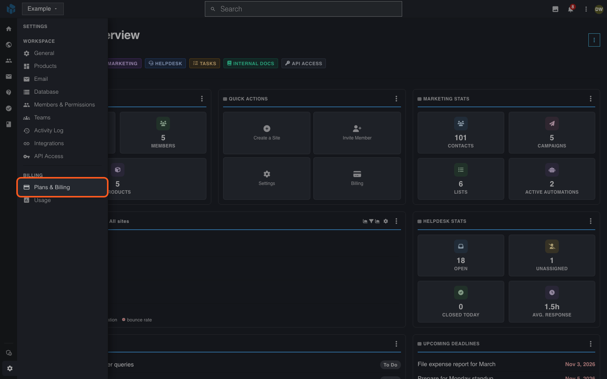
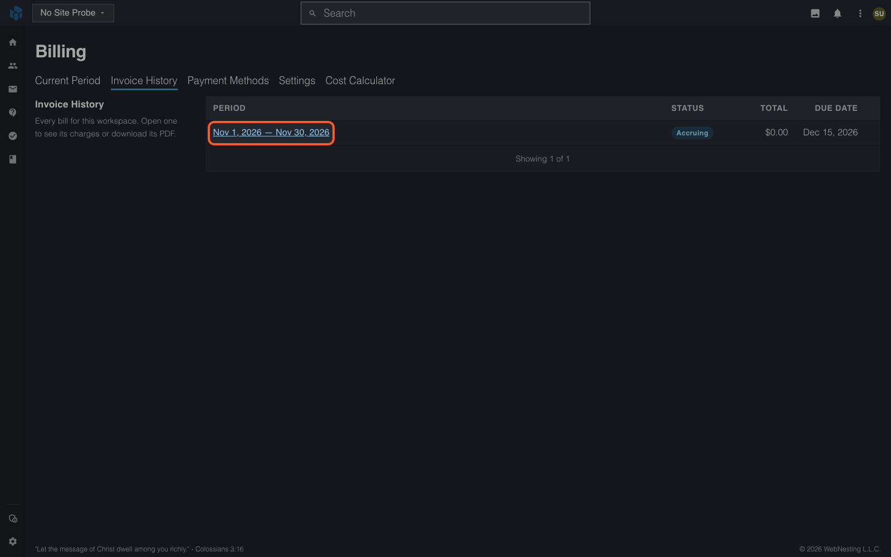
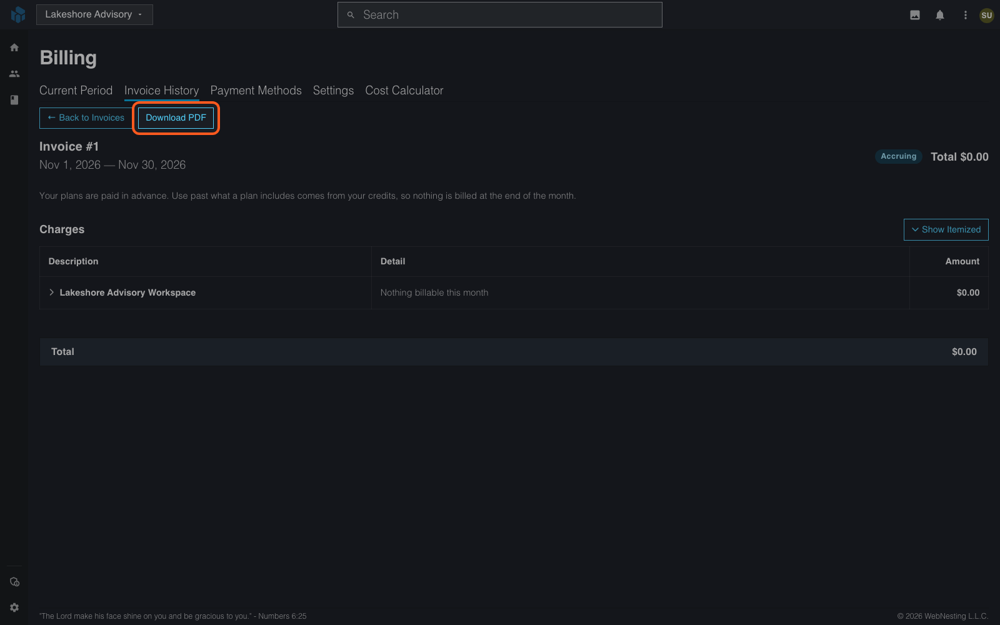
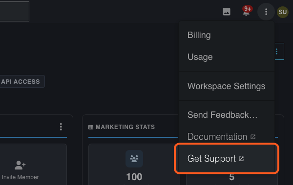

# Asking for a Refund

**Last verified:** 2026-11-07 10:12am

This guide shows how to ask Support for a refund of a charge that was billed in error, and what happens next.

---

## Before you start

- **What WebNesting refunds.** A charge it billed in error, in full. An error is a bug, a duplicate charge or a wrong usage figure.
- **What it does not refund.** Usage that was billed correctly. WebNesting bills each month's usage after you have used it.
- **How long you have.** Ask within 30 days of the invoice date.
- **Who can ask.** You need permission to manage billing in the workspace.

The full policy is in [Billing and Usage](../dashboard/billing-and-usage.md#refund-policy).

---

## Find the invoice

1. Open your workspace.
2. Select **Settings** at the bottom of the left icon rail, then **Plans & Billing** under **Billing**.

   

3. Open the **Invoice History** tab.
4. Select the invoice period. Its title shows the invoice number, for example **Invoice #12**.

   

5. Find the charge that looks wrong. Select **Show Itemized** to see how each charge was worked out.

Select **Download PDF** if you want to attach a copy to your request.

---

## Ask Support

1. Select the **⋮** menu in the top bar, then **Get Support**. It opens the contact form on webnesting.com. Or email Support at support@webnesting.com.

   

2. Write from the email address on your account.
3. Give your workspace name and the invoice number.
4. Name the charge and say what is wrong with it.
5. Send the message.

---

## What happens next

WebNesting approves each refund, and Support tells you the result. An approved refund goes back to the card that paid the invoice. Your bank can take a few days to show it.

- **A plan invoice refunded in full** ends those plans on the next 1st. You keep them until then.
- **A credit purchase refunded** takes back the credits you have not spent first.

## Check it worked

Open the invoice again. Its summary shows the amount under **Refunded**. When the full amount is returned, the invoice status changes to **Refunded**. Your activity log (**Settings** > **Activity Log**) also records it, with the amount returned to your card.

---

## If something goes wrong

- **You have no reply.** Send your message again and mention the invoice number.
- **The 30 days have passed.** Still write to Support and give the dates. Support tells you what is possible.
- **The charge was billed correctly.** Use [Usage and Billing](usage-and-billing.md) to see how plans and credits are charged.

---

## Where to go next

- [Billing and Usage](../dashboard/billing-and-usage.md#how-a-refund-reaches-you)
- [Usage and Billing](usage-and-billing.md)
