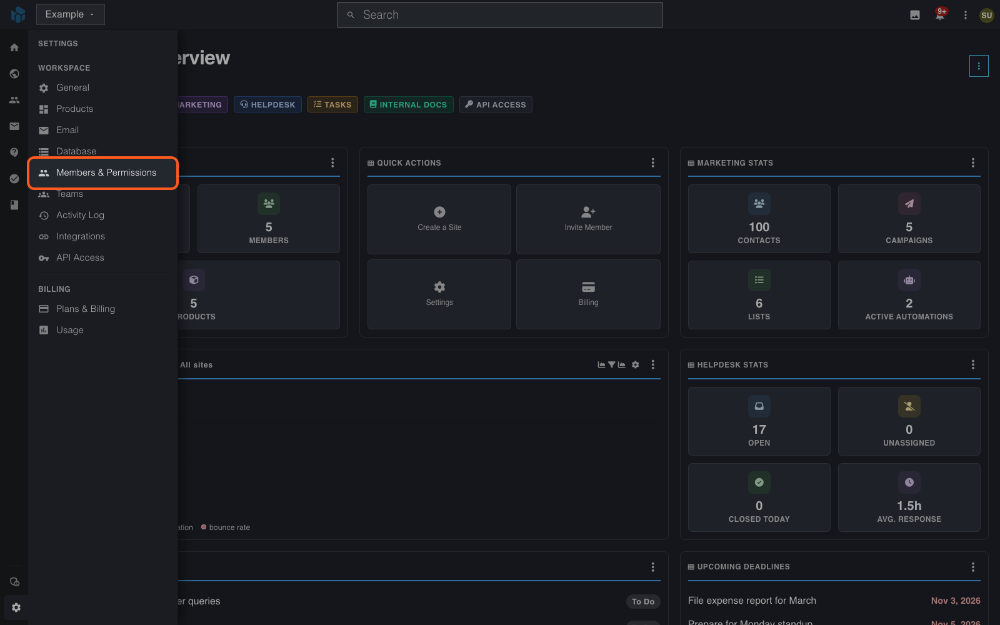
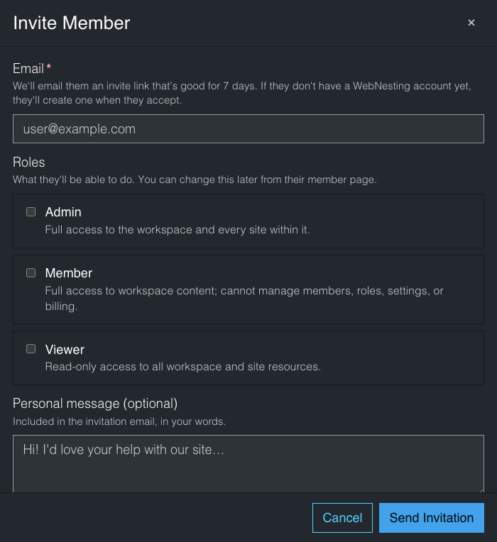
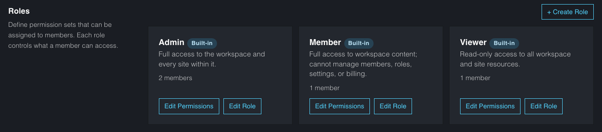
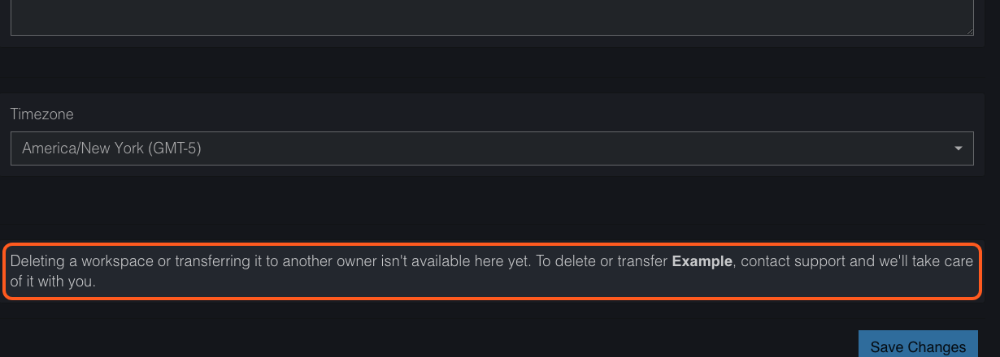

# Moving a Site to Someone Else

**Last verified:** 2026-11-07 10:11am

This guide shows the ways to hand a site to another person or business. A site stays in the workspace where you created it. The app has no button that moves one site to a different workspace.

---

## Pick the way that fits

- **The person helps run it.** Add them to your workspace as a team member.
- **The person takes over everything.** Ask Support to transfer the whole workspace to them.
- **You want only one site moved.** Ask Support what is possible.

---

## Add the person to your workspace

1. Open your workspace.
2. Point at **Settings** at the bottom of the left icon rail, then select **Members & Permissions**.

   

3. Select **+ Invite Member**.
4. Enter their email address and tick a role: **Admin** (full access to the workspace and every site), **Member** (full access to content, but not members, roles, settings or billing) or **Viewer** (read only).
5. Add a personal message if you want to. It is optional.
6. Select **Send Invitation**.

   

The invitation link works for 7 days. The person accepts it from their account portal. A person who has no WebNesting account creates one when they accept.

The **Roles** section of the same page lists the three built-in roles and how many members each has.

See [Team and Permissions](../dashboard/team-and-permissions.md).

> **Important:** Everyone in the workspace sees all of its sites. If the person must see only one site, ask Support first.

---

## Transfer the whole workspace

1. Email Support at support@webnesting.com from the email address on your account.
2. Give the workspace name and the new owner's name and email address.
3. Ask the new owner to create a WebNesting account first, and to verify their email address.
4. Pay any outstanding invoice under **Plans & Billing**.

**Settings** > **General** says transfers are not available in the app yet: contact Support and they take care of it with you.

The workspace owner pays the workspace's bill. After a transfer, the new owner should check **Plans & Billing** > **Payment Methods** and **Settings**, where **Billing email** and **Billing name** are kept.

---

## Check it worked

- The new person can open the workspace and the site from their account portal.
- For a team member, the person appears under **Members & Permissions** with the status **Active**.
- For a transfer, **Settings** > **Members & Permissions** shows the new owner.

---

## If something goes wrong

- **The invitation does not arrive.** Check the spam folder, then send it again. The page shows pending invitations.
- **The person cannot change billing or members.** Only the **Admin** role and the owner can. Change the role under **Members & Permissions**.

---

## Where to go next

- [Team and Permissions](../dashboard/team-and-permissions.md)
- [Closing Your Workspace or Account](account-closing-your-account.md)
