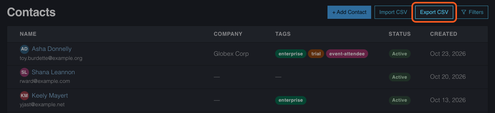
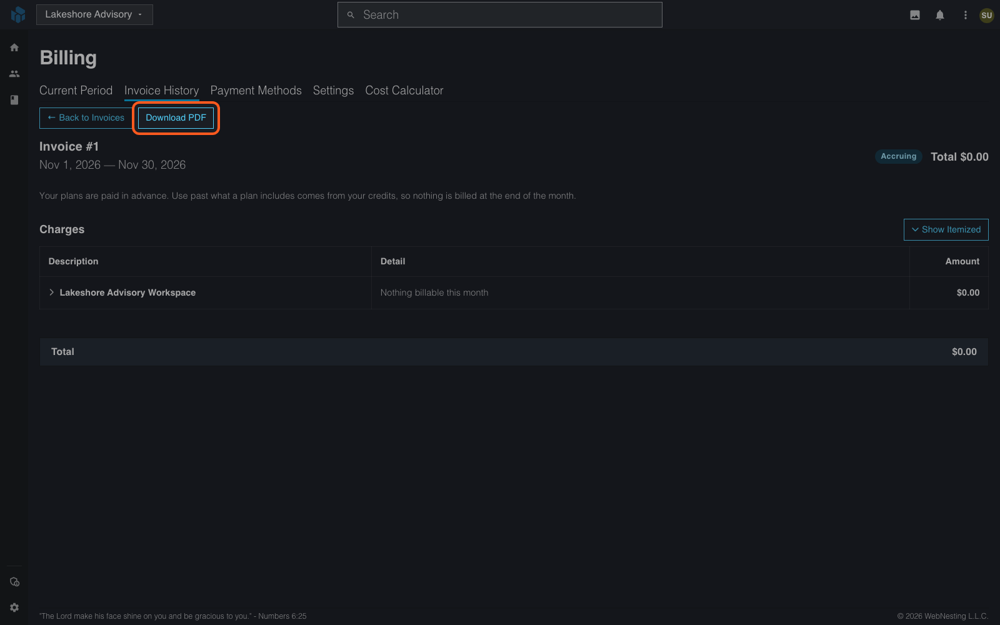
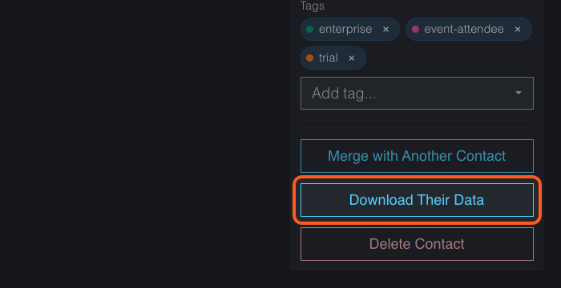

# Requesting a Copy of Your Data

**Last verified:** 2026-11-07 10:12am

This guide shows how to get a copy of your data, either yourself or by asking Support. It also covers a person on your contact list who asks you for their data.

---

## Copy data yourself

You can download most of what your workspace holds without asking anyone.

- **Contacts.** Open **Contacts** and select **Export CSV**.
- **One person's data.** Open the contact and select **Download Their Data**. It gathers everything your workspace holds about that person.
- **Form submissions.** Open the form's **Submissions** tab and export the list.
- **Files.** Open **Files** in the top bar and download what you need.
- **A product's data.** Turn the product off, then select **Download a copy** on its card. WebNesting emails you a link that works for 7 days. Your contacts are not in it; they stay in **Contacts**. Turning a product off ends it and its data is deleted after 30 days, so read [Workspace Products](../dashboard/workspace-products.md#disabling-a-product) first.
- **Invoices.** Open an invoice under **Plans & Billing** > **Invoice History** and select **Download PDF**.

---

## Ask Support for a copy of your data

Ask Support if you want everything WebNesting holds about you.

1. Email Support at support@webnesting.com from the email address on your account.
2. Say that you are asking for a copy of your data.
3. Give your workspace name.
4. Say what you need: all of it, or one part, such as your contacts.

Support's target is to answer within 14 days. Support sends the copy to the email address on your account.

---

## If a person on your list asks for their data

You hold their data for your sites. Do this:

1. Open **Contacts** and find the person by name or email.
2. Open the contact.
3. Select **Download Their Data**.
4. Send them the file.

If they ask you to remove them, select **Delete Contact** on the same page and confirm. This cannot be undone.

---

## If something goes wrong

- **The contact is not there.** Search by the email address they used. Check **Filters** to be sure no filter hides them.
- **You cannot see the button.** You need permission to read contacts, and to delete them for **Delete Contact**. Ask your workspace owner.

---

## Where to go next

- [Contacts Management](../dashboard/contacts-management.md)
- [Closing Your Workspace or Account](account-closing-your-account.md)
