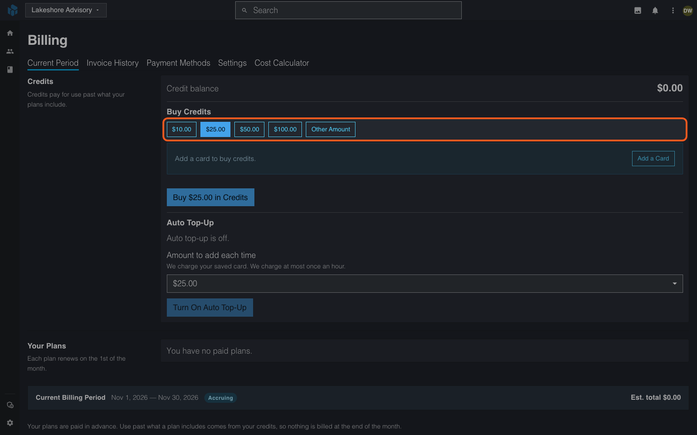
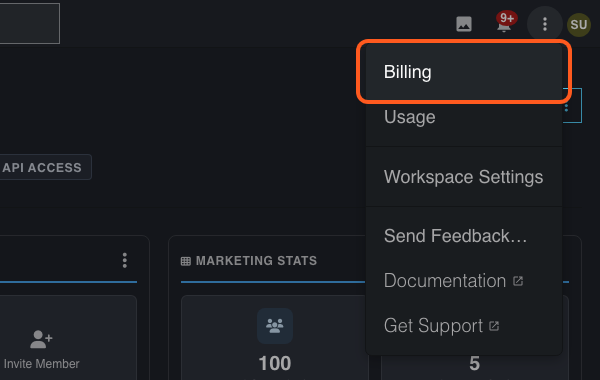
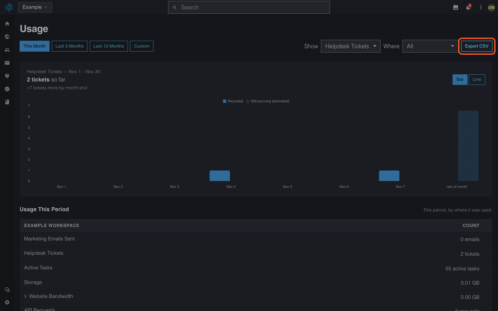
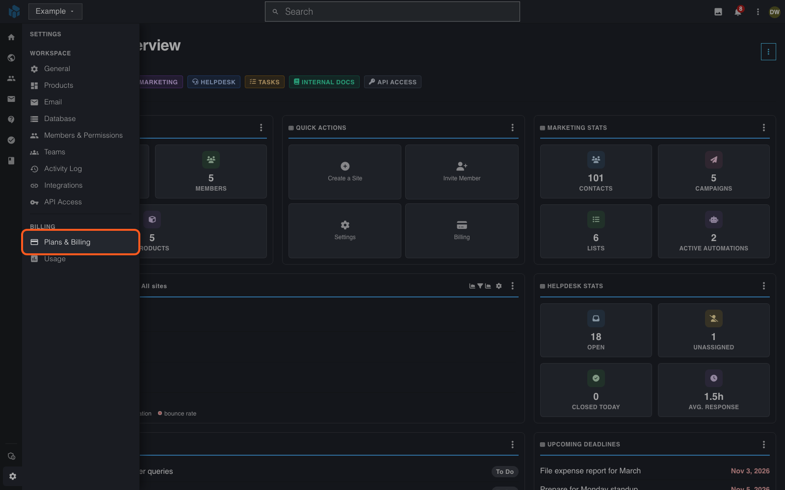
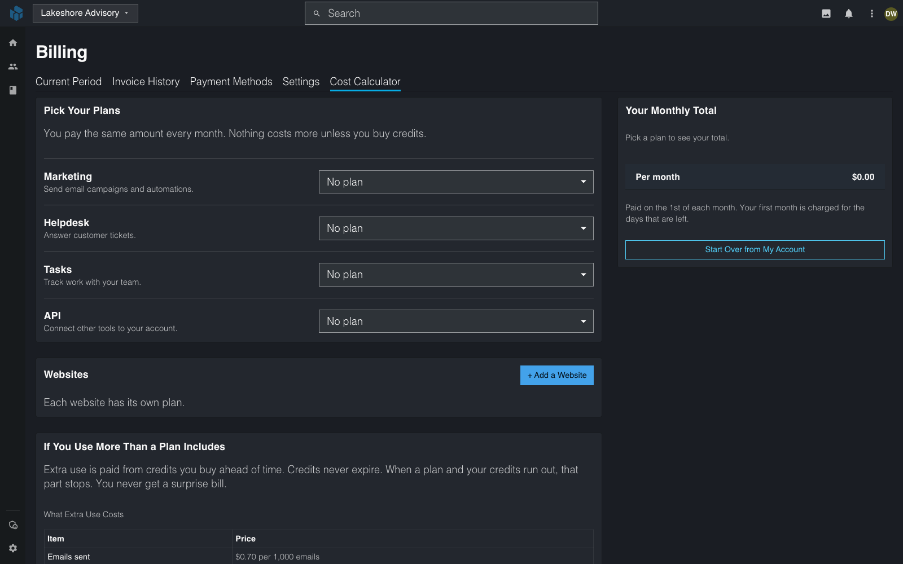
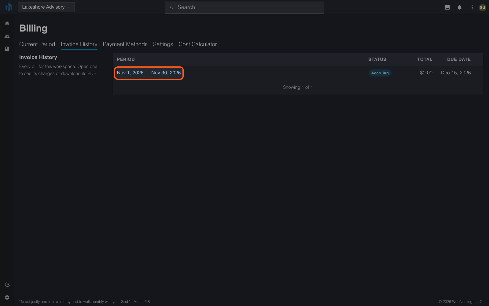

# Usage and Billing

**Last verified:** 2026-11-13 9:58am

WebNesting works with plans. You pick a plan for each part of WebNesting you use, and you pay for it on the 1st of the month. If you use more than a plan includes, you pay for the extra with prepaid credits. This guide explains the plans, the credits, what happens at a limit, and how to see your usage and pay.

---

## Plans

### What a plan is

A plan is one part of WebNesting at one size. Each plan has a flat price per month and a set amount included. The amount starts over on the 1st of every month.

| Plan | Starter | Growth | Pro |
|---|---|---|---|
| **Websites** (price for each site) | $6 a month: 2 GB storage, 5 GB website bandwidth | $12: 5 GB storage, 15 GB bandwidth | $22: 20 GB storage, 40 GB bandwidth |
| **Marketing** | $8: 10,000 emails | $29: 50,000 emails | $59: 125,000 emails |
| **Helpdesk** | $7: 100 tickets | $19: 500 tickets | $34: 2,000 tickets |
| **Tasks** | $5: 500 active tasks | $12: 5,000 active tasks | $25: unlimited active tasks |
| **API** | $10: 100,000 requests, 10 GB data | $29: 300,000 requests, 30 GB data, longer audit history | $89: 1,000,000 requests, 100 GB data, longer audit history, a higher rate limit |

- **Contacts, team members and API tokens are unlimited** on every plan.
- **Every site has unlimited pages**, one you are still building free too.
- **Active tasks** are the tasks that are not done. "Unlimited" on Tasks Pro is for normal use.
- **Tasks has a Free plan.** It costs $0, needs no card and includes 10 active tasks. When you turn on Tasks, you start on Free unless you pick a paid plan. Free never uses credits: at 10 active tasks, a new task is refused until you finish a task or upgrade to Starter.
- Prices are in US dollars. Plans are billed monthly.

### Building a site free, then going live

A new site has no plan, and its plan costs $0 while you build. It has unlimited pages, 500 MB of storage and 500 MB of bandwidth each month. Only your **Preview** and **Share** links use that bandwidth. Past 500 MB, a share link shows the "temporarily unavailable" page until the 1st or until the site goes live. The site has no public address yet. The usage page calls it "Not published: building free".

Pick a plan when the site is ready. **Go Live** on the Sites page lists Starter, Growth and Pro. It shows the exact price first: the amount you pay now for the rest of this month, then the monthly price on the 1st. Choose **Next**, tick two boxes to agree, then choose **Pay** to charge your card. Then WebNesting sets up the site on its `webnesting.site` address. If your bank asks you to confirm the payment, the site goes live as soon as the payment goes through. A member who cannot manage billing sees "Ask a workspace owner to put this site live." After an owner approves, the window says so, and **Go Live** puts the site live and charges the card on file.

**Take Offline** works on the monthly cycle. The site stays live, and its plan stays billed, until the end of the current month. Then the site goes offline and its plan ends. Add-ons keep billing until you turn them off. Until the end of the month you can choose **Keep It Live**. To put the site live again afterwards, use **Go Live** and agree to a new price summary.

The builder's **Publish** button is a different step. It publishes a page. It does not put the site on the web.

Any workspace with a paid plan can make 25,000 API requests a month at no charge, even with no API plan.

### Add-ons for a site

Add-ons turn on extra features for one site. Any site can have them, one you are still building free too. Add-ons charge at once, even before the site has a plan.

| Add-on | Price for each site |
|---|---|
| Blog (the Articles module) | $3 a month |
| Events | $3 a month |
| Forms | $3 a month |
| Widget builder | $5 a month |
| Store | $10 a month |
| **All add-ons together** | **$15 a month** |

### The multi-product discount

**Your highest plan is full price. Every other plan is 5% off with two plans, 10% with three, 15% with four and 20% with five or more.**

With two or more paid plans, your highest-priced plan is full price. Every other plan gets a discount, on any tier. The more paid plans you have, the bigger the discount:

| Paid plans | Discount on every plan but your highest |
|---|---|
| 2 | 5% |
| 3 | 10% |
| 4 | 15% |
| 5 or more | 20% |

- Every paid plan counts: Websites, Marketing, Helpdesk, Tasks and the API. Two paid sites count as two plans.
- A site with no plan (still building free) and the Tasks Free plan do not count, and they have no discount.
- When two plans have the same highest price, the one you had first is the full-price plan.
- Add-ons and credits are always full price.
- The discount is taken from your plans on each renewal, on the 1st. The invoice shows it as one line, for example "10% off every plan but your highest", with the plans it is for.
- When you add a plan or move to a bigger one during the month, you pay the change in your monthly total, for the rest of the month. The invoice shows the new plan at its full price and one discount line under it.
- The plan picker, the cost calculator and the **Your Plans** list on the **Billing** page show each discounted plan's full price struck through, its new price, and "You save $X a month".

- A new plan can move your other plans to a bigger discount. Sometimes your monthly total then goes down. In that case you pay nothing for the new plan this month, and your next bill on the 1st is lower.

For example, a Starter site ($6) and Marketing Pro ($59) are $65 at full price. Marketing Pro is the highest-priced plan, so it stays at $59. With two plans, the site is 5% off, at $5.70. You pay $64.70 a month. Add Helpdesk Starter ($7): with three plans, the site and Helpdesk are 10% off, at $5.40 and $6.30. You pay $70.70 a month.

### Storage is shared

All your storage is one pool for the whole workspace. It is the storage of each Websites plan, plus 2 GB for each paid Marketing, Helpdesk, Tasks or API plan. Your site files, helpdesk attachments and form uploads all use the same pool. A workspace with no paid plan has 500 MB.

---

## When You Pay

- **Buying a plan:** You pay for the time left in the month, down to the second, and you get the matching share of what the plan includes. The charge goes to your saved card.
- **Renewing:** Every plan and add-on renews in one charge on the 1st of the month. You get an invoice and an email.
- **The price you renew at:** A plan or add-on renews at the price you agreed to when you turned it on. If its price goes down, you pay the lower price from the next 1st.
- **If a price goes up:** Everyone who can manage billing gets a bell entry, an email and a phone or browser push. The message names the old and new price and the date of your first bill at the new price, at least 30 days away. You pay the old price until then. To stop the item first, follow the link in the message. Losing the multi-product discount, when you turn a product off, changes your total on the next 1st with no 30-day wait.
- **Moving to a bigger plan:** It starts right away. You pay the difference for the rest of the month.
- **Moving to a smaller plan:** It starts on the next 1st. You keep the bigger plan until then.
- **Small charges:** A part-month charge under $0.50 is not sent to your card. It is added to your next renewal.
- **The card fee is in the price.** New invoices have no separate processing fee. An older invoice sent with one still shows it, and you pay the total it was sent with.

You need a saved card to buy a plan or credits. Open the **Payment Methods** tab on the **Billing** page to add one.

---

## Credits

Credits pay for use past what your plans include. Your workspace has one credit balance.

- **Buying:** Open the **Billing** page and use **Buy Credits**. Pick $10, $25, $50 or $100, or select **Other Amount** and enter any amount from $5 to $5,000. We charge your saved card at once and add the credits right away. With no saved card, the page shows **Add a Card** instead.
- **Auto Top-Up:** Turn it on and choose an amount. When your balance runs out, we charge your saved card that amount. We charge at most once an hour. If the card is declined, auto top-up turns off and we email you.
- **Credits never expire.** Your plan's included amount starts over each month, but your credits carry over.
- **Credits cannot be refunded.**

What a credit pays for:

| Use past your plan | Credit price |
|---|---|
| Marketing emails | $0.90 per 1,000 emails |
| Helpdesk tickets | $0.06 for each ticket |
| Active tasks | $0.01 for each active task, each month |
| API requests | $0.08 per 1,000 requests |
| API data | $0.35 per GB |
| Website bandwidth | $0.35 per GB |
| Storage | $0.25 per GB, each month |

---

## What Happens at a Limit

You always see your numbers on the **Usage** page, under **Included This Month**. When you use all of a plan's included amount, credits pay first. When the credits are gone too, this is what happens:

| Part | At the limit |
|---|---|
| **Marketing emails** | A new campaign does not start. The message tells you how many emails you used. Emails from automations wait and go out when you add credits, move to a bigger plan, or the month starts over. |
| **Helpdesk tickets** | Tickets keep arriving. Up to 25% above your limit works as normal. Past that, new tickets are marked as over the limit and replies to them are locked. |
| **Active tasks** | You cannot create, reopen or restore a task. On the Free plan, the message points you to Starter, and credits are not used. |
| **API** | Requests are refused with a "usage limit" message. This also happens when the API data of the month is past your plan and credits did not pay for it. |
| **Storage** | Uploads, imports and site publishing that add files are refused. Helpdesk attachments and form uploads are still stored and paid with credits. |
| **Pages** | No limit. If a site's paid plan is not renewed, you cannot make a new page until you renew it. |
| **Website bandwidth** | See the next section. |

Buying credits, moving to a bigger plan, or the 1st of the month lifts a limit at once.

### Website bandwidth for each site

Bandwidth is counted for each site, not for the whole workspace. It is the data a site sends to its visitors.

1. **At 80% of the site's bandwidth** we email you. We email you again when the site reaches **100%**.
2. **Past the included bandwidth,** each extra GB is paid from your credits.
3. **When the credits run out,** a paid site keeps working for a further 15% of its plan's bandwidth. That 15% is not free: credits you buy later pay for it first, and the rest is [extra usage on your next bill](#extra-usage-on-your-next-bill). A site you are still building free has no extra.
4. **After that, the site is held.** Visitors who open the site's pages see a page that says the site is temporarily unavailable. We email you that the site is held.
5. **The hold ends** when you buy credits, move the site to a bigger plan, or the month starts over.

Your site, its pages and its files stay safe while it is held, and you can keep editing. If a site stays held for **30 days**, we email you again. Search engines can lower a site that stays unavailable for a long time.

While a site is held, its pages do not open. The pictures and videos in **Files** are not touched: they keep loading, in **Files**, in the Builder and anywhere else they are linked, and they still count toward bandwidth. Your other sites keep working. When the hold ends, the site comes back within a few minutes.

### Extra usage on your next bill

Some use is counted only after it happens, so a limit cannot stop it in time:

- the website bandwidth of each site, the 15% extra of a paid site included;
- files sent from your workspace media library (not from a site), which keep loading at a limit;
- the data your API calls send;
- helpdesk attachments and form uploads;
- storage and active tasks you still have above your plan on the 1st.

Credits pay for this use first. What credits did not pay for is extra usage, and you pay it on your next bill:

1. **On your next renewal on the 1st,** we first take what you still owe from any credits you bought in the meantime.
2. **The rest is one line on that invoice** for each kind of use and each site. For example, the January 1 invoice has "Website bandwidth, December 2026". The line shows the amount that credits did not pay for and the price of December. You pay it with the renewal.
3. **With no paid plan,** there is no monthly bill. Instead, that amount comes off what the site or workspace includes next month. If next month's amount is not enough, the rest comes off the month after.

Each month is billed once. If a later check finds the month was counted a little low, credits pay the difference, and what they cannot pay is a "(recounted)" line on a later bill. If the month was counted a little high, the difference goes back to your credit balance.

---

## If a Renewal Payment Fails

If your card does not pay on the 1st, **everything keeps working for 7 days.** We try the card again on days 1, 3, 5 and 7, and email you each time. You can also pay the invoice yourself at any time with **Pay Now**.

If the invoice is still unpaid after day 7, your paid plans go on hold. **Nothing is deleted.**

- Your site shows a "not available" page to visitors until the plan is paid. This holds for its `webnesting.site` address and for a custom domain. You can still open and edit the site in your dashboard.
- You can still see your paid products and add-ons, but you cannot change them.
- **Paying the invoice brings everything back at once.**

An unpaid renewal invoice is cancelled on the next 1st. After that, pick a plan again on the site's plan card and the site comes back at once.

---

## Enterprise

Large teams can have a contract with their own terms. Enterprise is not a plan you pick on the Billing page: contact us. An Enterprise contract names a size for each product, and usage past that size is billed after the month on the contract's terms, at the credit prices. An Enterprise workspace does not use credits. It gets the first 10 GB of website bandwidth each month free. Its **Cost Calculator** tab prices each unit you use, not plans. A workspace on plans gets neither.

---

## Viewing Your Usage

### Where to find it

1. Go to your **account portal** and open the **Workspaces** card.
2. Open the workspace whose usage you want to see.
3. Select **Settings** at the bottom of the left icon rail, then **Usage** under **Billing**. (The **⋮** menu in the top bar has a shortcut to **Usage** too.)

### What you'll see

The **Usage** page shows how much you use over time. It shows counts only, no prices.

 (Everything to do with money, including your plans, credits and what you have left, is on the **Billing** page.)

- **Show** picks one thing to chart at a time -- for example emails sent, tickets created, contacts or pages.
- The chart covers every day of the range you picked, up to today, including days with nothing on them, so you can see exactly when things happened. Switch between **Bar** and **Line** to change how it is drawn.
- **Export CSV** saves what you are looking at as a spreadsheet file.

### Choosing date ranges

Pick **This Month**, **Last 3 Months** or **Last 12 Months**, or **Custom** to choose a From and To month. Ranges are always whole months. In the current month, the chart stops at today -- days that haven't happened yet are never drawn as zero -- and for emails, tickets and API calls a lighter bar estimates the rest of the month.

### How things are counted

- **Emails, tickets, API calls and website bandwidth** add up: the number is everything that happened in the range. Website bandwidth shows in GB and is counted within a few minutes of each visit. Click its **Website Bandwidth** row to see one month: the last month of the range you picked. It shows that month's total, the GB each website sent that month and the 5 files that sent the most. If you picked more than one month, the number on the row adds all of them, so it can be larger than the total inside.
- **Automation emails** count with your marketing emails, in **Marketing Emails Sent**, and cost the same.
- **Contacts, active tasks, pages, storage and API tokens** are what you have right now (or, for a past range, what you had at its end) -- they don't add up day after day.

### Usage by where it's used

The **Usage This Period** table lists your workspace first, then each of your websites, so you can see which site is driving your usage. Use **Where** to narrow it to one website or your workspace.

### From WebNesting

Under **Usage This Period**, the **From WebNesting** section lists everything WebNesting gave your workspace for the month your date range ends in: bonus units, your price and complimentary periods. For bonus units it shows how many you earned, used and have left, and when they end. Everything else says **On your invoice**, because this page shows counts and never money. A **Waiting** label means the product was off all month, so nothing was used and what you have left is kept. **Ends this week** means it ends in 7 days or less.

---

## Viewing Your Bills

### Where to find them

1. Go to your **account portal** and open the **Workspaces** card.
2. Open the workspace whose bills you want to see.
3. Select **Settings** at the bottom of the left icon rail, then **Plans & Billing** under **Billing**. (The **⋮** menu in the top bar has a shortcut to **Billing** too.)

### What you'll see

The **Billing** page has five tabs: **Current Period**, **Invoice History**, **Payment Methods**, **Settings** and **Cost Calculator**.

**Current Period** shows your **Credits**, **Your Plans** with the price and the date each one renews, and the **Next Renewal**: what will be charged on the 1st. When a plan's price goes up, **Your Plans** shows a line under it such as "Price goes up to $35.00 a month from your bill on Jan 1, 2027". Below them, **Current Billing Period** lists the charges so far. Its status reads **Accruing** until the month ends. **Your Plans** and **Credits** show only when the workspace has them. A workspace with no paid plan shows "You have no paid plans."

**Payment Methods** holds your saved cards. **Settings** holds **Billing email** and **Billing name**, which print on each invoice, and the **Pay automatically each period** choice. Below them, **Approved charges** lists every charge your workspace agreed to in a **Check the price** window. Each row shows what the charge was for, where it applies, who agreed and when. The list is a record. To stop a charge, follow the link in its row. A site's plan stops with **Take Offline** on the **Sites** page, and a product or add-on stops where you turned it on. When a member who cannot manage billing asks for a charge, a window called **A charge needs your OK** opens for the owners. They select **Approve**, **Decline** or **Not now**, and the member gets a notice.

**Cost Calculator** shows what a set of plans costs. Pick a plan for **Marketing**, **Helpdesk**, **Tasks** and **API**, and select **+ Add a Website** for each site. **Your Monthly Total** updates as you pick. It changes nothing on your account. Select **Start Over from My Account** to go back to the plans you have.

**Invoice History** lists your invoices with their **Status**, **Total** and **Due Date**. There is one invoice for each plan purchase or renewal, and one for each credit purchase. Select an invoice to open it, and select **Download PDF** for a PDF copy.

Anything still outstanding appears in a banner at the top of the Billing page.

### Promotion codes

If you have a promotion code from WebNesting, enter it in one of three places. Each place has **Have a code?**: select it, enter the code and select **Check code** to see what it gives you.

- **When you sign up** -- the code is kept for the first workspace you create. See [Creating Your Account](creating-your-account.md).
- **When you create a workspace** -- it is applied when you create the workspace.
- **On the Billing page** -- under **Promotion code**. Select **Apply to this workspace**.

Details and the messages a refused code shows: [Promotion codes](../dashboard/billing-and-usage.md#promotion-codes).

---

## Paying Your Bill

When an invoice is outstanding, a banner at the top of the **Billing** page names the amount and has a **Pay Now** button. You can also select **Pay** beside an invoice on the **Invoice History** tab.

1. Select **Pay Now**.
2. Enter your payment details in the window that opens. WebNesting accepts credit and debit cards. The window shows the **Amount Due**.
3. Select the **Pay** button that shows the amount. Your payment is processed securely through Stripe.
4. You'll see a confirmation once your payment goes through.

To save a card without paying, open the **Payment Methods** tab and select **Add Payment Method**.

> **Tip:** Your payment information is handled by Stripe, a trusted payment processor. WebNesting never sees or stores your full card number.
