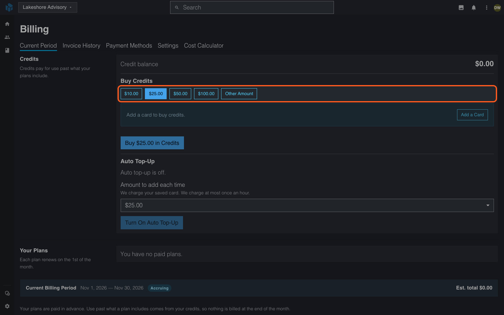
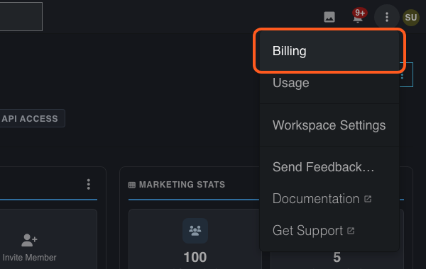
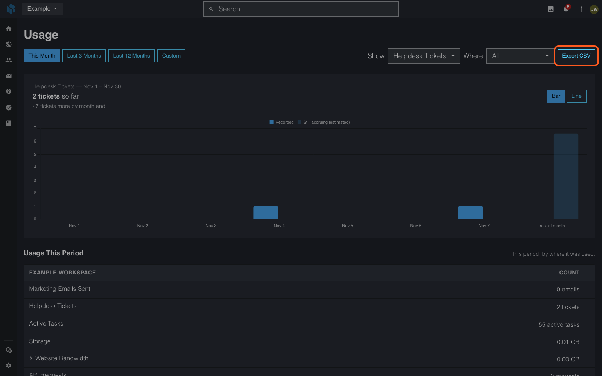
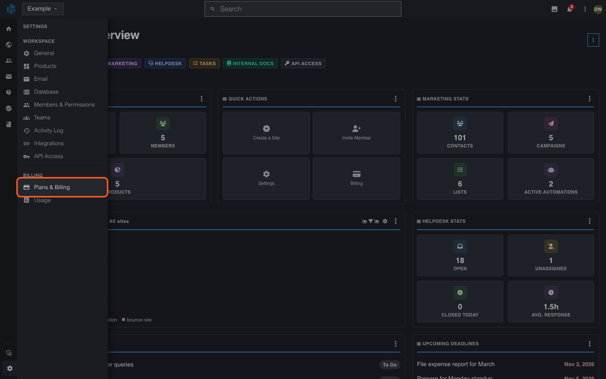
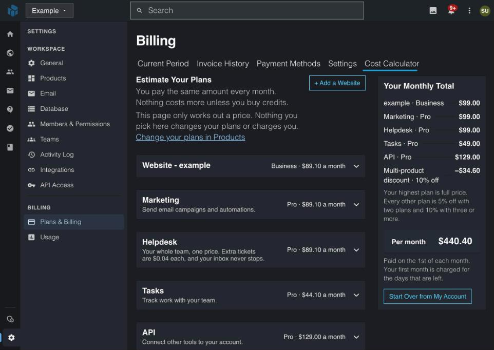
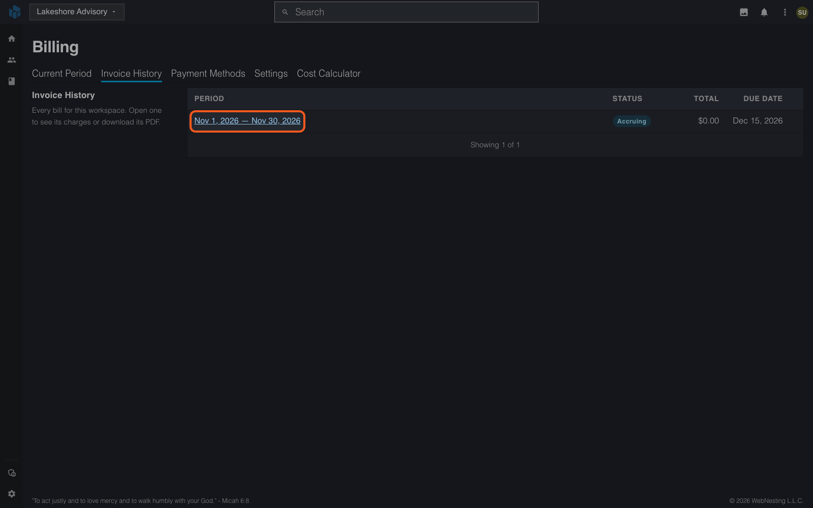

# Usage and billing

**Last verified:** 2026-11-24 5:25am

WebNesting works with plans. You pick a plan for each part of WebNesting you use, and you pay for it on the 1st of the month. If you use more than a plan includes, you pay for the extra with prepaid credits. This guide explains the plans, the credits, what happens at a limit, and how to see your usage and pay.

---

## Plans

### What a plan is

A plan is one part of WebNesting at one size. Each plan has a flat price per month and a set amount included. The amount starts over on the 1st of every month.

Websites have four plans. You pick one for each site.

| Websites plan | Price for each site | Storage | Website bandwidth | About this many visits a month |
|---|---|---|---|---|
| **Starter** | $15 a month | 2 GB | 2 GB | 1,900 |
| **Growth** | $25 | 10 GB | 15 GB | 14,000 |
| **Pro** | $49 | 25 GB | 38 GB | 37,000 |
| **Business** | $99 | 50 GB | 85 GB | 83,000 |

Marketing, Helpdesk, Tasks and the API have three paid plans each.

| Plan | Starter | Growth | Pro |
|---|---|---|---|
| **Marketing** | $19: 6,000 emails | $59: 35,000 emails | $99: 65,000 emails |
| **Helpdesk** | $15: 200 tickets | $49: 1,750 tickets | $99: 4,000 tickets |
| **Tasks** | $10: 5,000 open tasks | $19: 40,000 open tasks | $49: 150,000 open tasks |
| **API** | $19: 25,000 requests, 3 GB data | $49: 110,000 requests, 11 GB data | $129: 340,000 requests, 34 GB data |

- **Contacts, team members and API tokens are unlimited** on every plan.
- **Every site has unlimited pages**, one you are still building free too.
- **Open tasks** are the tasks that are not done. A paid Tasks plan counts each task once a month, so a task you finish this month still counts until the 1st. Every paid Tasks plan has a set number of open tasks. Tasks Pro has 150,000.
- **A Helpdesk ticket counts once, when it is answered.** That is when a reply from your team goes out, or when an automatic reply is delivered. A ticket nobody answers, such as spam, does not count. A "resolved" notice does not count it, and neither does imported email history. A ticket you delete stops counting. Replies never lock.
- **Tasks has a Free plan.** It costs $0, needs no card and has 1 project and 20 open tasks at once. When you turn on Tasks, you start on Free unless you pick a paid plan. Free never uses credits. At 20 open tasks, a new task is refused until you finish a task or upgrade to Starter. A second project is refused too. An archived project still counts as your 1 project, and a deleted one does not. Every paid Tasks plan has unlimited projects.
- Prices are in US dollars. Plans are billed monthly.

### Building a site free, then going live

A new site has no plan, and its plan costs $0 while you build. It has unlimited pages, 500 MB of storage and 500 MB of bandwidth each month. Only your **Preview** and **Share** links use that bandwidth. Past 500 MB, a share link shows the "temporarily unavailable" page until the 1st or until the site goes live. The site has no public address yet. The usage page calls it "Not published: building free".

Pick a plan when the site is ready. **Go Live** on the Sites page lists Starter, Growth, Pro and Business. It shows the exact price first: the amount you pay now for the rest of this month, then the monthly price on the 1st. With no card saved yet, the window says so instead and has **Open Billing**, where you add one. Choose **Next**, tick two boxes to agree, then choose **Subscribe With Obligation to Pay** to charge your card. Then WebNesting sets up the site on its `webnesting.site` address. If your bank asks you to confirm the payment, the site goes live as soon as the payment goes through. A member who cannot manage billing sees "Ask a workspace owner to put this site live." After an owner approves, the window says so, and **Go Live** puts the site live and charges the card on file.

**Take Offline** works on the monthly cycle. The site stays live, and its plan stays billed, until the end of the current month. Then the site goes offline and its plan ends. Its extra module slots stop billing then too. Until the end of the month you can choose **Keep It Live**. To put the site live again afterwards, use **Go Live** and agree to a new price summary.

Within 14 days after the first charge at a new, higher price, **Take Offline** works differently. The site goes offline at once, and its plan and module slots end. We refund the unused part of the period you paid for, counted from the moment you confirm. The window shows the amount before you confirm. See [Cancel a plan](#cancel-a-plan).

The builder's **Publish** button is a different step. It publishes a page. It does not put the site on the web.

Any workspace with a paid plan can make 5,000 API requests a month at no charge, even with no API plan.

### Module slots and feature add-ons

Each paid Websites plan includes module slots for the Blog, Events, Forms and Store modules: 2 on Starter, 5 on Growth, 10 on Pro and 15 on Business. Blog, Events and Forms take 1 slot each. A Store takes 4. An extra slot costs $8 a month.

A module turned on inside your free slots adds nothing to your bill. A module past your free slots adds the extra slots it needs, at $8 each a month. For example, a Store on Starter (2 slots) needs 4, so it adds 2 extra slots, $16 a month.

A module that is turned off is **read-only**. It frees its slots at once. Your records stay, and nothing deletes them on a timer. You can read them in your dashboard and on your published site, but you cannot add, edit or delete them. A form on your site stops taking new entries. To work in the module again, select **Turn back on**. It needs free slots, as it did the first time. **Download a copy** emails you a copy of its content. **Delete records** deletes the content for good, after you type the site's name.

A feature that your plan does not include has its own monthly add-on price. Open the **Cost Calculator** on the **Billing** page to see the price of each. A feature add-on is only a price. It adds no tickets, emails, tasks or requests. The plan sets those amounts.

### What each plan includes

A plan can include features that a smaller plan does not. A feature you add alone costs the add-on price. It stops costing anything once your plan includes it.

| Feature | Add-on price a month | Included from |
|---|---|---|
| Extra site languages (Websites) | Not sold alone | 2 on Growth, 5 on Pro, no limit on Business |
| Marketing automations | $21 | Growth |
| Marketing conditional content | $21 | Growth |
| Marketing A/B testing | $21 | Pro |
| Marketing automation webhooks | $21 | Pro |
| Marketing best send time | Not on sale now | Pro |
| Helpdesk email inboxes | $9 for each extra inbox | 5 on Growth, no limit on Pro (Starter has 1) |
| Helpdesk teams | $18 | Growth |
| Helpdesk SLA targets and business hours | $18 | Growth |
| Helpdesk time tracking and linked tasks | $18 | Growth |
| Helpdesk satisfaction surveys | $26 | Pro |
| Tasks dependencies and milestones | $5 | Growth |
| Tasks custom fields and templates | $5 | Growth |
| Tasks time report | $5 | Growth |
| API 365-day log history | $22 | Growth |
| API high speed limit | $69 | Pro |

Marketing automation webhooks need Marketing automations to be on. Tasks timeline and calendar views, time tracking, watchers and the activity log come with every paid Tasks plan. The Tasks Free plan has none of them.

### Choosing plans, modules and add-ons in the calculator

**Settings** > **Products** is where you pick plans, modules and add-ons, and see the price before you pay. Each website and product shows as one row, with its plan and monthly price on the right.

1. Open **Settings**, then **Products**.
2. Select a product's row to open it, and choose a plan. Open each website's row and choose its plan too.
3. Under **Modules**, turn on the modules a site uses. A module past the plan's slots shows the extra slots it adds.
4. Under the plan, tick the features you want to add alone. A plan that already includes a feature does not list it.
5. Read the price lines. Each shows the change from today and the multi-product discount.
6. Select **Review and Turn On**. A window shows what you pay now and what you pay each month. Select **Subscribe With Obligation to Pay** to agree and pay.

When a different plan would cost less for the features you picked, the calculator says so, in a line such as "Move to Growth and save" with the amount. Select the **Move to** button and everything you picked stays.

The total on the right is the amount your card is charged each month. If your workspace has a special, held or free price, the total shows that price and the change from today, and the rows show no list prices. When we cannot work out your price yet, the total reads **Estimated Monthly Price** and says your special or held prices apply at checkout, where you see the exact amount before you pay.

A member who cannot manage billing sees the same screens. The change then goes to a workspace owner to approve. Nothing is charged until an owner does.

The **Cost Calculator** tab on the **Billing** page has the same plans and modules, and it only works out a price. Nothing you pick there changes your plans or charges you. Select **Change your plans in Products** to go to **Settings** > **Products**.

### Deleting a website that is not live yet

You can delete a website that is not live, such as one you are still building. A live website has no **Delete Website** button. Take it offline first.

> **Warning:** Deleting a website deletes everything in it: its pages, modules, media and records. You cannot undo this. Its address stops working, and no one in your workspace can open it again.

1. Open **Settings**, then **Products**.
2. Select the website's row to open it.
3. Select **Delete Website**.
4. Read the warning in the window that opens.
5. Type the website's name exactly as the window shows it.
6. Select the red **Delete Website** button. It works only after the name matches.

The website leaves your workspace at once, and its files are deleted in the background. To keep the website, select **Cancel** instead.

The window refuses the delete in these cases, and says why:

- If the website has a plan or add-on, cancel the plan or add-on first.
- If the website is going offline, delete it after it is offline.
- If the website is still being set up, try again in a few minutes.

Only members who can manage websites see **Delete Website**. A website you added only in the **Cost Calculator** on the **Billing** page shows **Remove**. **Remove** takes it out of the estimate and deletes nothing.

### Free trial of Helpdesk and Marketing

Try Helpdesk or Marketing free for 14 days, on the Starter plan. You pay nothing on the day you start.

1. Open **Settings**, then **Products**.
2. Select the Helpdesk or Marketing row to open it, then select **Start 14-Day Trial**.
3. Read the window that opens. It shows the price and the date and time we charge your card, with the time zone. It also shows how to cancel.
4. If you have no saved card, select **Add a Card** and add one. The card window asks for the country of your billing address first. The window then shows the terms again, with your card named.
5. Tick **I accept these terms**. The button below stays off until you tick it.
6. Select **Subscribe With Obligation to Pay**. This accepts the terms in the window.

The row then shows a chip with the days left, such as "Trial · 9 days left".

- **When the card is charged:** On the day the trial ends, we charge your saved card for the rest of that month. After that, the plan is billed on the 1st of each month, until you cancel. The window shows the exact date, time and amount before you start.
- **How to cancel:** Open **Billing**, find the trial under **Free trials** and select **Cancel Trial**. Any member with billing rights can do this. Cancel before the first charge and you pay nothing. The window asks when the trial ends:
  - **End the trial now:** The product turns off at once. Your data stays saved for 30 days, then we delete it.
  - **End the trial on** the last day: The product stays on until the time shown, then turns off. We do not charge your card. The trial row then reads "Cancelled. Ends on" that day. To end it sooner, select **End Trial Now**.

  We email you to confirm the cancel, the day the trial ends and the time it ends. The window names the address we send it to.
- **If the charge fails:** The product turns off the same day. There is no grace period, and we do not try the charge again. You owe nothing for the trial. Your data stays saved for 30 days, then we delete it. Buy the product within that time to get it back.
- **If your billing address is outside the United States:** The window reads "Not available in your country yet" in place of the terms, and shows no **Add a Card** button. For now, free trials are only for billing addresses in the United States. See [Where paid plans are available](#where-paid-plans-are-available).
- **Upgrade any time:** Choose a paid plan or add a feature, and the trial ends that day. The free days you have left are lost. We then charge the plan you choose for the days left in that month. You see and confirm that charge first, and the window says how many free days you lose.
- **Limits:** A Helpdesk trial includes 93 answered tickets. A ticket counts once, when you first answer it. A Marketing trial sends at most 500 emails in total. At a limit, that part of the product stops until you upgrade. A trial never charges extra usage. Reaching a limit does not end the trial or stop the charge on its last day. To stop the charge, cancel the trial.
- **One trial for each product and person:** Trials are for new customers of a product. We check the saved card and the workspace owner's email address. If either was used for a trial of that product in any workspace, there is no second trial. We keep this check for 3 years after the trial ends, then delete it. A workspace that paid for the product before gets no trial. A workspace that already gets everything free has no trial.
- **The email when the trial starts:** It goes to every member with billing rights and to the member who started the trial. It has a PDF attached. The PDF holds the terms you accepted, in the language you read them in. If you live in the EU or the UK, it also holds the withdrawal information and a model form for withdrawing from the contract. Keep it. Every trial email ends with a way to write to us, a link to the trial on **Billing** where you can cancel, and the name of the seller.
- **The record of your yes:** When you start a trial, we keep a copy of the terms you accepted, in the language you read them in. The copy also holds the amount, the date and time, and the member who accepted. We delete it 3 years after the trial ends. If you keep the paid plan, we keep the copy until 1 year after the plan ends, when that is later.

### Where paid plans are available

Prices are in US dollars. Paid plans, free trials and credits are available to customers with a billing address in the United States. We may add countries later. The **Pricing** page on webnesting.com lists where we sell.

- Free plans work in every country, except where US law stops us from providing the service.
- You can build a site free from any country. Going live needs a paid plan, so a site cannot go live from outside the United States yet. The **Go Live** window says so.
- The **Add a Card** window asks for the country of your billing address first. For a country we do not sell in yet, it reads "Not available in your country yet" and shows no card fields, so you never type a card number. We save nothing, and cards you saved before stay as they are.
- If you seem to be outside the United States, a notice shows on **Billing**, **Credits**, the trial window and the **Go Live** window. With a billing address in the United States, for example when you travel, you can still buy.
- If your billing address moves outside the United States, tell Support. Your plan runs until we end it with at least 30 days' notice, and we do not charge for it after that.

### Cancel a plan

You can cancel a paid Marketing, Helpdesk, Tasks or API plan on the **Billing** page. It ends at the end of the month or year you paid for, and we charge nothing more. Soon after a price rise, a cancel ends the plan at once and refunds the unused part of the period, as described below.

1. Open **Billing**. On **Current Period**, find the plan under **Your Plans**.
2. Select **Cancel Plan**.
3. Read the window. It names the last day you paid for, with the time zone, and the day the plan ends.
4. Select **Cancel Plan** in the window to confirm. Select **Go Back** to keep the plan.

- **Until the end of the month:** The product and its add-ons keep working as before.
- **On the 1st:** The plan and its add-ons end. Your renewal has no charge for them. The product turns off, and its data stays saved for 30 days, then we delete it. Tasks moves to its Free plan and stays on.
- **Cancel on the 1st:** If you cancel on the 1st before that day's renewal, the plan ends that day and we do not charge a new month. If the renewal already charged that month, the plan runs through it and ends on the next 1st. The window names the right day.
- **Tasks on the Free plan:** We delete nothing. Free has 1 project and 20 active tasks. Over those limits, you keep everything but cannot add more. The paid features turn off, and some saved items are hidden, such as the activity log, dependencies and milestones.
- **Use past the allowance:** For a product that charges for use past its allowance, use before the end day can still be on a later bill. The window and the email say so.
- **A yearly plan:** You can cancel it at any time. It ends at the end of the year you paid for, and **Cancel Plan** refunds nothing for the rest of that year. The one exception is a cancel after a price rise, below.
- **A plan with a failed payment:** If the renewal payment failed, the plan ends at once and the product turns off then. You owe nothing for that unpaid month, and we do not try the card again for it.
- **A cancel after a price rise:** If you cancel within 14 days after the first charge at a new, higher price, the plan and its add-ons end at once. A website goes offline. A product turns off, or stays on with its Free plan if you chose Free or cancelled a plan that has one. We refund the part of that period you did not use, counted from the moment you cancel, and you do not need to ask for it. The window names the amount and the last day you can get it. The email names the amount too. We send the refund back the way you paid. A card payment goes back to that card. If product credit or a promotion paid all or part of the charge, that part comes back to your credit balance. A payment made another way also comes back to your credit balance; ask Support if you want it back as money. Every way you end the plan inside the 14 days counts as a cancel. **Take Offline** on a website gives the same refund. So does **Settings** > **Products**: setting a product to **No plan**, Tasks to **Free**, a website to **Building**, or an add-on to none ends it at once. The review window shows "Ends now" and the refund before you confirm. If you confirm within 30 minutes of opening the window, we pay the amount it showed. After 30 minutes, the window shows the new amount, and you confirm again. If part of the charge was under $0.50 and we added it to your next bill, we take the unused share off it, and you never pay it. To close your account inside the 14 days, tell Support. We end each plan at once and send the same refund, counted from the moment you asked. After the 14 days, or after a renewal with no price rise, the plan ends at the end of the period as usual, with no refund.
- **After you cancel:** The plan's row reads "Ends on" with the day and the last day you paid for. The next renewal shown leaves it out.
- **Changed your mind:** Until the end day, select **Keep Plan** on the plan's row. We charge nothing now. The plan renews on the 1st as before, and we email everyone with billing rights to confirm it.
- **The email:** We email everyone with billing rights at once. It names when we received the cancel, the last day you paid for, and the day the plan ends.
- **Who can cancel:** Any member with billing rights.

Some plans have no **Cancel Plan** button. A website plan ends when you take the site offline. Taking a site offline with **Take Offline** within 14 days after a price rise also refunds the unused part of the period. An add-on ends with its plan. A trial has its own **Cancel Trial** button.

### The multi-product discount

**Your highest plan is full price. Every other plan is 5% off with two plans and 10% with three or more.**

With two or more paid plans, your highest-priced plan is full price. Every other plan gets a discount, on any tier. The more paid plans you have, the bigger the discount:

| Paid plans | Discount on every plan but your highest |
|---|---|
| 2 | 5% |
| 3 or more | 10% |

- Every paid plan counts: Websites, Marketing, Helpdesk, Tasks and the API. Two paid sites count as two plans.
- A site with no plan (still building free) and the Tasks Free plan do not count, and they have no discount.
- When two plans have the same highest price, the one you had first is the full-price plan.
- Feature add-ons, extra module slots and credits are always full price.
- The discount is taken from your plans on each renewal, on the 1st. The invoice shows it as one line, for example "10% off every plan but your highest", with the plans it is for.
- When you add a plan or move to a bigger one during the month, you pay the change in your monthly total, for the rest of the month. The invoice shows the new plan at its full price and one discount line under it.
- The calculator in **Settings** > **Products**, the **Cost Calculator** tab and the **Your Plans** list on the **Billing** page show each discounted plan's full price struck through, its new price, and "You save $X a month".

- A new plan can move your other plans to a bigger discount. Sometimes your monthly total then goes down. In that case you pay nothing for the new plan this month, and your next bill on the 1st is lower.

For example, a Starter site ($15) and Marketing Pro ($99) are $114 at full price. Marketing Pro is the highest-priced plan, so it stays at $99. With two plans, the site is 5% off, at $14.25. You pay $113.25 a month. Add Helpdesk Starter ($15): with three plans, the site and Helpdesk are 10% off, at $13.50 each. You pay $126.00 a month.

### Save 5% with a "Powered by WebNesting" link

A site on a paid plan can show a small "Powered by WebNesting" link at the bottom of its footer. In return, that site's plan costs 5% less. This 5% adds to the multi-product discount, so one site plan can be up to 25% off.

- **Turn it on** with the checkbox in the site's section, on its **Modules** page or in **Settings** > **Products**, or in the **Go Live** window. It is off until you choose it.
- **The link shows at once.** Your 5% starts with your next bill. When you turn it on in **Go Live**, the 5% starts with your first bill.
- **The 5% comes off the site's plan only.** Add-ons and credits stay at full price. A site on a special price gets 5% of that price.
- **Turn it off** with the same checkbox. The link and the 5% both end with your next bill.
- **Keep the link visible.** We check it on the last day of each month. If visitors cannot see it, that month's bill has no 5% off for that site, and we email you the reason. Fix the link and we check again the next month.

### Storage is shared

All your storage is one pool for the whole workspace. It is the storage of each Websites plan, plus 2 GB for each paid Marketing, Helpdesk, Tasks or API plan. Your site files, helpdesk attachments and form uploads all use the same pool. A workspace with no paid plan has 500 MB for each site you are still building. Credits do not pay for more: go live to get more storage.

---

## When You Pay

- **Buying a plan:** You pay for the time left in the month, down to the second, and you get the matching share of what the plan includes. The charge goes to your saved card.
- **Renewing:** Every plan and add-on renews in one charge on the 1st of the month. You get an invoice and an email.
- **The price you renew at:** A plan or add-on renews at the price you agreed to when you turned it on. If its price goes down, you pay the lower price from the next 1st.
- **If a price goes up:** Everyone who can manage billing gets a bell entry, an email and a phone or browser push. The message names the old and new price and the date of your first bill at the new price, at least 30 days away. A second email comes about 28 days before the new price starts, and at least 10 days before it (15 for a yearly plan). If you cancel within 14 days after the first charge at the new price, we refund the unused part of the period, counted from the moment you confirm. See [Cancel a plan](#cancel-a-plan). It gives the last day to cancel, a **Review or Turn Off** link and our support address. If that email cannot reach you in time, the new price starts one renewal later. You pay the old price until then. To stop the item first, follow the link in the message. Losing the multi-product discount, when you turn a product off, changes your total on the next 1st with no 30-day wait.
- **If a usage price goes up, or a plan loses something:** The same two emails come when the price of a usage charge goes up, or when a plan or add-on loses a feature, a module slot or part of its allowance. A usage price email reaches every workspace whose plan or add-on can use that charge, even one that has not used it yet. An email about a loss says what goes and what stays the same. Each email says how to avoid the change and has a **Review or Turn Off** link. If the second email cannot reach you in time, the change starts one billing month or renewal later.
- **Moving to a bigger plan:** It starts right away. You pay the difference for the rest of the month.
- **Moving to a smaller plan:** It starts on the next 1st. You keep the bigger plan until then.
- **Small charges:** A part-month charge under $0.50 is not sent to your card. It is added to your next renewal.
- **The card fee is in the price.** New invoices have no separate processing fee. An older invoice sent with one still shows it, and you pay the total it was sent with.

You need a saved card to buy a plan or credits. Open the **Payment Methods** tab on the **Billing** page to add one.

The **Pricing** page on webnesting.com and the calculator you use before you sign in show prices in US dollars, with no VAT.

---

## Credits

Credits pay for use past what your plans include. Your workspace has one credit balance.

- **Buying:** Open the **Billing** page and use **Buy Credits**. Pick $10, $25, $50 or $100, or select **Other Amount** and enter any amount from $5 to $5,000. We charge your saved card at once and add the credits right away. With no saved card, the page shows **Add a Card** instead.
- **Auto Top-Up:** Turn it on and choose an amount. When your balance runs out, we charge your saved card that amount. We charge at most once an hour. If the card is declined, auto top-up turns off and we email you.
- **Credits never expire.** Your plan's included amount starts over each month, but your credits carry over.
- **Credits cannot be refunded.**

What a credit pays for:

| Use past your plan | Credit price |
|---|---|
| Marketing emails | $1.50 per 1,000 emails |
| Helpdesk tickets | $0.04 for each ticket |
| Open tasks | $0.01 for each open task, each month |
| API requests | $0.10 per 1,000 requests |
| API data | $0.39 per GB |
| Website bandwidth | $0.39 per GB |
| Storage | $0.25 per GB, each month |

---

## What Happens at a Limit

You always see your numbers on the **Usage** page, under **Included This Month**. When you use all of a plan's included amount, credits pay first. When the credits are gone too, this is what happens:

| Part | At the limit |
|---|---|
| **Marketing emails** | A new campaign does not start. The message tells you how many emails you used. Emails from automations wait and go out when you add credits, move to a bigger plan, or the month starts over. |
| **Helpdesk tickets** | Nothing stops. Tickets keep arriving, your team can always reply, and no customer email is refused. Past your plan, credits pay $0.04 for each extra ticket. When the credits are gone, the extra tickets go on your next bill (see [Extra usage on your next bill](#extra-usage-on-your-next-bill)). |
| **Open tasks** | You cannot create, reopen or restore a task. On the Free plan, credits are not used. You can have 20 open tasks at once and 1 project. The message points you to Starter. |
| **API** | Requests are refused with a "usage limit" message. This also happens when the API data of the month is past your plan and credits did not pay for it. |
| **Storage** | Uploads, imports and site publishing that add files are refused. Helpdesk attachments and form uploads are still stored and paid with credits. |
| **Pages** | No limit. If a site's paid plan is not renewed, you cannot make a new page until you renew it. |
| **Website bandwidth** | See the next section. |

Buying credits, moving to a bigger plan, or the 1st of the month lifts a limit at once.

### Website bandwidth for each site

Bandwidth is counted for each site, not for the whole workspace. It is the data a site sends to its visitors.

1. **At 80% of the site's bandwidth** we email you. We email you again when the site reaches **100%**.
2. **Past the included bandwidth,** each extra GB is paid from your credits.
3. **When the credits run out,** a paid site keeps working for a further 15% of its plan's bandwidth. That 15% is not free: credits you buy later pay for it first, and the rest is [extra usage on your next bill](#extra-usage-on-your-next-bill). A site you are still building free has no extra.
4. **After that, the site is held.** Visitors who open the site's pages see a page that says the site is temporarily unavailable. We email you that the site is held.
5. **The hold ends** when you buy credits, move the site to a bigger plan, or the month starts over.

Your site, its pages and its files stay safe while it is held, and you can keep editing. If a site stays held for **30 days**, we email you again. Search engines can lower a site that stays unavailable for a long time.

While a site is held, its pages do not open. The pictures and videos in **Files** are not touched: they keep loading, in **Files**, in the Builder and anywhere else they are linked, and they still count toward bandwidth. Your other sites keep working. When the hold ends, the site comes back within a few minutes.

### Extra usage on your next bill

Some use is counted only after it happens, and some use never stops, so a limit cannot hold it back:

- the website bandwidth of each site, the 15% extra of a paid site included;
- files sent from your workspace media library (not from a site), which keep loading at a limit;
- the data your API calls send;
- helpdesk attachments and form uploads;
- helpdesk tickets past your plan, because Helpdesk never stops;
- storage and open tasks you still have above your plan on the 1st.

Credits pay for this use first. What credits did not pay for is extra usage, and you pay it on your next bill:

1. **On your next renewal on the 1st,** we first take what you still owe from any credits you bought in the meantime.
2. **The rest is one line on that invoice** for each kind of use and each site. For example, the January 1 invoice has "Website bandwidth, December 2026". The line shows the amount that credits did not pay for and the price of December. You pay it with the renewal.
3. **With no paid plan,** there is no monthly bill. Instead, that amount comes off what the site or workspace includes next month. If next month's amount is not enough, the rest comes off the month after.

Each month is billed once. If a later check finds the month was counted a little low, credits pay the difference, and what they cannot pay is a "(recounted)" line on a later bill. If the month was counted a little high, the difference goes back to your credit balance.

---

## If a Renewal Payment Fails

If your card does not pay on the 1st, **everything keeps working for 7 days.** We try the card again on days 1, 3, 5 and 7, and email you each time. You can also pay the invoice yourself at any time with **Pay Now**.

If the invoice is still unpaid after day 7, your paid plans go on hold. **Nothing is deleted.**

- Your site shows a "not available" page to visitors until the plan is paid. This holds for its `webnesting.site` address and for a custom domain. You can still open and edit the site in your dashboard.
- Marketing, Helpdesk and API turn off, as when you turn a product off yourself. Their data stays saved. Tasks moves to its Free plan and stays on.
- **Paying the invoice brings everything back at once,** and turns those products back on.

When you cancel a product's plan, or it is fully refunded, the product stays on through the month you paid for. It turns off on the 1st, and its data stays saved. A cancel soon after a price rise turns it off at once. See [Cancel a plan](#cancel-a-plan).

An unpaid renewal invoice is cancelled on the next 1st. After that, open **Settings** > **Products**, pick a plan for the site and select **Review and Turn On**. The site comes back at once.

---

## Enterprise

Large teams can have a contract with their own terms. Enterprise is not a plan you pick on the Billing page: contact us. An Enterprise contract names a size for each product, and usage past that size is billed after the month on the contract's terms, at the credit prices. An Enterprise workspace does not use credits. It gets the first 10 GB of website bandwidth each month free. Its **Cost Calculator** tab prices each unit you use, not plans. A workspace on plans gets neither.

---

## Viewing Your Usage

### Where to find it

1. Go to your **account portal** and open the **Workspaces** card.
2. Open the workspace whose usage you want to see.
3. Select **Settings** at the bottom of the left icon rail, then **Usage** under **Billing**. (The **⋮** menu in the top bar has a shortcut to **Usage** too.)

### What you'll see

The **Usage** page shows how much you use over time. It shows counts only, no prices.

 (Everything to do with money, including your plans, credits and what you have left, is on the **Billing** page.)

- **Show** picks one thing to chart at a time, for example emails sent, tickets created, open tasks or storage.
- The chart covers every day of the range you picked, up to today, including days with nothing on them, so you can see exactly when things happened. Switch between **Bar** and **Line** to change how it is drawn.
- **Export CSV** saves what you are looking at as a spreadsheet file.

### Choosing date ranges

Pick **This Month**, **Last 3 Months** or **Last 12 Months**, or **Custom** to choose a From and To month. Ranges are always whole months. In the current month, the chart stops at today (days that have not happened yet are never drawn as zero), and for emails, tickets and API calls a lighter bar estimates the rest of the month.

### How things are counted

- **Emails, tickets, API calls and website bandwidth** add up: the number is everything that happened in the range. Website bandwidth shows in GB and is counted within a few minutes of each visit. Click its **Website Bandwidth** row to see one month: the last month of the range you picked. It shows that month's total, the GB each website sent that month and the 5 files that sent the most. If you picked more than one month, the number on the row adds all of them, so it can be larger than the total inside.
- **Automation emails** count with your marketing emails, in **Marketing Emails Sent**, and cost the same.
- **Open tasks and storage** are what you have right now (or, for a past range, what you had at its end). They do not add up day after day.
- **Contacts, pages and API tokens** are unlimited on every plan, and the Usage page does not count them. The **API Usage** card on your workspace home shows how many of your API tokens are active right now.

### Usage by where it's used

The **Usage This Period** table lists your workspace first, then any website with its own usage in the range. Use **Where** to narrow it to one website or your workspace. To see which site sends the most data, click the **Website Bandwidth** row.

### From WebNesting

Under **Usage This Period**, the **From WebNesting** section lists everything WebNesting gave your workspace for the month your date range ends in: bonus units, your price and complimentary periods. For bonus units it shows how many you earned, used and have left, and when they end. Everything else says **On your invoice**, because this page shows counts and never money. A **Waiting** label means the product was off all month, so nothing was used and what you have left is kept. **Ends this week** means it ends in 7 days or less.

---

## Viewing Your Bills

### Where to find them

1. Go to your **account portal** and open the **Workspaces** card.
2. Open the workspace whose bills you want to see.
3. Select **Settings** at the bottom of the left icon rail, then **Plans & Billing** under **Billing**. (The **⋮** menu in the top bar has a shortcut to **Billing** too.)

### What you'll see

The **Billing** page has five tabs: **Current Period**, **Invoice History**, **Payment Methods**, **Settings** and **Cost Calculator**.

**Current Period** shows your **Credits**, **Your Plans** with the price and the date each one renews, and the **Next Renewal**: what will be charged on the 1st. When a plan's price goes up, **Your Plans** shows a line under it such as "Price goes up to $35.00 a month from your bill on Jan 1, 2027". Below them, **Current Billing Period** lists the charges so far. Its status reads **Accruing** until the month ends. **Your Plans** and **Credits** show only when the workspace has them. A workspace with no paid plan shows "You have no paid plans."

**Payment Methods** holds your saved cards. **Settings** holds **Billing email** and **Billing name**, which print on each invoice, and the **Pay automatically each period** choice. Below them, **Approved charges** lists every charge your workspace agreed to in a **Check the price** window. Each row shows what the charge was for, where it applies, who agreed and when. The list is a record. To stop a charge, follow the link in its row. A site's plan stops with **Take Offline** on the **Sites** page, and a product or add-on stops where you turned it on. When a member who cannot manage billing asks for a charge, a window called **A charge needs your OK** opens for the owners. They select **Approve**, **Decline** or **Not now**, and the member gets a notice.

**Cost Calculator** shows what a set of plans costs. Pick a plan for **Marketing**, **Helpdesk**, **Tasks** and **API**, and select **+ Add a Website** at the top right for each extra site. **Your Monthly Total** updates as you pick. To see the price without one of your websites, open its row and select **Remove Website**. This only takes it out of the estimate. **Start Over from My Account** brings it back. Picking plans here changes nothing on your account. To change your plans, select **Change your plans in Products**.

To change your plans, use **Settings** > **Products**. It shows the same plans, and there **Review and Turn On** changes your account. Each product also has **No plan**. Set a product you pay for to **No plan** and select **Review and Turn On**: the window shows the last day you paid for and the 1st, when the plan stops billing and the product turns off. The product then turns off as **Turn off** does (see [Disabling a Product](../dashboard/workspace-products.md#disabling-a-product)). Tasks also has **Free**. Set a paid Tasks plan to **Free** and it stops billing on the 1st, and Tasks stays on with the Free plan's limits. Each website also has **Live** or **Building**. Set a live website to **Building** and choose what visitors see until it comes off the web on the 1st. **Stay live until** the 1st is the default. **Show your Coming Soon page until** the 1st shows visitors your Coming Soon page from the moment you confirm, and you still see your real website while you are signed in. A website with no Coming Soon page gets the standard one first. Either way the website stays billed through the month you paid for, and you are not charged next month. Select **Keep It Live** before the 1st to stay live on your plan, at no charge: visitors then see your website as before. Select **Start Over from My Account** to go back to the plans you have. Within 14 days after the first charge at a new, higher price, each of these ends the plan at once instead, and the review window shows the refund before you confirm (see [Cancel a plan](#cancel-a-plan)). When your changes only end plans, the window is called **Review and Cancel**, and you select **Confirm Cancellation**. When they change nothing you pay for, it is called **Review Changes**, and you select **Confirm Changes**. A website that is not live also has a **Delete Website** button: see [Deleting a website that is not live yet](#deleting-a-website-that-is-not-live-yet).

**Invoice History** lists your invoices with their **Status**, **Total** and **Due Date**. There is one invoice for each plan purchase or renewal, and one for each credit purchase. Select an invoice to open it, and select **Download PDF** for a PDF copy.

Anything still outstanding appears in a banner at the top of the Billing page.

### Promotion codes

If you have a promotion code from WebNesting, enter it in one of three places. Each place has **Have a code?**: select it, enter the code and select **Check code** to see what it gives you.

- **When you sign up**: the code is kept for the first workspace you create. See [Creating your account](creating-your-account.md).
- **When you create a workspace**: it is applied when you create the workspace.
- **On the Billing page**: under **Promotion code**. Select **Apply to this workspace**.

Details and the messages a refused code shows: [Promotion codes](../dashboard/billing-and-usage.md#promotion-codes).

---

## Paying Your Bill

When an invoice is outstanding, a banner at the top of the **Billing** page names the amount and has a **Pay Now** button. You can also select **Pay** beside an invoice on the **Invoice History** tab.

1. Select **Pay Now**.
2. Enter your payment details in the window that opens. WebNesting accepts credit and debit cards. The window shows the **Amount Due**.
3. Select the **Pay** button that shows the amount. Your payment is processed securely through Stripe.
4. You'll see a confirmation once your payment goes through.

To save a card without paying, open the **Payment Methods** tab and select **Add Payment Method**. Choose the country where you live or are billed in the card form. We need it for tax and for how a free trial ends. If the card has no country, we do not save it, and the form asks you to add it again with the country.

> **Tip:** Your payment information is handled by Stripe, a trusted payment processor. WebNesting never sees or stores your full card number.
