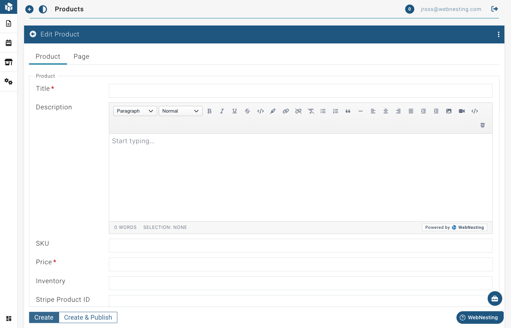

# Products and E-Commerce

**Last verified:** 2026-10-27 11:40am

The E-Commerce module turns your WebNesting website into an online store. You can list products, manage orders, and give your customers a place to browse and buy -- all from the same dashboard you use to manage the rest of your site.

---

## What the E-Commerce Module Includes

When you enable E-Commerce, you get two connected tools:

- **Products** -- Create product listings with titles, descriptions, prices, images, and inventory tracking.
- **Orders** -- Record and manage your orders.

The **Add** panel in the Website Builder also gets **Product List** and **Product Detail** blocks, so you can show your products on your site.

---

## How to Enable E-Commerce

Before you can start selling, you need to turn on the E-Commerce module.

1. Log in to your WebNesting dashboard.
2. In the site menu, open **Settings** and click **Modules**.
3. Find **Store** in the list of available modules and click **Turn on**.
4. A window shows what it costs -- its rate and estimated monthly cost, plus the 10 free pages it earns your site while it's on -- before anything happens.
5. Click **Enable** to confirm. The module activates right away.

Once enabled, **Store** appears in your site menu, below **Pages**, with links to **Products** and **Orders**.

> **Tip:** Online checkout on product pages is not available yet, so visitors cannot pay through your site today. See "Taking Payments" below for what you can do now.

The Store module costs $20/month. Each product page also counts as a page for billing purposes -- but turning Store on also gives your site 10 more free pages for as long as it stays on. See [Billing and Usage](../dashboard/billing-and-usage.md#pages).

---

## Managing Products

Products are the items you are selling. Each product gets its own listing with all the details your customers need.

### Creating a New Product

1. In the site menu, open **Store**, then select **Products**.
2. Select **+ New Product** at the top of the page.
3. The editor opens with three tabs: **Product**, **Page** and **Content**. Fill in the product details on the **Product** tab.
4. To give the product its own page on your site, open the **Page** tab and turn on **Enable page for this record**. Fill in the page fields it shows.
5. Select **Create**.

Here is what each field is for:

**Title** (required)
The name of your product. This is what customers will see. For example, "Handmade Ceramic Mug" or "Premium Yoga Mat."

**Description**
A detailed description of the product. Tell your customers what it is, what makes it special, what it is made of, dimensions, and any other relevant details. Use the text editor to format your description with headings, bullet points, and bold text.

**Price** (required)
The selling price of the product. Enter the amount in your currency. For example, enter `29.99` for a product that costs $29.99.

**SKU**
A unique product code for your own reference. SKU stands for "Stock Keeping Unit." This is optional but helpful if you have many products or need to track inventory in another system. For example, "MUG-BLUE-001."

**Inventory**
The number of items you have in stock. This is optional but useful for tracking how many units are available.

**Stripe Product ID** and **Stripe Price ID**
Optional text fields for the matching IDs from your Stripe account. Leave them empty unless you already use Stripe.

**Image**
A photo of your product. This is what customers see when browsing your store.

1. Find **Image** on the **Product** tab.
2. Click **Add Image** to open the media picker.
3. Choose an image from your File Manager, or upload a new one.

> **Tip:** Use clear, well-lit product photos. Show the product from its best angle. If possible, include multiple photos showing different views or the product in use.

### Editing a Product

1. In the site menu, open **Store**, then select **Products**.
2. Find the product you want to update in the list.
3. Click on the product to open it in the editor.
4. Make your changes -- update the price, description, images, or any other field.
5. Select **Save** to keep your changes as a draft, or **Save & Publish** to put them on your live website.

### Organizing Products

Your products appear in a list in your dashboard. You can browse through them and narrow the list to find what you need.

1. In the site menu, open **Store**, then select **Products**.
2. Select **Filters** at the top right and set **Status** to **Published**, **Draft** or **Trashed**.
3. Scroll through the list to browse all your products. The **Search** bar at the top of the dashboard also finds a product by name.

### Product Status (Draft vs. Published)

Like other content in WebNesting, products can be saved as drafts or published.

- **Draft** -- The product is saved in your dashboard but not visible to customers on your website.
- **Published** -- The product is live on your site and customers can see it.

Use drafts when you are still working on a product listing. When it is ready, open the product and select **Save & Publish**, or choose **Publish** from the ⋮ menu on its row in the list. **Unpublish** in the same menu takes it offline again.

> **Tip:** Before publishing a product, double-check that the price is correct, the description is complete, and the images look good. First impressions matter when selling online.

---

## Managing Orders

You can view and manage your orders from your dashboard, and add an order yourself with **+ New Order**.

### Viewing Incoming Orders

1. In the site menu, open **Store**, then select **Orders**.
2. You will see a list of your orders.
3. Click an order to open it.

### Order Details

Click on any order in the list to see its full details:

- **Title** -- A reference name or number for the order.
- **Email** -- The customer's email address.
- **Subtotal**, **Tax** and **Total** -- The amounts for the order.
- **Currency** -- The currency of the amounts.
- **Status** -- The current state of the order (see below).
- **Payment Status** -- Whether the order is **Unpaid**, **Pending**, **Paid**, **Failed** or **Refunded**.

### Order Status Tracking

Each order has a status that tells you where it is in the fulfillment process. A new order starts as **Pending**. These are the choices:

- **Pending** -- The order is recorded, but you have not started working on it yet.
- **Processing** -- You are preparing the order (packing, labeling, etc.).
- **Completed** -- The order has gone to the customer and everything is finalized.
- **Cancelled** -- The order was cancelled before it was fulfilled.
- **Refunded** -- The customer got their money back.

### Updating Order Status

As you work through each order, update its status to keep things organized and to communicate progress:

1. Click on the order to open its details.
2. Find the **Status** field.
3. Select the new status from the dropdown.
4. Save your changes.

Work through statuses in order: move from Pending to Processing when you start preparing the order, and then to Completed when everything is done. Use the **Payment Status** field the same way to record whether the customer has paid.

> **Tip:** Check your orders regularly so none are left waiting. Getting back to customers quickly builds trust and keeps them coming back.

### Payment Information

Each order has a **Payment Status** field. You set it yourself, because your site does not collect payments yet (see "Taking Payments" below).

> **Tip:** Keep your own record of refunds and payment disputes in your payment service, and set the order's **Status** and **Payment Status** to match.

### Communicating with Customers

Good communication keeps customers happy and reduces support requests:

- **Confirm receipt** -- When you record a new order, consider sending the customer an acknowledgment.
- **Provide updates** -- Let customers know when their order goes out, including any tracking information.
- **Handle issues promptly** -- If there is a problem with an order (out of stock, shipping delay), reach out to the customer right away rather than waiting.

> **Tip:** A quick, friendly message goes a long way. Customers appreciate knowing that a real person is handling their order.

---

## Taking Payments

Product pages do not show a purchase button yet, and the dashboard has no place to enter payment keys. Visitors cannot pay through your site today.

Until online checkout is available, record each sale yourself as an order in **Orders**, and collect payment the way you do now, for example by invoice or in person.

---

## Displaying Products on Your Site

To show your products to visitors, you add product components to your pages using the Website Builder.

### Adding a Product List to a Page

A Product List shows a collection of your products -- perfect for a "Shop" or "Products" page.

1. Open the page where you want to display products in the **Website Builder**.
2. Open the **Add** panel.
3. Look for **Product List** in the **Site modules** group.
4. Drag the Product List component onto your page.
5. The component will automatically display your published products.
6. Save your page.

Visitors will see your products laid out in a browsable format with titles, images, and key details.

### Adding a Product Detail to a Page

A Product Detail component shows all the information for a single product. This is used on individual product pages -- the pages that open when a customer clicks on a product from the list.

1. Open the product's individual page in the **Website Builder**.
2. Open the **Add** panel.
3. Look for **Product Detail** in the **Site modules** group.
4. Drag the Product Detail component onto the page.
5. The component will display the full product title, description, price, and images.
6. Save your page.

> **Tip:** Your product list and product detail pages work together. The list gives customers an overview of what you sell, and each product links to its own detail page with the full information.

---

## Tips for Running an Online Store

### Write Detailed Product Descriptions

Do not just list the basics. Tell customers why they should buy your product. What problem does it solve? What makes it different? Include dimensions, materials, care instructions, and anything else that helps customers make a decision.

### Use High-Quality Product Photos

Photos are the most important part of selling online. Customers cannot touch or try your products, so your images need to do the selling. Use clear, well-lit photos with a clean background. Show the product from multiple angles if possible.

### Price Clearly

Make sure your prices are accurate and easy to understand. If there are additional costs (like shipping), mention them in the product description so customers are not surprised at checkout.

### Keep Inventory Up to Date

If you track inventory, update it regularly. There is nothing more frustrating for a customer than ordering something that turns out to be out of stock.

### Respond to Orders Quickly

When an order comes in, process it as soon as you can. Fast fulfillment leads to happy customers, positive reviews, and repeat business.

### Organize Your Products

If you have many products, organize them with clear titles and descriptions so customers can find what they are looking for. Use the search feature in your dashboard to quickly locate specific products when you need to make updates.

### Test the Customer Experience

After setting up your store, visit your own website as if you were a customer. Browse the product list, click into a product detail page and check that the price and photos look right. Make sure everything looks right and works smoothly.

> **Tip:** Start with a small number of products and add more over time. It is better to have a few well-crafted product listings than many incomplete ones. You can always expand your catalog as you get comfortable with the tools.
