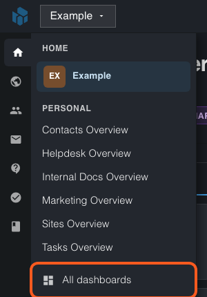
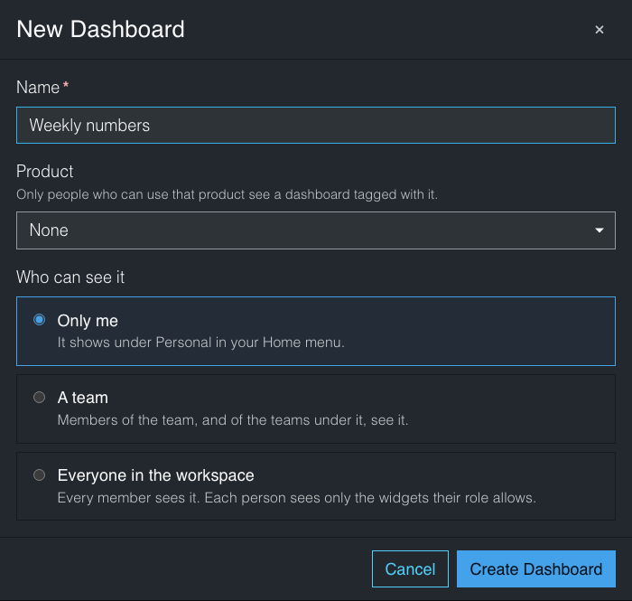
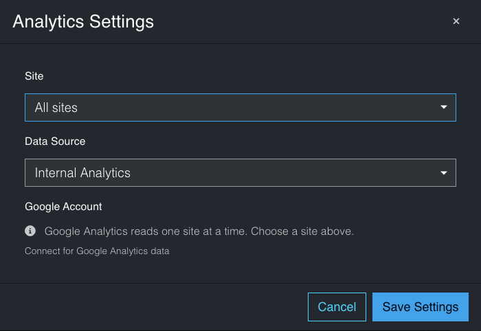
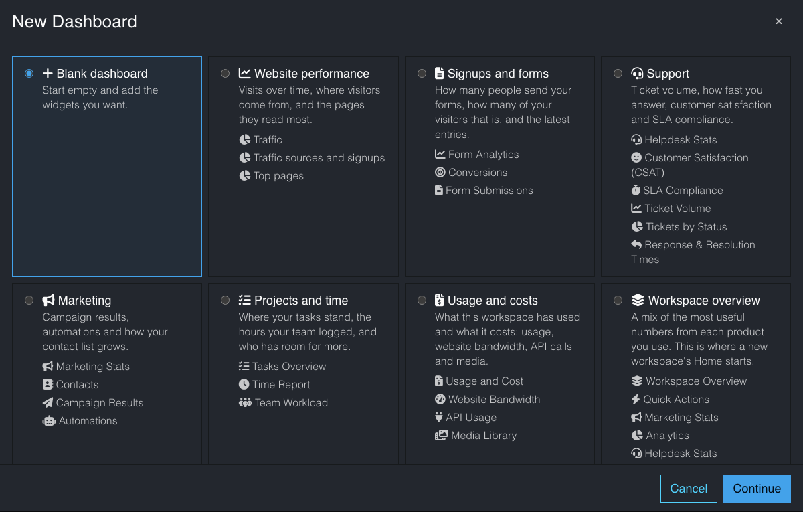
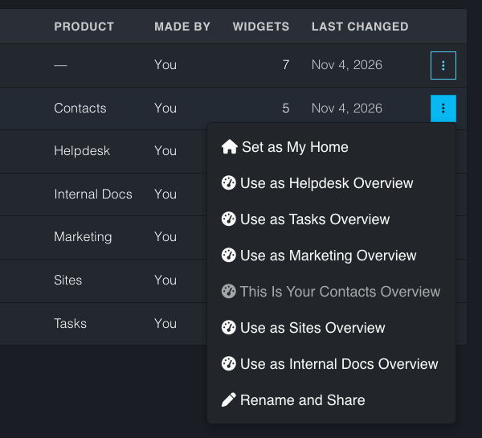
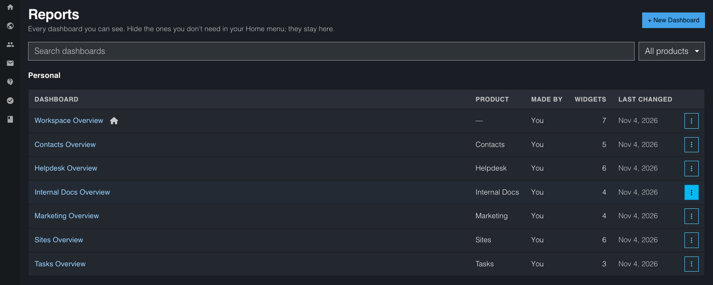

# How to make, share and organize dashboards

**Last verified:** 2026-11-07 11:21am

A dashboard is a page of widgets: your numbers from Sites, Marketing, Helpdesk, Tasks, billing and more, in one place. You can make as many as you like, keep them to yourself or share them with a team or the whole workspace.

## Before you start

- Open your workspace and click **Home** in the left rail. The workspace name at the top of the **Home** menu opens your home dashboard. Under it, the menu lists your other dashboards.
- To share a dashboard, your role must let you change dashboards. If you can only view, you can still make dashboards for yourself.

## Make a dashboard

1. In the **Home** menu, click **All dashboards**. The **Reports** page opens.

2. Click **+ New Dashboard**.
3. Pick **Blank dashboard**, or a template (see "Start from a template" below), then click **Continue**.
4. Type a **Name**. A template fills in its own name.

5. Under **Product**, choose **None**, or **Helpdesk**, **Tasks** or **Marketing**. Only people who can use that product see a dashboard tagged with it. If the **Reports** page is filtered to a product, the new dashboard starts with that product.
6. Under **Who can see it**, choose **Only me**, **A team** or **Everyone in the workspace**.
7. Click **Create Dashboard**. The new dashboard opens.
8. Click **+ Add Widget**, then pick a widget. Widgets are grouped by type.

Drag a widget by its handle to move it. Use a widget's **⋮** menu to make it **Small**, **Medium** or **Large**, or to delete it.

To remove a whole dashboard, open its **⋮** menu on the **Reports** page and choose **Delete**. Everyone it is shared with loses it too. The data behind its widgets stays where it is.

## Show one website or all of them

A website widget (visits, pages, forms, orders, site health, storage and more) shows **All sites** when you add it. It adds up the numbers of every website you can see. Rates, such as the bounce rate or the average order, are worked out from all the visits and orders together. Lists show the website each row comes from, and a row opens that website's record. If your workspace has one website, the widget shows it.

To show one website, or to go back to all of them:

1. Click the small site name next to the widget's title (for example **All sites**). The widget's settings open.

2. Under **Site**, pick a website, or **All sites**.
3. Click **Save Settings**. The widget changes in place.

You can also open the settings with the widget's gear icon.

- If a website is still being set up or cannot be read right now, the widget leaves it out and names it under the numbers.
- **Google Analytics** reads one website at a time. Pick a website under **Site** to connect it.
- On a website's own dashboard, the widgets always show that website.

## Start from a template

A template is a dashboard with its widgets already chosen. The templates are **Website performance**, **Signups and forms**, **Store**, **Support**, **Marketing**, **Projects and time**, **Usage and costs** and **Workspace overview**. Each card lists the widgets it holds.

- You see a template only when your workspace uses the products it needs. Support needs Helpdesk, Marketing needs Marketing and Projects and time needs Tasks. The website templates need a website, and **Signups and forms** and **Store** need a website that has forms or a store.
- If a widget's product is off, it is left out of your copy.
- If your workspace has one website, the website widgets show it. If it has several, they show **All sites**. You can change each one to a single website in its settings.
- Your dashboard is a copy. You can change it freely, and a later change to the template never touches it.
- Your own home dashboard, **Workspace Overview**, starts from the **Workspace overview** template. Once made, a template never changes it.
- The templates are only in the **+ New Dashboard** window.

## Share a dashboard

1. Open the dashboard.
2. Click the **⋯** menu at the top right, then **Rename and Share**.
3. Under **Who can see it**, choose who sees it:
   - **A team**: pick the team. Members of that team, and of every team under it, see it. You can pick a team you belong to; the workspace owner can pick any team.
   - **Everyone in the workspace**: every member sees it. You need permission to change each product whose widgets are on it.
4. Click **Save Changes**.

Each person sees only the widgets their role allows. A widget they cannot open shows "You don't have access to …" instead. Only the person who made a dashboard can change or delete it. Everyone else sees it as it is.

## Choose the dashboard your workspace opens on

1. Open the dashboard.
2. Click the **⋯** menu, then **Set as My Home**.

The workspace name at the top of the **Home** menu now opens it, so it leaves the list under the name. Your choice is only yours. With no choice, your own **Workspace Overview** opens. When you choose another dashboard, **Workspace Overview** shows in the list like any other.

## Choose the Helpdesk, Tasks and Marketing overviews

Each product's menu starts with **Overview**: Helpdesk, Tasks, Marketing, Contacts, Sites and Internal Docs. It opens your overview dashboard for that product.

- **Your first one:** the first time you open a product's **Overview**, you get your own dashboard named **Helpdesk Overview** (or **Tasks Overview**, **Marketing Overview**, **Contacts Overview**, **Sites Overview**, **Internal Docs Overview**). If you had arranged that product's page before, your widgets are kept. If not, it starts from that product's template.
- **Use another dashboard:** open any dashboard from the **Home** menu or the **Reports** page. Click the **⋮** menu, then **Use as Helpdesk Overview** (or Tasks, Marketing, Contacts, Sites or Internal Docs).

The menu offers only the products you can use, and only when that product is on in your workspace. Your choice changes only that product's **Overview**, and only for you.
- **Go back:** on your own **Helpdesk Overview**, click **⋯**, then **Use as Helpdesk Overview**. If the dashboard you chose is deleted, unshared or hidden from your menu, your own overview opens again.
- **Change it:** you change an overview's widgets like any dashboard. If someone else made it, the page says so, and only they can change it.
- **Who sees them:** a dashboard tagged with a product shows only to people who can use that product. If your role does not include the Helpdesk, you see no Helpdesk dashboards anywhere.

## Hide a dashboard from your menu

The **Home** menu shows every dashboard you can see, apart from your home: **Personal**, then one group per team, then **Workspace**. A group with nothing in it has no heading.

1. Click **All dashboards** in the **Home** menu.
2. Find the dashboard on the **Reports** page and click its **⋯** menu.
3. Click **Hide from Menu**.

The dashboard stays on the **Reports** page, and you can still open it there. Click **Show in Menu** to bring it back. Hiding a dashboard changes only your menu. Your own home and your product overviews have no **Hide from Menu**, **Delete** or move choices. A dashboard you made has them.

## The Reports page

The **Reports** page lists every dashboard you can see, hidden ones included. Each row shows the **Product** the dashboard is tagged with (**Helpdesk**, **Tasks**, **Marketing**, or a short dash for none), who made it, how many widgets it has and when it last changed. A small house marks your home dashboard. Click a dashboard's name to open it. To see one product's dashboards, pick the product in the list next to the search box. Use **Move Up** and **Move Down** in a row's **⋮** menu to change the order of your own dashboards in the **Home** menu.

## Check it worked

- Your new dashboard shows in the **Home** menu under **Personal**, a team's name, or **Workspace**.
- A teammate in that team sees it in their **Home** menu with no action needed.
- Clicking the workspace name at the top of the **Home** menu opens your home dashboard.

## If something goes wrong

- **I can't choose A team or Everyone in the workspace.** Your role lets you view dashboards but not share them. Ask a workspace admin to change your role.
- **"To share this dashboard with the whole workspace you need edit access to …"** Remove those widgets, share with a team instead, or ask an admin for access to that product.
- **"This dashboard isn't available."** It was deleted, or it is no longer shared with you. Your own **Workspace Overview** opens instead when you open the workspace.
- **Where did Recent Activity go?** Open **Settings**, then **Activity Log**. Your other workspaces are in the list under the workspace name at the top of the page.
