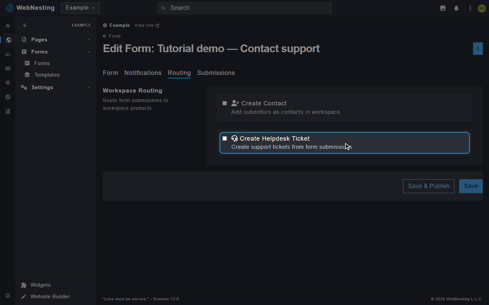

# Helpdesk

**Last verified:** 2026-10-31 3:13pm

The Helpdesk gives your workspace a complete customer support system. Use it to manage support tickets, organize your team, build a knowledge base for self-service, and track how quickly your team responds to customers -- all from your WebNesting workspace.

---

## What Is the Helpdesk?

Think of the Helpdesk as your team's support command center. When a customer needs help, a ticket is created. Your team can see all incoming requests in one place, assign them to the right people, and track every conversation until the issue is resolved.

The Helpdesk is a workspace product, which means it works across all your sites and is shared by your entire team. You enable it from your workspace settings, and it appears in your workspace sidebar right away.

Beyond ticket management, the Helpdesk includes a knowledge base where you can publish help articles so customers can find answers on their own, SLA policies to set response time goals, canned responses for common questions, and satisfaction ratings so you know how your team is doing.

> **Tip:** The Helpdesk is a workspace-level product. To enable it, see the [Workspace Products](workspace-products.md) guide.

---

## Your Helpdesk Inbox

The inbox is the main view of the Helpdesk. It shows all your support tickets in one place, like a shared email inbox for your whole team.

Click **Helpdesk** in your workspace sidebar. The Helpdesk menu has **Overview**, **All**, **Unclaimed**, **My tickets** and **Watching**, then your teams under **My Teams**, then **Site Connections** and **Settings**. **Overview** opens your **Helpdesk Overview** dashboard. Change its widgets, or use another dashboard instead (see [Dashboards and Reports](dashboards-and-reports.md#choose-the-helpdesk-tasks-and-marketing-overviews)). **All** opens the **Tickets** list with key details at a glance:

- **Title** -- What the ticket is about
- **#** -- The ticket number
- **Status** -- Where the ticket is in the support process (for example, Open or In Progress)
- **Priority** -- How urgent the ticket is
- **Assigned To** -- Which team member is handling it
- **Contact** -- The customer who wrote in
- **Received** -- When the ticket was submitted

You can sort and filter the list to find specific tickets. Use filters to show only tickets with a certain status, priority, assignee, or tag.

Above the list, quick tabs let you switch what you're looking at with one click:

- **Open** -- Tickets still being worked
- **Unclaimed** -- Open tickets routed to a team that no one has picked up yet
- **Closed** -- Resolved tickets
- **All** -- Every ticket, regardless of status

When you open the Helpdesk, you land on **Open** so you see live work first.

**Unclaimed** is worth a daily look. A ticket lands there when three things are true at the same time: it is still **open**, it has been **routed to a team**, and **no one person** is assigned to it. A ticket that is already assigned to someone has an owner, and a ticket with no team was never routed anywhere -- it is the gap between those two that goes quiet, because "the team" is not a person who replies.

The number beside **Unclaimed** in the menu is how many there are across the workspace, and each of your teams further down the menu carries its own count too. That lets a team lead see just their own pile without changing any filters. Assigning a ticket to someone takes it out of the list straight away, and every count drops at the same time.

### Saved Views

If you find yourself applying the same filters often, you can save them as a view for quick access. For example, you might create a saved view for "My Open Tickets" or "Urgent Unassigned Tickets." Click **Filters**, set them, then click **Save as view…**. Your saved views are listed in the same filter panel, so you can switch between them with one click.

> **Tip:** Start your day by checking the inbox for any new or unassigned tickets. This helps you stay on top of incoming requests and make sure nothing falls through the cracks.

---

## Creating a Ticket

There are several ways a ticket can be created:

- **From the inbox** -- Click **+ New Ticket** at the top of the ticket list. You write the first message to a customer, and it opens a ticket.
- **By email** -- When a customer emails one of your Helpdesk inboxes, a ticket opens in your list. See [Connecting Your Email](#connecting-your-email).
- **From a form on your website** -- A form on a connected site can open a ticket each time someone fills it in. See [Turning a Form on Your Site Into a Ticket](#turning-a-form-on-your-site-into-a-ticket).

### Ticket Fields

When you click **+ New Ticket**, you fill in:

- **To** -- The customer. Search for a contact, or type an email address.
- **Subject** -- A short summary of the issue
- **Message** -- What you want to tell the customer
- **Internal note (don't email the customer)** -- Tick this to save a note for your team only

Click **Send** to email the customer, or **Save as Draft** to keep it for later. Any custom fields you added for tickets show on the form too.

When the ticket is open, set these in its sidebar:

- **Status** -- The current stage of the ticket (new tickets start as Open)
- **Priority** -- How urgent the ticket is (Urgent, High, Normal, or Low)
- **Assigned To** -- The team member responsible for resolving the ticket
- **Teams** -- The team that should handle this ticket
- **Tags** -- Labels to help organize and categorize tickets

---

## Managing Tickets

Once a ticket is in the inbox, you and your team can manage it through its lifecycle.

### Ticket Statuses

Every ticket has a status that shows where it is in the support process:

- **Open** -- The ticket has been received but work has not started yet
- **In Progress** -- A team member is actively working on the ticket
- **Pending** -- The ticket is waiting on something (for example, a response from the customer or information from another team)
- **Resolved** -- The issue has been addressed and the solution has been provided
- **Closed** -- The ticket is complete and no further action is needed

To change a ticket's status, open the ticket and select the new status from the status dropdown. Update the status as you make progress so your team always knows where things stand.

### Customizing Statuses and Categories

Every status belongs to a **category**, and each category **counts as** one of three things: **Open** (still being worked on -- shows in the Open tab and your team's counts), **Done** (resolved), or **Closed** (finished without being resolved, like a duplicate). Tickets whose status counts as Done or Closed appear in the **Closed** tab.

Open **Settings** in the Helpdesk menu, then the **Statuses** tab, to change them:

- **Add a status** -- click **+ Add Status**, name it (for example "Waiting on Customer"), pick its **Category**, and choose a color.
- **Reorder statuses** -- drag a status up or down by the handle at the start of its row. Statuses show in this order everywhere: the status menu on a ticket, the ticket list, and the **Tickets by Status** dashboard widget.
- **Edit a status** -- open the menu on its row and choose **Edit**. Moving a status into a category that counts differently moves every ticket in it too.
- **Categories** -- click **+ Add Category** to create one, give it a color, and choose what it **counts as**. Rename, recolor, or change an existing one from the menu on its row. A category that still has statuses can't be deleted. Drag categories by their handle to reorder the list.

If you also use Tasks, a category can be shared by both: tick **Also use in Tasks**. Shared categories show a **Tasks** label, and changes to them apply in both places.

### Setting Priority

Priority tells your team how urgently a ticket needs attention:

- **Urgent** -- Critical issue that needs immediate attention
- **High** -- Important issue that should be addressed soon
- **Normal** -- Standard request with no special urgency
- **Low** -- Minor issue that can be handled when time allows

You can set or change the priority when creating a ticket or at any time while managing it.

### Assigning Tickets

You can assign a ticket to a specific team member or to a team:

- **Individual assignment** -- Assign the ticket to one person who will be responsible for resolving it
- **Team assignment** -- Assign the ticket to a team (like "Billing Support" or "Technical Support") so anyone on that team can pick it up

To assign a ticket, open it and use the **Assigned To** and **Teams** fields in the sidebar.

### Tags

Tags are labels you can attach to tickets to categorize and organize them. For example, you might use tags like "Billing," "Bug Report," "Feature Request," or "Account Issue."

Tags make it easy to filter your inbox and spot patterns. If you notice many tickets tagged "Billing," you might want to update your billing help articles in the knowledge base.

### Watchers

If you want to follow a ticket without being assigned to it, you can add yourself as a watcher with the **Watch** button on the ticket. It then reads **Watching**, and the ticket is listed under **Watching** in the Helpdesk menu. Watchers receive updates when the ticket changes -- new comments, status changes, or reassignments -- so they can stay informed without being responsible for resolving the ticket.

> **Tip:** Use watchers when a manager wants to keep an eye on a high-priority ticket, or when a team member from another department has related context.

---

## Replying to Tickets

Communication on a ticket happens through comments. There are two types:

### Replies

Replies are visible to the customer. Use these to respond to the customer's question, provide a solution, ask for more information, or share updates on progress.

### Internal Notes

Internal notes are visible only to your team. The customer never sees them. Use internal notes to discuss the issue with teammates, share background information, leave instructions for the next person who works on the ticket, or document your troubleshooting steps.

To add a comment, open a ticket and type your message in the box under the conversation. Choose whether it is a reply (customer-visible) or an internal note (team-only) before sending. The button reads **Reply** for a reply and **Add Note** for an internal note.

> **Important:** Double-check whether you are writing a reply or an internal note before sending. Replies are visible to the customer, so make sure internal discussions stay in internal notes.

### Editing and Deleting Your Notes

To fix or remove an internal note you wrote, click the **⋮** menu on it and choose **Edit** or **Delete**. An edited note is marked **edited**, and anyone you newly @-mention while editing is notified. Deleting asks you to confirm and can't be undone.

Replies can't be edited or deleted once they're sent — they've already been emailed to the customer, so the ticket always matches what's in their inbox. Messages from the customer can't be changed either. You can only edit or delete your own notes.

### Attaching Files to a Reply

You can send files with a reply, just like in Gmail or Outlook:

- **Attach** — upload files straight from your computer. They're kept private in your workspace's Files (in the Helpdesk folder) and emailed with your reply.
- **From Files** — pick files already in your workspace's [Files](media-library.md), including private ones.

Attached files appear as small chips under the message box — click the **×** on a chip to remove one before sending. When you hit Reply, the files are emailed to the customer as real attachments and appear in the ticket conversation. A reply can even be attachments-only, with no text.

A few things to know:

- Files on one reply are limited to **15 MB total** — for bigger files, share a link instead.
- Once a reply is sent, its attachments can't be removed (the email has already left) — though deleting the file from Files later removes the stored copy.
- Attachments start uploading the moment you add them, so if you navigate away mid-compose, your message is saved as a **draft** with its files — send, edit (from its **⋮** menu), or discard it from the conversation. Only the person who wrote a draft can send or discard it, since it goes out under their name.

### Ticket Files (Internal)

The ticket sidebar has a **Files** section for attaching workspace files to the ticket itself — reference material, logs, screenshots for your team. These are internal only and are **never emailed** to the customer. Remove one anytime with the **×** next to it.

### Linked Tasks

If your workspace also has **Tasks**, you can turn a ticket into work for your team. Click **+ Create Linked Task** in the ticket, pick a project, and click **Create** -- the task is named after the ticket and linked to it. Linked tasks show in the ticket just like a task's subtasks: status, project, priority, assignee, and due date, which you can change right there, or tick the circle to complete the task. Click a task's name to open it.

### Time on Tickets

The ticket sidebar has a **Time Tracked** section, so you can record how long a ticket took -- handy for billing support hours or seeing where your team's time goes.

- Click **Log Time**, enter the hours and the day, optionally a note, tick **Billable** if it should be billed, and click **Log Time**.
- Or click **Start Timer**, work the ticket, then click **Stop** -- the Log Time form opens with the time filled in for you to save.

You can change or delete only your own time; workspace admins can change anyone's. If your workspace also has **Tasks**, ticket time appears in its **Time Report** as its own **Helpdesk tickets** group, and you can filter the report to tickets only. See [Tasks and Projects](tasks-and-projects.md) for more on the timer and the report.

---

## Using Teams

Teams let you organize your support staff into groups based on their specialties or responsibilities. For example, you might have a "Technical Support" team, a "Billing" team, and a "Sales" team.

### Why Use Teams

- **Route tickets to the right people** -- Assign tickets to a team so the right group sees them
- **Shared responsibility** -- Any member of a team can pick up tickets assigned to that team
- **Better organization** -- Filter your inbox by team to see only the tickets relevant to your group

### Creating a Team

1. In your workspace, open **Settings**, then **Teams**. Teams are shared by your whole workspace, so they are not in the Helpdesk settings.
2. Click **+ Add Team**.
3. Give the team a name (for example, "Technical Support").
4. Add team members.
5. Save the team.

Once created, you can assign tickets to the team. Any member of that team can view and work on the assigned tickets.

### Team Widgets on Your Dashboard

Three widgets show a team's work on your workspace dashboard. Add them from **+ Add Widget**, then open the widget's settings and pick a **Team**. The list holds only the teams you can see, and **My team** is the default.

- **Team Workload** -- the open tickets and tasks each teammate has. A product your workspace does not use is left out.
- **Team Inbox** -- tickets and tasks sent to the team that nobody has taken yet, and the ones you are watching. Each number opens the matching list.
- **Team Activity** -- the latest ticket and task activity of the team, with a link to the full activity page.

---

## SLA Policies

SLA stands for Service Level Agreement. In the Helpdesk, SLA policies let you set goals for how quickly your team should respond to and resolve tickets. Think of them as response time targets that help you keep your support quality consistent.

### What SLA Policies Track

Each SLA policy defines two types of time targets:

- **Response time** -- How quickly your team should send the first reply to a new ticket. For example, you might set a goal of responding to all Urgent tickets within one hour.
- **Resolution time** -- How quickly the ticket should be fully resolved. For example, Normal priority tickets might have a resolution target of 24 hours.

### Setting Up SLA Policies

1. Go to the **SLA Policies** tab in the Helpdesk settings.
2. Click **+ Add Policy**.
3. Under **What should we call this policy?**, give it a name. **What is it for?** is an optional note only your team sees.
4. Under **How fast should tickets be answered?**, set the response time and resolution time targets in hours. To give different priorities tighter or looser deadlines, fill in the per-priority columns — leave a priority blank and it uses the "Every ticket" times.
5. Turn on **Only count time while we're open** if you want the clock to pause outside your business hours, then choose a schedule under **Which hours should it follow?**. Schedules are set up on the **Business Hours** tab; the field links straight to it.
6. Click **Save Policy**.

Your workspace starts with a **Default SLA** policy that already gives the most pressing tickets tighter targets -- Urgent tickets are due for a reply in 1 hour and a resolution in 4, and High tickets in 2 hours and 8.

You can also adjust per-priority targets directly from the policy list without opening the full form: click **Targets** next to any policy to expand its priority ladder inline, change the hours, then click **Save Targets**.

### Business Hours

SLA targets can be counted in business hours rather than around the clock. This means if a ticket comes in at 5:00 PM on Friday and your office opens at 9:00 AM on Monday, the SLA clock does not count the weekend.

#### Setting up your hours

1. Go to the **Business Hours** tab in the Helpdesk settings.
2. Click **+ Add Schedule**.
3. Under **What should we call these hours?**, name your schedule (e.g. "Standard support hours").
4. Under **Which time zone are these hours in?**, pick the time zone these hours are in -- the times you enter are read in that zone, wherever your customers happen to be. **Use workspace timezone** (the default) follows your workspace's timezone, so the hours move with it if you change it.
5. Under **When is your team open?**, toggle each day on or off and set the opening and closing times.
6. Under **Days you're closed**, add any holidays — they pause the clock the same way a weekend does.
7. Save the schedule.

As you edit, a note under the week shows what your hours mean in practice — for example, *"A ticket arriving Friday at 5:00 PM is due Monday at 1:00 PM."* The same note appears on the SLA policy form, so you can see the effect of a target before you save it.

A schedule an SLA policy is using cannot be deleted. Its row shows **In use**, its **⋮** menu has no **Delete**, and hovering **In use** names the policies you need to point elsewhere first.

#### Connecting a schedule to an SLA policy

When you create or edit an SLA policy, turn on **Only count time while we're open** and choose which schedule the policy should follow from the dropdown. Every schedule you create on the Business Hours tab appears in that list.

If you leave **Only count time while we're open** switched off, the SLA clock runs around the clock — overnight, weekends and holidays included.

> **Tip:** Even if you do not enforce SLAs strictly, setting response time goals gives your team a clear benchmark and helps you spot when tickets are taking too long.

---

## Canned Responses

Canned responses are pre-written replies you can save and reuse when responding to tickets. They save time on common questions and help your team give consistent answers.

### Creating a Canned Response

1. Go to the **Canned Responses** tab in the Helpdesk settings.
2. Click **+ Add Response**.
3. Give it a **Title** and a **Shortcut** (a short keyword, such as /thanks, that helps you find the response quickly when you search the Canned Responses menu). You can also set a **Category**.
4. Write the response text in **Body**. Type `{{` anywhere in the body to insert a placeholder that fills itself in when you use the response: the customer's first name, last name, full name, or email; the ticket number or subject; or your own name. For example, "Hi {{first_name}}, thanks for reaching out about #{{ticket_number}}." If we don't know the customer's name, `{{first_name}}` becomes "there".
5. Click **Save Response**.

### Using a Canned Response

When replying to a ticket, open the **Canned Responses** menu below the reply box and pick a response. Type in the menu's search box to find one by its name or its shortcut. The response text goes into your reply with any placeholders already filled in from that ticket -- the customer's name, the ticket number, your name -- so what you see is what will be sent. You can still edit it before sending.

> **Note:** Picking a canned response replaces whatever is already in the reply box, so choose the response first and add your own words after.

> **Tip:** Create canned responses for your most frequently asked questions. Common examples include password reset instructions, refund policies, shipping information, and "Thank you for contacting us" greetings.

---

## Knowledge Base

The knowledge base holds the help articles that answer common questions. When customers can find answers on their own, they do not need to submit a ticket.

Knowledge base articles live on your websites. When Helpdesk is on, each of your sites gets a **Knowledge Base** module. Each article is a page of that site, so it has its own web address and can show in your site menus.

### Writing an Article

1. Open your site in the workspace, then click **Pages** in the site menu and choose **Knowledge Bases**.
2. Click **+ New Knowledge Base**.
3. On the **Page** tab, give the article a **Title**. You can also set its **Page URI**, **Layout**, menu visibility and SEO settings.
4. Open the **Content** tab and write the article.
5. Open the **Settings** tab to set the **Author** and a **Featured Image** if you want them.
6. Click **Create**.

The **Knowledge Base** list shows each article with its **Updated** date and **Status**.

### Organizing Articles

Articles nest under other pages the way pages do. Use a parent page, such as a "Help Center" page, to group related articles.

> **Tip:** Write your knowledge base articles as if you are explaining something to a friend. Use plain language, break steps into numbered lists, and include examples where possible. The clearer your articles are, the fewer tickets your team will receive.

---

## Site Connections

You can connect your websites to the Helpdesk. A connected site can send form submissions to your ticket list.

### Connecting a Site

1. Click **Site Connections** in the Helpdesk menu.
2. Click **Connect Site**.
3. Under **Site**, select the website you want to connect.
4. Tick **Active**. Tick **Widget Enabled** to turn the widget on for that site.
5. Save your settings.

The **Connected Sites** list shows each site with its **Active** and **Widget** status and the date it was **Connected**. A connected site can also turn a form into a ticket, as described below.

### Turning a Form on Your Site Into a Ticket

A form on your website -- a contact form, a support request form, a "get a quote" form -- can open a Helpdesk ticket every time someone fills it in, instead of just sending you an email. The ticket is titled after the form, lists every answer the person gave, and follows the same SLA targets and business hours as a ticket that arrived any other way.

This is set per form, and it is off until you switch it on. Turning it on for your contact form does not affect your newsletter signup.



1. In the site menu, open **Forms** and click **Forms**.
2. Open the form you want (or click **+ New Form** and then **Create** -- the Routing tab only appears once a form has been created).
3. Open the **Routing** tab.
4. Switch on **Create Helpdesk Ticket**.
5. Two more options appear: **Assign to Team**, so the ticket lands with the right group, and **Priority**, which sets how urgently it starts. Leaving both alone sends it to your default queue at normal priority.
6. Click **Save & Publish**.

Seeing **Assign to Team** and **Priority** after the save is your confirmation -- those two only show while the switch is on.

> **Tip:** The switch above it, **Create Contact**, is separate and can be used at the same time. It adds the person who submitted the form to your workspace contacts, and lets you add them to a list or apply a tag. For that to work, one of your form's fields needs its **Marketing Field** set to **Email**, so WebNesting knows which box holds the email address.

---

## Connecting Your Email

There are **five ways** to set up email in Helpdesk, ranging from "zero DNS, working in 30 seconds" to "fully branded on your own infrastructure." The wizard at **Settings → Email → + Add Inbox** walks you through whichever path fits.

**Your support address always has to be one of these two things:** your WebNesting-hosted address, or a domain you've verified here. If you try to set up an inbox with an address on a domain nobody's verified for your workspace, you'll see "Use your workspace address or a domain you've verified in Email settings" and the save won't go through. This keeps anyone from receiving or sending support mail that looks like it came from a different company (including us).

### Which path do I pick?

Use this table to match your situation to a setup option. You can always change later, or use different options for different inboxes (e.g. helpdesk via Gmail OAuth + marketing via your own domain).

| Your situation | Recommended option | Why |
|---|---|---|
| **I just want to try Helpdesk in 30 seconds** | Option 0 — WebNesting-hosted | No DNS, no accounts. Customers email a `@webnesting.email` address we provide. Easy to switch later. |
| **I already use Gmail / Google Workspace for support** | Option 1 — Gmail OAuth | Connect with one click. Existing `support@yourcompany.com` keeps working unchanged; tickets are read from your inbox and replies thread cleanly. |
| **I already use Microsoft 365 / Outlook for support** | Option 2 — Outlook OAuth (when available) | Same as Gmail but for Microsoft. |
| **I'm setting up a brand-new branded support address and I don't want to give a third-party OAuth access** | Option 3 — Vanity subdomain | Publish one MX record on a subdomain like `help.yourcompany.com`. Multiple addresses (`support@`, `billing@`, `careers@`) work automatically. No mailbox accounts to create. |
| **I want to send marketing emails from my own domain** | Option 4 — Verified domain (DKIM-signed outbound) | The setup our **deliverability** rests on. Required for marketing campaigns. Works alongside any of the inbound options above. |
| **I use a niche email provider (Zoho, FastMail, my own server)** | Option 5 — IMAP / SMTP | Works with any provider that supports IMAP + an app password. |

> **Already using a custom domain for your website?** That's separate from email DNS — your website domain handles where visitors browse, your email setup handles where mail arrives + gets signed. See [Custom Domains](../getting-started/custom-domains.md) for the website side.

### Option 0: WebNesting-hosted (fastest)

The default. Every workspace already has a hosted address we manage, `support@yourworkspace.webnesting.email`, and tickets sent to it arrive at once. **No DNS changes, no account connections, no setup time.** Customers reply to that address, and their replies thread back into the original ticket. **Settings → Email** shows your exact address. Before you add your first inbox, that page shows **+ Add My First Inbox** in place of **+ Add Inbox**.

Trade-off: the address shows our brand (`@webnesting.email`) rather than yours. Good for trying things out or for internal-only support; upgrade to Options 1-4 whenever you want branded mail.

### Option 1: Connect Gmail (OAuth)

Best for teams already running on Google Workspace or personal Gmail with a `support@yourcompany.com` address you've been using for a while.

1. Go to **Settings → Email** → click **+ Add Inbox**.
2. Pick **Helpdesk** (or **Both** if you also want to send marketing from the same address).
3. Enter the email address customers send to (e.g. `support@yourcompany.com`).
4. Choose **Gmail / Google Workspace** as the inbound source. Save → we'll open Google's OAuth consent screen.
5. Authorize WebNesting to read + send. Helpdesk now receives every email at that address as a ticket; replies go out through your existing Gmail account.

If you've already connected a Google account in this workspace that isn't powering another inbox, the wizard offers it under **Which account?** so you can skip Google's sign-in. The same choice appears if an inbox ever needs its account connected again: click **Connect Gmail** on the inbox in **Settings → Email** and pick the account, or choose **Connect a new account** to sign in. Each Google account can power one inbox.

**Fastest setup — no DNS changes required.** Existing email history at that address can be imported into tickets in one click after OAuth completes. Importing is quiet: nobody is emailed about the old messages, they don't start SLA timers or automations, and conversations older than the window you choose come in already closed.

### Option 2: Connect Outlook / Microsoft 365 (OAuth)

> **Coming soon.** Outlook OAuth is not yet available. In the meantime, use Option 3 (vanity subdomain) or Option 5 (IMAP with an Outlook app password) instead.

When available, the flow is identical to Gmail OAuth — pick **Microsoft 365 / Outlook** as the inbound source, authorize through Microsoft, and replies thread cleanly through your existing Outlook conversations.

### Option 3: Vanity Subdomain on Your Own Domain

Best for: **you're setting up a brand-new branded support address, you don't want to give us OAuth into your main mailbox, and you want your apex domain (`yourcompany.com`) email completely untouched.**

Example: keep your existing Gmail at `you@yourcompany.com` for personal mail, but route support emails through `support@help.yourcompany.com` directly into Helpdesk.

1. Go to **Settings → Email → + Add Inbox**.
2. Pick **Vanity subdomain on your own domain** as the inbound source.
3. The wizard suggests `help.<yourdomain>` — accept it or pick `support`, `tickets`, `desk`, whatever you want.
4. Save → the wizard shows you one MX record to publish at your DNS provider:
   ```
   help.yourcompany.com   MX 10 inbound-smtp.us-east-1.amazonaws.com
   ```
5. Once DNS propagates (typically 5-15 min), **every address at `*@help.yourcompany.com` works automatically** — `support@`, `billing@`, `careers@`, anything you want. We catch them all and route by recipient prefix to the right team.

**Why this is different from Option 4 (verified domain):**
- Option 4 sets up *outbound* signing on your apex domain. It doesn't change where mail arrives.
- Option 3 sets up *inbound* routing on a subdomain. It doesn't touch the apex.
- Many customers use **both together** — verified domain for marketing campaigns + vanity subdomain for helpdesk inbox.

> **Important:** You can only use Option 3 on a domain you control DNS for. If you can't publish DNS records on that domain, use Option 0 or Option 1 instead. (The wizard's DNS-control confirmation checkbox catches the most common mistake here.)

### Option 4: Verified Domain (DKIM-signed outbound)

Best for: **branded outbound replies + required for marketing campaigns from your own domain.** Combine with any inbound option (0, 1, 2, 3, or 5) to get branded mail in both directions.

1. Go to **Settings → Email → + Add Inbox**, OR open the domains part of the same **Settings → Email** page.
2. Add your domain (e.g. `acme.com`) and confirm in the checkbox that you control DNS for that domain.
3. We register the domain with our email provider and show you the DNS records to publish:
   - **Domain ownership proof** (1 TXT record) — proves to us that YOU control this domain, even if it's already set up for sending somewhere else
   - **DKIM signing keys** (3 CNAME records)
   - **MAIL FROM subdomain** (1 MX + 1 TXT on `bounces.<yourdomain>`) — so recipients see `mailed-by: bounces.yourcompany.com` instead of `amazonses.com`
   - **SPF** (1 TXT on apex)
   - **DMARC** (1 TXT on `_dmarc.<yourdomain>`)
4. Publish at your DNS provider. Click **Verify now** in the wizard until everything resolves (typically 5-15 minutes).
5. Once verified, helpdesk replies + marketing campaigns send from `support@acme.com` with full DKIM alignment.

This is the **strongest option for trust and deliverability**, but it does require DNS access.

### Option 5: IMAP / SMTP (Other Providers)

For Zoho, FastMail, ProtonMail (via Bridge), your own SMTP server, or any provider that supports IMAP. Also works for Gmail or Outlook if you'd rather use an app password than OAuth.

1. Go to **Settings → Email → + Add Inbox**.
2. Pick **IMAP / SMTP (advanced)** as the inbound source.
3. The wizard offers one-click presets for common providers (Gmail, Outlook, Fastmail, iCloud, Yahoo, ProtonMail) — pick one or fill in custom server + port + TLS.
4. Enter your username + **app password** (not your regular account password — most providers block IMAP with the regular password for security).
5. Save → we run a live LOGIN + SELECT INBOX test → you're live.

### Multiple inboxes (`support@`, `billing@`, `careers@`)

Add another inbox via the same wizard for each address. Each inbox has its own routing (which team handles tickets), its own inbound source, and its own signature and "we got your message" auto-reply. A ticket always answers from the inbox it arrived on: a customer who wrote to `billing@` gets the billing inbox's auto-reply, your replies go out from `billing@` with its signature, and the ticket is routed to the billing inbox's team. Inboxes on the same domain share its DNS setup, so you only publish the records once — and each inbox still sends from its own address.

### Changing an inbox's address

If an inbox uses your own verified domain, you can change the part of its address before the @ — for example from `support@acme.com` to `help@acme.com`:

1. Go to **Settings → Email** and open the inbox (**⋮ → Edit Settings…**).
2. Under **Email address customers see**, type the new name. The domain stays the one you verified, and the preview on the right shows the new **From:** line.
3. Click **Save Changes**, then use **Send Test** on the inbox to confirm it works. You can send 20 test emails an hour.

Customers reply to this address, so before you switch, make sure mail sent to the new address reaches the inbox the same way mail to the old one does (for example, set up the same forwarding for it). Addresses from Gmail, Outlook, or IMAP accounts come from that account and aren't changed here, and a marketing inbox's sending address follows your domain.

### What happens when DNS setup isn't finished

If you start adding a domain but don't finish publishing the DNS records:

- A **countdown banner** appears on the domain's DNS Records page showing how many days until we auto-clean it up. After 12 days unfinished, you'll get a reminder email; after 14 days, we automatically remove the domain so it doesn't sit pending forever (and to keep our email provider's identity quota tidy).
- You can also **Remove now** any time from the same page if you've decided you don't need that domain after all.

This is intentional — it prevents typos and abandoned setups from creating long-running orphans on either your side or ours.

### Brand logo in recipient inbox (BIMI)

Once you have a verified domain (Option 4) with DMARC enforcement, you can show **your company logo next to outbound email** in supporting recipient inboxes.

1. Go to **Settings → Email → click your verified domain** → scroll to the **Brand logo in recipient inbox (BIMI)** section.
2. Tighten DMARC first — BIMI only takes effect when your DMARC policy is at `p=quarantine` or `p=reject`. Update the DMARC record we generate in the DNS Records list to `p=quarantine`.
3. Click **Upload Logo (SVG)** and pick a square SVG logo (SVG-Tiny-PS profile, max 32 KB, no scripts or external resources).
4. Publish the BIMI TXT record we generate at your DNS provider.
5. Send a test email — recipients on Yahoo or La Poste should now see your logo next to your name in their inbox.

**For Gmail and Apple Mail full inbox-icon support**, you also need a **Verified Mark Certificate (VMC)** from Entrust or DigiCert (~$1,500-$3,000/year per domain). Upload it in the same BIMI section after your logo.

| Tier | Cost | Where it works |
|---|---|---|
| Self-asserted (logo only) | Free | Yahoo, La Poste |
| VMC verified (logo + cert) | $1,500-$3,000/yr | Yahoo, La Poste, **Gmail, Apple Mail** |

The BIMI section in the wizard tells you which tier you're currently at and what's needed to reach the next one.

---

## Automatic Emails

Besides the replies your team writes, the Helpdesk sends a few emails on its own. You choose which ones in **Settings** in the Helpdesk menu, on the **Email** tab, under **Automatic emails to customers** and **Automatic emails to your team**. Each is a switch that saves as soon as you flip it, and each shows the exact wording your customers will get.

**To your customers:**

| Email | When it's sent | Never sent |
|---|---|---|
| **Confirm we got their email** | A customer emails you and a new ticket opens | For tickets your team starts, for form submissions (the form's own confirmation handles those), or to automated senders such as no-reply addresses, bounce messages, and out-of-office replies |
| **Tell them when their ticket is resolved** | A ticket is marked resolved | For conversations your team started |

**To your team:**

| Email | Who gets it |
|---|---|
| **A ticket is assigned to someone** | The person it was assigned to (not when they assign it to themselves) |
| **A customer replies** | The person the ticket is assigned to |

Your team is also notified inside the app either way, so turning a team email off doesn't mean anyone misses anything.

**Up to 100 automatic replies a day per workspace.** After the 100th "Confirm we got their email" of the day, new tickets still open and your team still gets its emails, but customers get no automatic reply until the next day. The day follows your workspace's time zone. A real business rarely gets near 100; the limit stops a flood of spam emails from sending replies without end.

**Replies your team writes always go out.** Someone chose to send those, so no switch stops them.

### Turning Off Automatic Emails for One Person

Sometimes one contact shouldn't get automatic emails: a partner who emails you often, a shared mailbox, or someone who asked you to stop. Open their contact (**Contacts**, then click their name) and find **Can we contact them?** in the sidebar and set **Helpdesk automatic emails** to **Off**. They stop getting the confirmation and "resolved" emails; your team's replies still reach them.

> **Tip:** Automatic emails also carry a standard "this is an automatic message" marker, so a customer's own out-of-office reply doesn't answer them and start a back-and-forth.

---

## Customer Satisfaction

You can record how satisfied a customer was once a ticket is closed. This gives you feedback on how well your team handled the support request.

### Recording a Satisfaction Rating

1. Open a ticket whose status counts as closed.
2. In the ticket sidebar, find **Customer Satisfaction**.
3. Click one to five stars.
4. Add a comment if you like.
5. Click **Submit Rating**.

The sidebar then shows the rating as **Satisfaction**, for example 4/5, with the comment under it. The Helpdesk does not email customers to ask for a rating.

### Seeing Your Satisfaction Score

The **Customer Satisfaction (CSAT)** widget adds up every rating on tickets closed in the period you choose. Add it to your workspace dashboard with **+ Add Widget**, then open its settings to pick the period (the last 7, 14, 30 or 90 days) and what it shows:

- **Score and responses** -- the average rating out of 5, how many customers rated, and the share who gave 4 or 5 stars, each next to the same figure for the period before.
- **Score trend** -- a line of the average rating for each day.
- **Ratings by stars** -- how many ratings each star level got.

With no ratings in the period, the widget says so instead of showing a score.

---

## Reports on Your Dashboard

Three Helpdesk widgets give you reports. Add any of them from **+ Add Widget** on your workspace dashboard or your Helpdesk Overview, and use the widget's settings to choose the period.

- **Ticket Volume** -- tickets opened and resolved each day, with the totals next to the period before. Choose **Split tickets by** to see the same tickets by channel, priority or team.
- **Response & Resolution Times** -- the average time to a first reply, the average time to close a ticket, and the share of tickets that met their SLA. Tick only the figures you want.
- **Customer Satisfaction (CSAT)** -- described above.

A figure shows a dash when no ticket in the period has the data yet, for example no reply sent. These widgets only appear if your workspace has the Helpdesk and you can view tickets.
