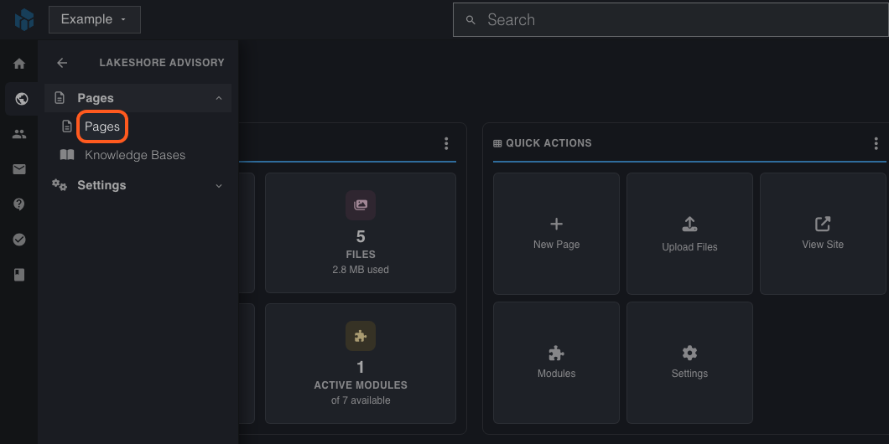
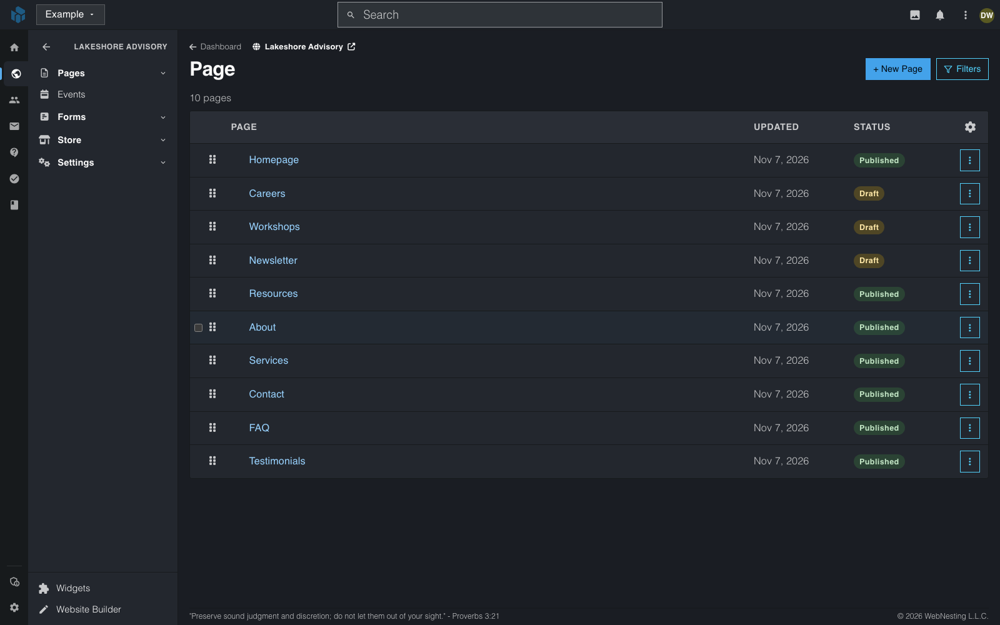
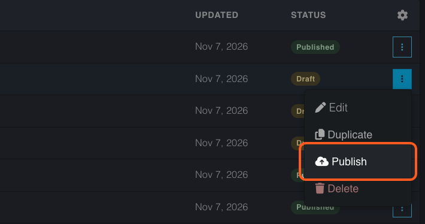
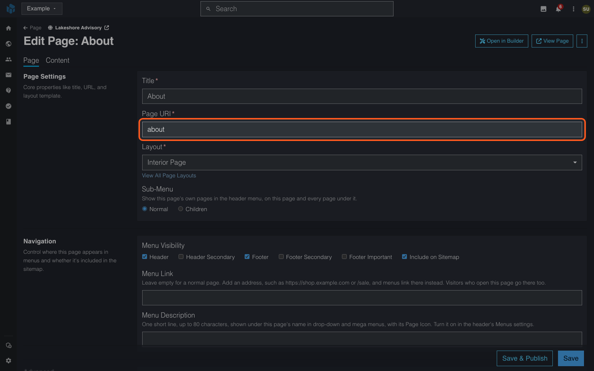
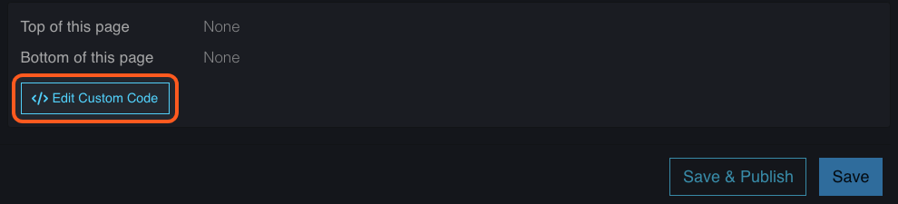
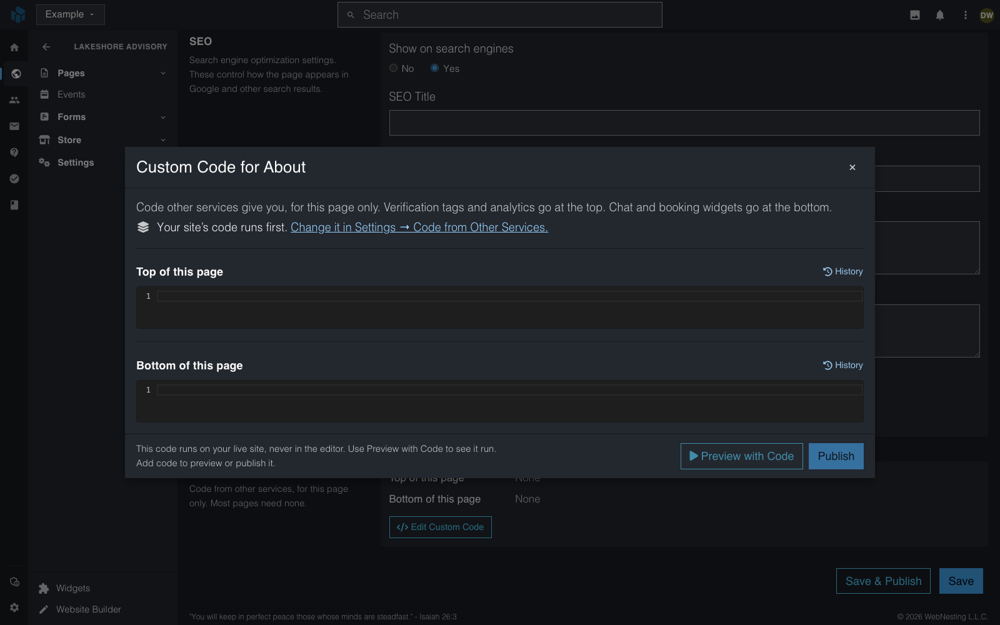
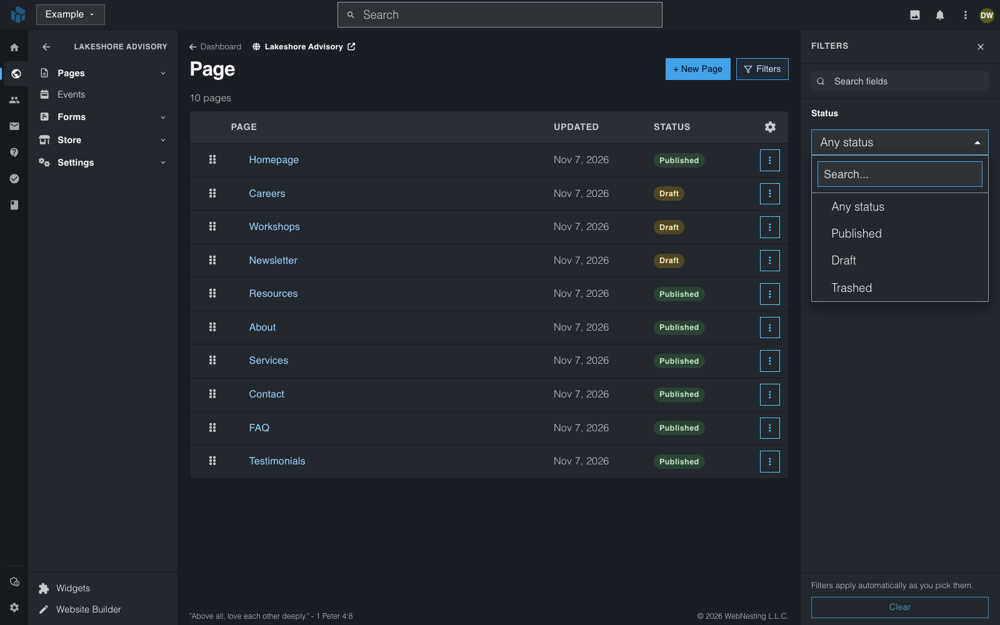

# Managing pages

**Last verified:** 2026-11-22 9:40pm

Pages are the foundation of your website. Each page on your site has its own web address (URL) and contains the content your visitors see. This guide walks you through everything you need to know about creating, organizing, and managing your pages in WebNesting.

---

## Viewing All Your Pages

When you log in to your WebNesting dashboard, you can see all of your pages in one place.

1. Open your WebNesting dashboard and open your site.
2. In the site menu, open **Pages**, then select **Pages**.
3. You will see a list of all your pages with their titles and current status.

Each page in the list shows:

- **Page** -- The name of the page. Click it to open the page settings.
- **Updated** -- When the page was last changed.
- **Status** -- **Draft** or **Published**.

Each row also has a ⋮ menu with **Edit**, **Duplicate**, **Publish** or **Unpublish**, and **Delete**. The gear at the end of the header row lets you choose which columns show. When your site has more than one language, a **Language** switch appears above the page title. See [Publishing Your Site in More Than One Language](#publishing-your-site-in-more-than-one-language).

> **Tip:** If you have many pages, use the **Search** bar at the very top of the dashboard to find the one you need.

---

## Creating a New Page

Adding a new page to your site takes just a few steps.

1. In the site menu, open **Pages**, then select **Pages**.
2. Click **+ New Page**.
3. Enter a **Title**. This is the name visitors will see at the top of the page and in their browser tab.
4. Set the **Page URI**. This is the part of the web address that comes after your domain name. For example, if your domain is `yoursite.com` and the **Page URI** is `about`, the page address will be `yoursite.com/about`. It fills in from the title, and you can change it.
5. Choose a **Layout**. Layouts control the overall structure of your page, such as whether it has a sidebar, a full-width design, or a specific header and footer style.
6. Click **Create**.

Your new page is now ready. It will start as a draft, so it will not be visible to the public until you publish it.

Every page needs its own **Page URI**. If you enter one that another page already uses, you'll see a message under the field and can pick a different one.

> **Tip:** Keep your **Page URI** short and descriptive. Use lowercase letters and hyphens instead of spaces. For example, `our-team` is better than `Our Team Page 2024`. Avoid special characters, spaces, or very long addresses.

---

## Editing a Page

You can update any page's basic information at any time.

1. In the site menu, open **Pages**, then select **Pages**.
2. Find the page you want to edit in the list.
3. Click on the page name, or open the ⋮ menu on its row and choose **Edit**.
4. Update the title, **Page URI**, layout, menu settings, search settings, or any other settings.
5. Click **Save** to keep your changes as a draft, or **Save & Publish** to put them on your live site.

The settings are in groups: **Page Settings**, **Navigation**, **Advanced** and **SEO**. Under **Navigation**, **Menu Description** is one short line, up to 80 characters, that shows under the page's name in drop-down and mega menus. Under **Advanced**, **Page Icon** is the small picture shown with it. **Lock Page** set to **Site Admin** shows the page only to people who can edit your site.

To edit the actual content of the page (text, images, sections), you will use the Website Builder. Click **Open in Builder** at the top of the page settings, or see the "Opening a Page in the Website Builder" section below. The **Content** tab next to the **Page** tab holds the builder inside the page settings, so you can change the content without leaving.

### Custom Code for One Page

A page can hold code that should run on that page only, such as a booking widget on your Contact page. Most pages need none. The page's settings show a **Custom Code** group, after **SEO**, when you have the **Custom Code** permission. It has one line for **Top of this page** and one for **Bottom of this page**: what the code there does, or **None**. An article, or another item that has its own page such as a Knowledge Base article, has the same group on its **Page** tab. The code runs on that item's own page. Save a new item first, because its page does not exist before that.

1. In the site menu, open **Pages**, then select **Pages**.
2. Click the page name to open it.
3. Scroll to the **Custom Code** group, after **SEO**.
4. Click **Edit Custom Code**. The code opens in a window.

5. Paste the code into **Top of this page** or **Bottom of this page**. Verification tags and analytics go at the top. Chat and booking widgets go at the bottom.
6. Optional: click **Preview with Code** to see the page run the code in a safe preview.
7. Click **Publish**.

The code has no draft: **Publish** puts it on your live site at once. The window stays open and each place shows when it was published. The group's lines change to the new code. Publishing the code doesn't publish the page, and the page's **Save & Publish** doesn't publish the code.

If you close the window before you publish, it asks first. **Discard** puts the code back to what is live; **Keep Editing** goes back to the window.

Under each place, a line says in plain words what the code does, such as which outside sites it loads from. Each place also shows its size and when it was last published.

Without permission to change the code, the button reads **View Custom Code**: you can see the code and preview it, but not change it.

Your site's code runs first, then the page's own code. To change your site's code, use the link at the top of the window. Verification tags prove the whole site is yours, so they belong in your site's code, not on one page. See [Code from Other Services](site-settings.md#code-from-other-services).

Each place has a **History** link. It shows the place's earlier versions in the window, with **Back to the Code** to return. **Load into Editor** puts a version's code back in the editor without publishing it, so you can preview it first. Click **Publish** to put it live.

---

## Draft vs. Published Pages

Every page has a status that controls whether your visitors can see it.

- **Draft** -- The page is only visible to you in the dashboard. Visitors to your website cannot see it. Use drafts when you are still working on a page and it is not ready yet.
- **Published** -- The page is live on your website and anyone can visit it.

### How to Change a Page's Status

To publish a draft:

1. In the site menu, open **Pages**, then select **Pages**.
2. Open the ⋮ menu on the page's row and choose **Publish**. Or open the page and click **Save & Publish**.

To take a published page offline:

1. Open the page.
2. Open the ⋮ menu at the top right and choose **Unpublish**. You can also choose **Unpublish** from the ⋮ menu on the page's row in the list.

> **Keep a page off your site until launch:** unpublish it. The page keeps its draft, shows "page not found" to visitors, and stays out of your menus and sitemap. Publish it when you are ready, and it stays published.

> **Tip:** If you need to make big changes to a live page, consider switching it to draft first. Make your updates, then publish it again when everything looks right.

---

## Organizing Pages with Parent and Child Hierarchy

As your website grows, you may want to group related pages together. WebNesting lets you create a parent-child structure, which means you can nest pages under other pages. You set this up in the Website Builder's **Pages** panel.

For example, you might have a top-level page called "Services" with child pages for each service you offer:

- Services
  - Web Design
  - SEO
  - Consulting

Child pages appear beneath their parent page in your site's navigation and in the page list.

### How to Add a Child Page

1. Open the **Website Builder** and click **Pages** in the icon rail on the right.
2. Point at the parent page's row and click **New sub-page under** that page (the arrow at the end of the row).
3. Fill in the form and create the page.

The new page appears indented under its parent. See [Managing pages in the builder](../website-builder/page-management.md#creating-a-child-page-sub-page) for the full steps.

The child page's URL will update to reflect the hierarchy. For example, the "Web Design" page might have the address `yoursite.com/services/web-design`.

### Giving a Section Its Own Header Menu

A group of pages can act like a small site inside your site, with its own header menu. Use the **Sub-Menu** setting for this.

1. In the site menu, open **Pages**, then select **Pages**.
2. Open the parent page of the group.
3. Under **Page Settings**, set **Sub-Menu** to **Children**.
4. Click **Save & Publish**.

On that page, and on every page under it, your menus now show only that page's own pages. This covers the header menu, the second header menu, the footer menu and the second footer menu. Pages under it keep their dropdowns. Every other page on your site keeps your normal menus. Your legal links (such as Privacy and Terms) stay the same everywhere.

For example, say you have an "Events" page with "Schedule" and "Tickets" under it. Set "Events" to **Children**. A visitor on "Events", "Schedule" or "Tickets" then sees a header menu and a footer menu with "Schedule" and "Tickets". A visitor on your home page still sees your normal menu, such as "About", "Events" and "Contact".

A few things to know:

- Each menu shows the pages under it that have that menu checked in **Menu Visibility**: **Header**, **Header Secondary**, **Footer** or **Footer Secondary**. If none do for a menu, that menu keeps your normal list.
- A group inside a group works too. The nearest page set to **Children** decides the menu.
- Your site logo still links to your home page. To give visitors a way back to the group's first page, add a link to it in the group's own header.
- Your legal links and the sitemap don't change.

---

## Making a Page a Menu Link

A page can link your menus to another address, such as your shop or a booking page. Open the page and type the address in **Menu Link**, under **Navigation**. Menus then link straight there, and a visitor who opens the page goes there too. For the steps, see [Site navigation](../website-builder/site-navigation.md#linking-a-menu-item-to-another-address).

---

## Reordering Pages

You can control the order in which your pages appear in navigation menus and the page list.

1. In the site menu, open **Pages**, then select **Pages**.
2. Drag the grip (the dotted handle at the start of a row) to move a page to a new place in the list.
3. Your new order is saved automatically.

> **Tip:** The order you set here is often used in your site's navigation menu. Check your live site after reordering to make sure everything looks right.

---

## Searching and Filtering Pages

When you have many pages, searching and filtering makes it easy to find exactly what you need.

### Searching

Type a word from the page title into the **Search** bar at the very top of the dashboard.

### Filtering

1. In the **Pages** list, click **Filters** at the top right.
2. Next to **Status**, choose **Published**, **Draft** or **Trashed**.
3. The list updates as you pick. Click **Clear** to see every page again.

The **View** choice under **Status** narrows the list to the pages in one menu, such as **Header menu** or **Footer menu**.

---

## Duplicating a Page

Duplicate a page when you want a new page that starts from one you already have.

1. In the site menu, open **Pages**, then select **Pages**.
2. Open the ⋮ menu on the page's row and choose **Duplicate**.
3. Check the address shown, then choose **Duplicate**.

The copy has the same sections, look, search settings and custom code as the page when you last saved it. It has the title "(copy)" added and the address ends in **-copy**. It is a draft, so visitors do not see it until you publish it. Change the title and address in the page settings.

> **Tip:** The copy starts from the last saved version of the page. Save the page in the Website Builder first if you just changed it.

---

## Publishing Your Site in More Than One Language

A page is one page in every language. It has one layout, and each language has its own text. You turn on more languages with the **Language** module and add them in **Languages** in the site menu. See [Site settings](site-settings.md#languages).

### Choose the language you work in

When your site has more than one language, a **Language** switch sits above the page title in the **Pages** list. Pick a language to see your pages in that language.

> **Tip:** Examples in this guide use German as the main language, with English and French added. Your languages can be any you choose.

In a language that is not your main language, each page can show a badge:

- **No French version yet** means nobody has written this page in French.
- **Out of date: the German changed** means the German text changed after the French version was saved.

The **Filters** panel has a **Translation** group. Choose **Missing in French** or **Out of date** to list only those pages.

### Write a page in another language

1. Pick the language in the **Language** switch.
2. Open the page.
3. Type your text in the page settings.
4. Save the page.

Each empty box shows the main language text in grey. The grey text is a hint. It is not saved. The page keeps showing the main language text in that language until you type your own.

The first save makes the language version. If you typed no text, the save makes nothing. The page then has an address in that language, for example **/fr/about**. The save line says **Saving in French**.

### Move between languages in the builder

The language menu in the builder top bar has the heading **This page in**. Each row shows the language and its state: **Main language**, **No version yet**, **Up to date** or, for example, **2 out of date**. Pick a row to open that version.

In another language, the layout is locked. A note says **Layout changes are made in German and show in every language.** You cannot add, remove or move components there.

The settings panel shows that language's text. A box that has no text yet shows **Shown from German**. A setting that is the same in every language, such as a size, is read only and says **Same in every language**. Each row of a list shows its own text.

In another language you can also:

- Choose **Hide in French** to hide a component in that language only.
- Choose **Use a different image in French**, and choose **Use the German image** to go back.
- Choose **Use a different link in French** to point a link elsewhere.
- Fill in **Image text in French** for the image description.

To change the layout, switch to your main language.

### Publish all languages

A publish sends every language of the page live. The publish warning says **This publishes all languages.** A language that has no version yet shows the main language text.

### Write a page in another language with your own AI assistant

You can connect your own AI assistant to WebNesting and ask it to write a page in another language. See [Connecting an AI tool](connecting-ai-tools.md).

1. Add the language in **Languages** in the site menu.
2. Ask your assistant to write the page in that language.
3. The assistant saves the text in the same page, in that language. It makes no copy.
4. Open the page in that language. Check the text.
5. Publish when you are happy with it.

### When the main language text changes

When you change the main language text of a page, its other versions show, for example, **Out of date: the German changed**. Check each version and save it again. The badge then goes away. Your AI assistant can also mark a version as up to date when you ask it to.

> **Tip:** A language version has no page of its own to publish. It goes live with the page.

---

## Deleting a Page

If you no longer need a page, you can delete it.

1. In the site menu, open **Pages**, then select **Pages**.
2. Find the page you want to delete.
3. Open the ⋮ menu on its row and choose **Delete**. You can also choose **Delete** from the ⋮ menu at the top right of the page settings.
4. Confirm that you want to delete the page.

The page will be removed from your page list and will no longer be visible on your site.

When your site has more than one language, the confirmation has two choices, for example **French version** and **All versions**. **French version** removes only the French text. The page then shows the main language text in that language. **All versions** deletes the page. In your main language, only **All versions** is offered.

### Pages That Cannot Be Deleted or Moved

Some pages are essential to your site working properly -- your homepage, your "page not found" page, and other built-in pages. These are protected: you will not be able to delete or unpublish them, so they cannot be removed by accident.

Your **Page Not Found** page shows when someone opens an address that does not exist. It starts with your header and footer, a short message and a button to your home page. You can edit it in the builder like any other page.

A part of your site with its own header and footer can have its own Page Not Found page. Add a page under that part's top page, and make its address the top page's address plus `-404`. For example, a page at `personal` gets its own with a child page at `personal-404`. Visitors who open a missing address in that part of your site then see this page, with that part's header and footer. Set **Show on search engines** to **No** on it.

Their web address is fixed as well. When you open one of these pages, the **Page URI** field shows its current value with a note that it can't be changed, and you can't nest the page under another page (which would change its address). Everything else about the page -- its title, layout, content, and search settings -- can still be edited as usual.

### Restoring a Deleted Page

Accidentally deleted a page? You may be able to bring it back.

1. In the **Pages** list, click **Filters** and set **Status** to **Trashed**. The page title changes to **Page — Trash**.
2. Find the page you want to restore.
3. Open the ⋮ menu on its row and choose **Restore**.
4. The page returns to your page list.

To remove a page from the Trash for good, choose **Permanently Delete** in the same menu instead. This cannot be undone.

> **Tip:** Deleted pages are kept, not purged on a timer, so you can restore one long after you removed it. If you are unsure about deleting a page, consider switching it to draft status instead -- that hides it from visitors while keeping it in your normal page list.

---

## Opening a Page in the Website Builder

The Website Builder is where you design and edit the actual content of your pages -- adding text, images, buttons, sections, and more.

1. In the site menu on the left, click **Website Builder** (at the bottom of the panel).
2. Once the builder opens, click **Pages** in the icon rail on the right.
3. Click the page you want to design.
4. The page loads on the canvas, ready to edit.

From the builder, you can visually add and arrange content. When you are finished, save your work.

> **Tip:** You never need to come back here to switch pages -- the builder's Pages panel lets you jump between pages, and create new ones, without leaving it.
