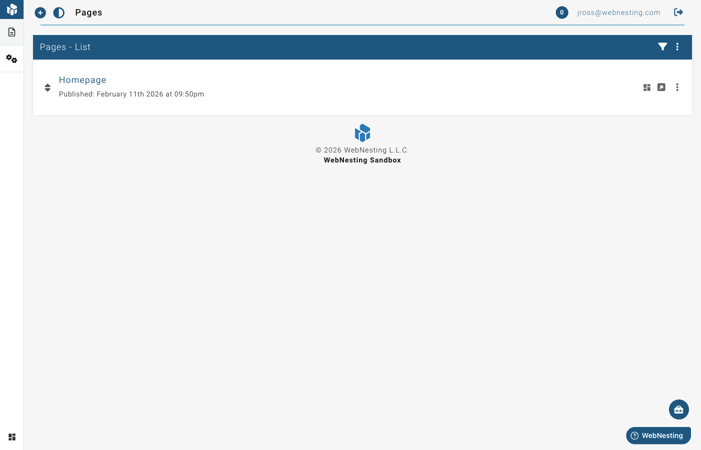

# Managing Pages

**Last verified:** 2026-10-27 11:40am

Pages are the foundation of your website. Each page on your site has its own web address (URL) and contains the content your visitors see. This guide walks you through everything you need to know about creating, organizing, and managing your pages in WebNesting.

---

## Viewing All Your Pages

When you log in to your WebNesting dashboard, you can see all of your pages in one place.

1. Open your WebNesting dashboard and open your site.
2. In the site menu, open **Pages**, then select **Pages**.
3. You will see a list of all your pages with their titles and current status.

Each page in the list shows:

- **Page** -- The name of the page. Click it to open the page settings.
- **Updated** -- When the page was last changed.
- **Status** -- **Draft** or **Published**.

Each row also has a ⋮ menu with **Edit**, **Publish** or **Unpublish**, and **Delete**.

> **Tip:** If you have many pages, use the **Search** bar at the very top of the dashboard to find the one you need.

---

## Creating a New Page

Adding a new page to your site takes just a few steps.

1. In the site menu, open **Pages**, then select **Pages**.
2. Click **+ New Page**.
3. Enter a **Title**. This is the name visitors will see at the top of the page and in their browser tab.
4. Set the **Page URI**. This is the part of the web address that comes after your domain name. For example, if your domain is `yoursite.com` and the **Page URI** is `about`, the page address will be `yoursite.com/about`. It fills in from the title, and you can change it.
5. Choose a **Layout**. Layouts control the overall structure of your page, such as whether it has a sidebar, a full-width design, or a specific header and footer style.
6. Click **Create**.

Your new page is now ready. It will start as a draft, so it will not be visible to the public until you publish it.

Every page needs its own **Page URI**. If you enter one that another page already uses, you'll see a message under the field and can pick a different one.

> **Tip:** Keep your **Page URI** short and descriptive. Use lowercase letters and hyphens instead of spaces. For example, `our-team` is better than `Our Team Page 2024`. Avoid special characters, spaces, or very long addresses.

---

## Editing a Page

You can update any page's basic information at any time.

1. In the site menu, open **Pages**, then select **Pages**.
2. Find the page you want to edit in the list.
3. Click on the page name, or open the ⋮ menu on its row and choose **Edit**.
4. Update the title, **Page URI**, layout, menu settings, search settings, or any other settings.
5. Click **Save** to keep your changes as a draft, or **Save & Publish** to put them on your live site.

To edit the actual content of the page (text, images, sections), you will use the Website Builder. Click **Open in Builder** at the top of the page settings, or see the "Opening a Page in the Website Builder" section below.

### Custom Code for One Page

A page can hold code that should run on that page only, such as a booking widget on your Contact page. Most pages need none. The page's settings show a **Custom Code** group, after **SEO**, when you have the **Custom Code** permission. It has one line for **Top of this page** and one for **Bottom of this page**: what the code there does, or **None**. An article, or another item that has its own page such as a Knowledge Base article, has the same group on its **Page** tab. The code runs on that item's own page. Save a new item first, because its page does not exist before that.

1. In the site menu, open **Pages**, then select **Pages**.
2. Click the page name to open it.
3. Scroll to the **Custom Code** group, after **SEO**.
4. Click **Edit Custom Code**. The code opens in a window.
5. Paste the code into **Top of this page** or **Bottom of this page**. Verification tags and analytics go at the top. Chat and booking widgets go at the bottom.
6. Optional: click **Preview with Code** to see the page run the code in a safe preview.
7. Click **Publish**.

The code has no draft: **Publish** puts it on your live site at once. The window stays open and each place shows when it was published. The group's lines change to the new code. Publishing the code doesn't publish the page, and the page's **Save & Publish** doesn't publish the code.

If you close the window before you publish, it asks first. **Discard** puts the code back to what is live; **Keep Editing** goes back to the window.

Under each place, a line says in plain words what the code does, such as which outside sites it loads from. Each place also shows its size and when it was last published.

Without permission to change the code, the button reads **View Custom Code**: you can see the code and preview it, but not change it.

Your site's code runs first, then the page's own code. To change your site's code, use the link at the top of the window. Verification tags prove the whole site is yours, so they belong in your site's code, not on one page. See [Code from Other Services](site-settings.md#code-from-other-services).

Each place has a **History** link. It shows the place's earlier versions in the window, with **Back to the Code** to return. **Load into Editor** puts a version's code back in the editor without publishing it, so you can preview it first. Click **Publish** to put it live.

---

## Draft vs. Published Pages

Every page has a status that controls whether your visitors can see it.

- **Draft** -- The page is only visible to you in the dashboard. Visitors to your website cannot see it. Use drafts when you are still working on a page and it is not ready yet.
- **Published** -- The page is live on your website and anyone can visit it.

### How to Change a Page's Status

To publish a draft:

1. In the site menu, open **Pages**, then select **Pages**.
2. Open the ⋮ menu on the page's row and choose **Publish**. Or open the page and click **Save & Publish**.

To take a published page offline:

1. Open the page.
2. Open the ⋮ menu at the top right and choose **Unpublish**. You can also choose **Unpublish** from the ⋮ menu on the page's row in the list.

> **Tip:** If you need to make big changes to a live page, consider switching it to draft first. Make your updates, then publish it again when everything looks right.

---

## Organizing Pages with Parent and Child Hierarchy

As your website grows, you may want to group related pages together. WebNesting lets you create a parent-child structure, which means you can nest pages under other pages. You set this up in the Website Builder's **Pages** panel.

For example, you might have a top-level page called "Services" with child pages for each service you offer:

- Services
  - Web Design
  - SEO
  - Consulting

Child pages appear beneath their parent page in your site's navigation and in the page list.

### How to Add a Child Page

1. Open the **Website Builder** and click **Pages** in the icon rail on the right.
2. Point at the parent page's row and click **New sub-page under** that page (the arrow at the end of the row).
3. Fill in the form and create the page.

The new page appears indented under its parent. See [Managing Pages in the Builder](../website-builder/page-management.md#creating-a-child-page-sub-page) for the full steps.

The child page's URL will update to reflect the hierarchy. For example, the "Web Design" page might have the address `yoursite.com/services/web-design`.

### Giving a Section Its Own Header Menu

A group of pages can act like a small site inside your site, with its own header menu. Use the **Sub-Menu** setting for this.

1. In the site menu, open **Pages**, then select **Pages**.
2. Open the parent page of the group.
3. Under **Page Settings**, set **Sub-Menu** to **Children**.
4. Click **Save & Publish**.

On that page, and on every page under it, the header menu now shows only that page's own pages. Pages under it keep their dropdowns. Every other page on your site keeps your normal header menu.

For example, say you have an "Events" page with "Schedule" and "Tickets" under it. Set "Events" to **Children**. A visitor on "Events", "Schedule" or "Tickets" then sees a header menu with "Schedule" and "Tickets". A visitor on your home page still sees your normal menu, such as "About", "Events" and "Contact".

A few things to know:

- Only the pages under it that have **Header** checked in **Menu Visibility** show. If none do, the page keeps your normal header menu.
- A group inside a group works too. The nearest page set to **Children** decides the menu.
- Your site logo still links to your home page. To give visitors a way back to the group's first page, add a link to it in the group's own header.
- The footer menus and the sitemap don't change.

---

## Reordering Pages

You can control the order in which your pages appear in navigation menus and the page list.

1. In the site menu, open **Pages**, then select **Pages**.
2. Drag the grip (the dotted handle at the start of a row) to move a page to a new place in the list.
3. Your new order is saved automatically.

> **Tip:** The order you set here is often used in your site's navigation menu. Check your live site after reordering to make sure everything looks right.

---

## Searching and Filtering Pages

When you have many pages, searching and filtering makes it easy to find exactly what you need.

### Searching

Type a word from the page title into the **Search** bar at the very top of the dashboard.

### Filtering

1. In the **Pages** list, click **Filters** at the top right.
2. Next to **Status**, choose **Published**, **Draft** or **Trashed**.
3. The list updates as you pick. Click **Clear** to see every page again.

---

## Deleting a Page

If you no longer need a page, you can delete it.

1. In the site menu, open **Pages**, then select **Pages**.
2. Find the page you want to delete.
3. Open the ⋮ menu on its row and choose **Delete**. You can also choose **Delete** from the ⋮ menu at the top right of the page settings.
4. Confirm that you want to delete the page.

The page will be removed from your page list and will no longer be visible on your site.

### Pages That Cannot Be Deleted or Moved

Some pages are essential to your site working properly -- your homepage, your "page not found" page, and other built-in pages. These are protected: you will not be able to delete or unpublish them, so they cannot be removed by accident.

Their web address is fixed as well. When you open one of these pages, the **Page URI** field shows its current value with a note that it can't be changed, and you can't nest the page under another page (which would change its address). Everything else about the page -- its title, layout, content, and search settings -- can still be edited as usual.

### Restoring a Deleted Page

Accidentally deleted a page? You may be able to bring it back.

1. In the **Pages** list, click **Filters** and set **Status** to **Trashed**. The page title changes to **Page — Trash**.
2. Find the page you want to restore.
3. Open the ⋮ menu on its row and choose **Restore**.
4. The page returns to your page list.

To remove a page from the Trash for good, choose **Permanently Delete** in the same menu instead. This cannot be undone.

> **Tip:** Deleted pages are kept, not purged on a timer, so you can restore one long after you removed it. If you are unsure about deleting a page, consider switching it to draft status instead -- that hides it from visitors while keeping it in your normal page list.

---

## Opening a Page in the Website Builder

The Website Builder is where you design and edit the actual content of your pages -- adding text, images, buttons, sections, and more.

1. In the site menu on the left, click **Website Builder** (at the bottom of the panel, below **Widgets**).
2. Once the builder opens, click **Pages** in the icon rail on the right.
3. Click the page you want to design.
4. The page loads on the canvas, ready to edit.

From the builder, you can visually add and arrange content. When you are finished, save your work.

> **Tip:** You never need to come back here to switch pages -- the builder's Pages panel lets you jump between pages, and create new ones, without leaving it.
