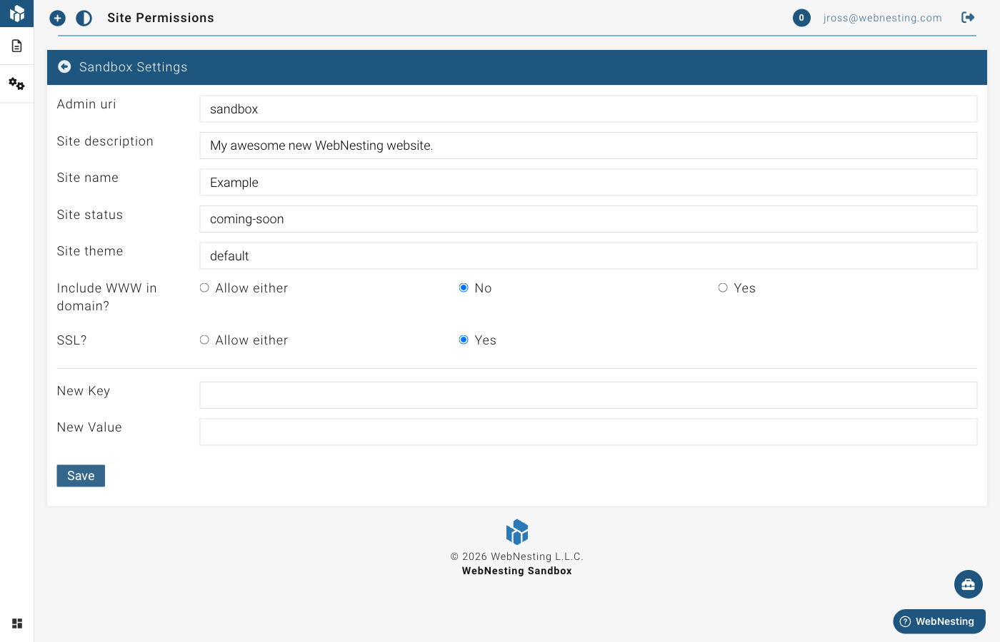

# Site Settings

**Last verified:** 2026-10-27 3:20pm

Site Settings is where you control the behind-the-scenes details of your website -- things like your logo, search engine preferences, analytics, and social media links. Most of these are "set it and forget it" options that you configure once when you build your site.

---

## Where to Find Site Settings

1. Open your WebNesting dashboard.
2. In the site menu, open **Settings** and click **Site Settings**.
3. You will see several sections organized by category. Click on any section to expand it and make changes.



---

## Site Timezone

Your site's timezone decides which days this site counts in -- the days its analytics, form reports and published dates use -- and it is the clock your pages show dates and times in, like a post's publish date. To change it, open **Site Settings**, click **Site Configuration**, and scroll to the **Timezone** section.

- **Use workspace timezone** (the default for every new site) -- the site follows your workspace's timezone, and changes with it.
- **A specific timezone** -- pick one when this site serves customers somewhere else, for example a client's site in another country.

Click **Save Changes** to apply it. Team members who haven't set a timezone on their own profile also see this site's times in it.

---

## Languages

Your site can be written in one language or in several. Open **Site Settings** and click **Languages** under **Your site**.

- **Site language** -- the language your pages are written in. Browsers, screen readers and search engines read your pages in it. Search for a language by its name in English or in the language itself.
- **More languages** -- click **+ Add a Language** to publish your pages in another one. The language list then shows each language with its address.

Each language you add gets its own address. Your main language stays at the root (`/about`), and a second language sits under its code (`/fr/about` for French). Your existing addresses never change.

**What visitors see in a language**

- A page you have translated shows its translation at the language address.
- A page you have not translated yet shows your main language's page at the language address, so a visitor never lands on "page not found". The header, menus and footer are in the visitor's language. Search engines are told that the original page is the one to list.
- Your menus, breadcrumbs and lists of articles show each page in the visitor's language where a translation exists. Where it does not, they show the original page.
- When you are signed in and open a page that has no translation yet, a small bar at the top says so: "This page has no French version yet". Visitors never see it.

**Things to know**

- You can change the site language only while your site has one language. To change it later, remove the other languages first.
- Removing a language keeps its pages. They stop showing, and their addresses show "page not found", until you add the language back.
- Your site does not switch language by itself from the visitor's browser. Visitors choose their language, or search engines send them to it.

**Multiple languages in your settings**

With more than one language, a row of language names sits under these settings. Click a language to write its words:

- **Header & Footer:** the announcement bar's message and link words, and the header and footer each language shows.
- **Site Messages:** the maintenance message and the header and footer messages.
- **SEO Settings:** the title and description search engines show.

A language you leave empty shows your main language's words. A hollow circle next to a language name means it has no words of its own yet. Empty link words show "Learn more" in the visitor's language. Removing a language keeps what you wrote for it.

---

## SEO Settings

SEO stands for Search Engine Optimization. These settings help search engines like Google understand your site and display it correctly in search results.

All of these live on the **SEO Defaults** page: go to **Site Settings** and click **SEO Defaults**.

### Title

This is the name that appears in browser tabs and in search engine results for pages that do not have their own custom title.

1. On the **SEO Defaults** page, find the **Title** field.
2. Enter a clear, descriptive title for your website. For example: "Smith & Co. Accounting -- Tax Services in Portland."
3. Save your changes.

You can insert your site's name or the current page's title automatically by typing `{{ site.name }}` or `{{ page.title }}`. For example, `{{ site.name }} | {{ page.title }}` shows as "Smith & Co. Accounting | About Us" on your About Us page.

> **Tip:** Keep your title under 60 characters so it does not get cut off in search results.

### Description

This is the short summary that appears below your site's title in search engine results. It helps visitors decide whether to click through to your site.

1. On the **SEO Defaults** page, find the **Description** field.
2. Write a brief, compelling description of your website (one to two sentences). The same `{{ site.name }}` and `{{ page.title }}` shortcuts work here.
3. Save your changes.

> **Tip:** Write a description between 120 and 160 characters. Include your most important keywords naturally -- do not stuff keywords in unnaturally.

### Previewing How You Appear in Search

Under the Title, Description and Image fields, **How it looks in search results** shows your site the way it appears in a search engine's results -- the web address, the title as a blue link, and the description underneath. It updates as you type, with `{{ site.name }}` and `{{ page.title }}` already filled in with their real values.

- Use **Preview for** to see a different page. The title changes with each page's name wherever you used `{{ page.title }}`.
- If a page has its own SEO title or description, the preview shows that instead, and says so -- the defaults only apply to pages without their own.
- Titles longer than 60 characters and descriptions longer than 155 are cut off with "…", as search results usually do.

Search engines sometimes shorten or rewrite what they show, so treat the preview as a close guide rather than an exact promise.

### Image (social sharing image)

When someone shares a link to your site on social media (Facebook, LinkedIn, X, etc.), this image appears alongside the link for any page that has no image of its own. It is sometimes called an OG image (Open Graph image).

1. On the **SEO Defaults** page, find the **Image** setting.
2. Click to choose an image from your File Manager, or upload a new one.
3. Save your changes.

> **Tip:** Use an image that is at least 1200 x 630 pixels for the best results across all platforms.

### Hiding Your Site from Search Engines

If your site is not ready for the public yet (for example, if you are still building it), you can tell search engines not to list any of its pages.

1. On the **SEO Defaults** page, find **Hide site from search engines**.
2. Click the **Hide my whole site** card. Because this affects every page, WebNesting asks you to confirm before it takes effect.
3. Save your changes.

While it is on, the setting shows a warning reminding you that the site is hidden, and your site tells search engines not to index it in two ways: its `robots.txt` file blocks everything, and every page carries a "noindex" instruction. Visitors can still open the site by typing its address.

**Important:** Remember to switch this back to **List my site** when your site is ready to launch. If you leave it on, people will not be able to find your site through Google or other search engines.

> **Tip:** This is a request that search engines honor, not a lock. Most major search engines respect it, but it is not a guarantee, and pages already listed can take a while to drop out of results.

### Sitemap Address Preferences

A sitemap is a file that lists all the pages on your site (at `yoursite.com/sitemap.xml`). Search engines use it to find and index your content more efficiently. WebNesting generates it for you automatically and keeps it up to date whenever you add, change, or remove pages.

Two on/off switches control how the addresses inside it are written:

- **Use secure (https) links in your sitemap** -- leave this on if your site uses a secure `https://` address (almost all do).
- **Start sitemap links with "www."** -- turn this on only if your site's address includes `www.`

Pick the form that matches how visitors actually reach your site so search engines see one consistent address for every page.

### Extra Code for Every Page's Head

Services such as Google Search Console, Pinterest and Bing give you a verification tag to prove the site is yours. It goes in **Extra code for every page's `<head>`**.

1. On the **SEO Defaults** page, under **Advanced**, find **Extra code for every page's `<head>`**.
2. Paste the tag the service gave you, such as `<meta name="google-site-verification" content="…">`.
3. Click **Save Changes**.

WebNesting adds this code to every page exactly as typed. It runs on your published pages only, never while you edit your site.

Only people with the **Custom Code** permission can change this field, because its code runs for every visitor. Site owners and Admins have it. Other people see the field read-only, with the line "Only people with the Custom Code permission can change this code. Ask your site owner." They can still change and save the other SEO settings. To give the permission, see [Team and Permissions](team-and-permissions.md#builder-access).

---

## Google Settings

**Google Settings** (under **Connections** on the Settings page) adds Google's tracking code to your site and holds the reCAPTCHA keys that protect your forms from spam. It has two sections: **Visitor tracking** and **Spam protection**.

### Google Analytics and Tag Manager (Visitor tracking)

- **Google Analytics ID** -- your GA4 measurement ID, from Google Analytics → **Admin** → **Data streams**. Type the part after `G-`; the box already shows the `G-`. WebNesting adds Google's tracking code to every page.
- **Google Tag Manager container** -- your container ID, shown next to the container's name in Tag Manager. Type the part after `GTM-`. Click **Check** to ask Google whether that container exists and is published -- an unpublished container does nothing on your site.

If you set a Tag Manager container, the Google Analytics ID is not used: add Google Analytics inside Tag Manager instead, so your visitors aren't counted twice.

To see Google Analytics numbers inside WebNesting, connect Google Analytics under **Workspace Settings → Integrations** (see [Integrations](integrations.md)). That is separate from the tracking code on this page.

> **Tip:** It can take 24 to 48 hours for data to start appearing in Google Analytics after you first add your ID.

### reCAPTCHA keys (Spam protection)

reCAPTCHA stops bots from submitting your forms. A form uses these keys when its spam protection is set to reCAPTCHA.

1. Go to [google.com/recaptcha/admin](https://www.google.com/recaptcha/admin) and register your site's domain.
2. Copy the **Site key** into **reCAPTCHA site key**, and the **Secret key** into **reCAPTCHA secret key**.
3. Save your changes.

The secret key is stored encrypted and never shown again after you save -- the box says **Saved** instead. Leave it empty to keep the saved key, or type a new one to replace it. If the box says the saved key can't be read, enter it again.

To test your keys, submit one of your forms that uses reCAPTCHA. Google only accepts reCAPTCHA on the domains you registered, so it can't be tested from the settings page.

### WebNesting's Built-In Analytics

WebNesting also has its own privacy-friendly visitor stats -- no Google account needed. Turn on **Enable first-party analytics** in **Site Configuration**, under **Analytics**. You can use it alongside Google Analytics; they work independently.

---

## Code from Other Services

**Code from Other Services** adds code that other services give you to your live site: a verification tag from Google Search Console, Pinterest or Bing, an analytics or ad pixel, or a chat or booking widget. To open it, go to **Site Settings**, find **Connections**, and click **Code from Other Services**.

The code never runs while you edit your site. It runs on your published pages only. To see it run before it goes live, use **Preview with Code**.

### Adding code from a service

The page has two places:

- **Top of every page** -- code that runs before the page shows. Verification tags, analytics and ad pixels go here. A service may call this "the `<head>`".
- **Bottom of every page** -- code that runs after the page's content. Chat and booking widgets go here. A service may call this "before `</body>`".

1. Open **Site Settings → Code from Other Services**.
2. Paste the code the service gave you into **Top of every page** or **Bottom of every page**.
3. Read the lines under the code. They say in plain words what the code loads and sends. Nothing runs while you paste.
4. Optional: click **Preview with Code** to see your Homepage run the code in a safe preview. Click **Close preview** to go back.
5. Click **Publish**.

The code has no draft: **Publish** puts it on your live site at once. Each place then shows when, and by whom, it was published. A place that you changed and did not publish yet says **Not published yet**. Each place can hold up to 256 KB of code.

To remove code, delete it from the box, then click **Publish**.

A verification tag at the bottom is refused when you publish, because services look for it at the top. Put it in **Top of every page**.

Code in **SEO Defaults → Extra code for every page's `<head>`** (see [above](#extra-code-for-every-pages-head)) runs first, before the code at the top of every page.

> **Tip:** Showing a form? Use the **Form** block in the **Site modules** group of the Web Builder instead. It needs no code. For a map, paste your map service's embed code into an **HTML** block in the Web Builder.

Using the keyboard? After **Publish**, focus moves to the line that says what is live. While **Publish** works, focus stays on it.

If you leave the page with code you did not publish, it asks first.

### Version history

Each place keeps its last 50 versions. Click **History** beside a place to see them in a side panel, newest first.

- A **Live** tag marks the version your live site runs.
- Click a version to see what it did, who did it and when, the lines it changed, and its code.
- **The code before history started** is the code a place held before its first recorded change. It has no author.
- After 50 versions, each new change deletes the oldest one kept.

To bring an earlier version back:

1. Click **History** beside the place.
2. Click the version.
3. Click **Load into Editor**, read the review, then click **Load into Editor** again.
4. The panel closes, and the code is in the editor. Nothing is saved yet.
5. Click **Preview with Code** to check it, then click **Publish**.

If you have typed changes in a place that you did not publish, publish them or undo them first. **Load into Editor** stays off until you do.

### Code for one page only

A page can have its own code too. Open the page in **Pages**, scroll to its **Custom Code** group after **SEO**, then click **Edit Custom Code**. Your site's code runs first, then the page's own code. See [Managing Pages](managing-pages.md#custom-code-for-one-page).

### Who can change this code

Only people with the **Custom Code** permission can add or change this code. Site owners and Admins have it. People who may only view it see the code and can preview it, but cannot change it. The page says: "Only people with the Custom Code permission can change this code. Ask your site owner." People without the permission do not see **Code from Other Services** in Site Settings. To give the permission, see [Team and Permissions](team-and-permissions.md#builder-access).

---

## Security Policy

Your live site has a security policy. It says which scripts may run on your pages. Scripts you add in **Code from Other Services**, and the scripts WebNesting adds, are allowed. The policy does not allow code inside an HTML attribute, such as `onclick`, code that builds more code from text, or a script added to a page some other way.

To open it, go to **Site Settings**, find **Advanced**, and click **Security Policy**. Most sites never need to change it.

### What the page says

The first line says what the policy would block, in plain words:

- "Nothing on your site would be blocked."
- "3 things on your site would be blocked if you turned on Enforce."
- With Enforce on: "Enforce is on. 2 things were blocked in the last 7 days."

Under it, **Now** shows the mode: **Report only** (nothing is blocked; visitors' browsers tell you what would be blocked) or **Enforce** (scripts the policy doesn't allow are blocked on your live site). At first the mode is **Report only**.

### Seeing the details

Click **See Details**. Each line says what would be blocked and on which page, such as "Code inside an onclick attribute on /contact", where it came from, and how often. The list shows the last 7 days and keeps the 200 most recent reports. Some reports are noise: a browser extension can cause one.

Click a line to see how to fix it. The technical names a developer needs are at the bottom, under **For a developer**.

**Fix code inside an attribute.** Move the code into a script, and give the element an `id`. For example, change this:

```html
<button type="button" onclick="location.hash = 'preorder-form'">Pre-order a loaf</button>
```

to this:

```html
<button type="button" id="preorder-button">Pre-order a loaf</button>
<script>
  document.getElementById('preorder-button').addEventListener('click', () => {
    location.hash = 'preorder-form';
  });
</script>
```

### Switching to Enforce

1. Click **See Details** and look at what would be blocked. **Switch to Enforce…** is offered after that.
2. Click **Switch to Enforce…**.
3. Read the list of scripts that will stop running, grouped by page.
4. Click **Switch to Enforce**.

After the switch, a report seen while Enforce is on shows **Blocked**.

**Go back.** Click **Switch Back to Report Only**. It takes one click and needs no confirm. Nothing is blocked after that.

Click **History** beside **Now** to see each switch: who made it and when.

Only people with the **Custom Code** permission can switch the mode. People who may only view it see the page, and the switch is off with the reason beside it. People without the permission do not see **Security Policy** in Site Settings.

---

## Social Media Profiles

Add your social media links so they can appear in your site's header, footer, or anywhere you use social media components.

### Adding Your Social Media Links

1. Go to **Site Settings** and open the **Connections** section, then click **Social Settings**.
2. You will see fields for each supported platform.
3. For each platform, enter your handle (like `@yourcompany`) or paste the link to your profile (like `https://www.instagram.com/yourcompany`). Either works.
4. Save your changes.

### Default Platforms

WebNesting includes fields for the following social media platforms by default:

- Facebook
- X (formerly Twitter)
- YouTube
- Instagram
- Pinterest

You can also add more platforms yourself — open **Add another network** at the bottom of the Social Settings page, and enter the network name and your handle or profile link, then click **Add** (or just **Save Changes** — it saves the new network along with your other changes). Each network name can only be used once. You only need to fill in the platforms you use. Leave the rest blank.

> **Tip:** A link works with or without the `https://` part, and a handle works with or without the `@`. Your site turns each one into a link to your profile.

---

## Site Images

These are the key images that represent your brand across your website. They live on the **Site Images** page, under **Content** in Site Settings. Each image on the page says where it appears, and the pictures are shown two to a row.

### Setting Your Logo

Your logo appears in your site's header and anywhere else your theme displays it.

On a phone, the header shows your logo picture by itself. If your site has no logo picture, the phone header shows your site's name instead.

1. Go to **Site Settings**, open **Content**, and click **Site Images**.
2. Find **Logo**.
3. Click to choose an image from your File Manager, or upload a new one.
4. Save your changes.

> **Tip:** Upload your logo as a PNG file with a transparent background. This ensures it looks good on any background color. SVG format also works well for logos.

### Setting Your Favicon

A favicon is the tiny icon that appears in browser tabs next to your page title. It also shows up in bookmark lists and on mobile home screens.

1. On the **Site Images** page, find **Favicon**.
2. Click to choose an image from your File Manager, or upload a new one.
3. Save your changes.

> **Tip:** Favicons should be square and simple. A good size is 512 x 512 pixels. Complex images will be hard to see at such a small size, so use a simple icon or the first letter of your brand name.

### Setting the Fallback Image

The **Fallback image** is used wherever something has no picture of its own -- an empty slideshow or gallery slot, for example.

1. On the **Site Images** page, find **Fallback image**.
2. Click to choose an image from your File Manager, or upload a new one.
3. Save your changes.

The image that appears when someone shares a link to your site on social media is a separate setting -- see **Image** under [SEO Settings](#seo-settings) above.

You can also add your own named images here with **Add** at the bottom of the page; your theme and content can then use them by name.

---

## Site Configuration

These settings control foundational aspects of how your website works -- its name, description, business name, visibility, and web address. They live on the **Site Configuration** page, under **Your site** in Site Settings.

### Launching Your Site (Visibility)

A new website starts in **Coming soon** mode: visitors see a "Coming Soon" page instead of your site, while you keep building. When you are ready for people to see it:

1. Go to **Site Settings**, open **Your site**, and click **Site Configuration**.
2. Under **Visibility**, click the **Live** card.
3. Save your changes.

To take the site back down later, choose **Coming soon** and save. Either way, you always see your real site while you are signed in -- open it in a private browser window to see what visitors see.

While your site is in **Coming soon** mode, only your home address shows the Coming Soon page as a normal page. Any other address shows the same Coming Soon page, marked as "page not found", so search engines do not list those addresses.

### Business Name

**Business name** appears in the copyright line at the bottom of every page ("Copyright © 2026 Your Business"). Leave it blank to use your Site Name instead.

### Choosing a Theme

Your theme has its own page now. The **Design** section of Site Configuration links to it: click **Change your theme in Appearance → Theme**. You can also open it from Site Settings: under **Appearance**, click **Theme**. There you can switch themes and make a theme's colors your own (see [Themes and Customization](themes-and-customization.md)). Under **Appearance**, **Color Mode** picks light or dark mode for your site and turns on a light / dark switch for your visitors (see [Light and Dark Mode](themes-and-customization.md#light-and-dark-mode)).

### Secure (HTTPS) Addresses

A secure address starts with `https://` instead of `http://`, and visitors see a lock icon in their browser.

1. Go to **Site Settings**, open **Your site**, and click **Site Configuration**.
2. Find **Always use a secure (https://) address?**
3. Click the **Always secure** card once your domain's certificate is active -- anyone who types `http://` is sent to `https://`. **Either works** leaves both forms reachable.
4. Save your changes.

> **Tip:** Once your certificate is active, always redirect to https. It protects your visitors, builds trust, and is favored by search engines.

### WWW Preferences

You can choose whether your site address starts with "www." or not.

- **With "www.":** `www.yoursite.com`
- **Without "www.":** `yoursite.com`
- **Either works:** both versions work as typed

Most modern sites use the non-www version. Choose whichever you prefer and stick with it, so search engines do not see them as two different sites.

1. On the **Site Configuration** page, find **Should your address start with "www."?**
2. Click one of the three cards.
3. Save your changes.

If you choose **With "www."** or **Without "www."**, WebNesting automatically redirects visitors who type the other form, so no one lands on the wrong one.

### Site Messages and HTML Blocks

**Site Messages** (under **Content**) holds your header and footer text and your maintenance message. **HTML Blocks** (under **Advanced**) holds named blocks of formatted text that your theme shows by name. Both keep your formatting: headings, bold and italic text, lists, tables, links, images and embedded videos or maps.

Code does not run there. If you paste a script, or a tag with code inside it, WebNesting removes the code when you save, and your visitors never run it. To add code from another service, such as a chat widget or a tracking tag, use **Code from Other Services**.

### All Settings (power-user view)

**All Settings**, under **Advanced**, lists every raw setting on your site in one place. Values there are saved exactly as typed, with no checks, except that code in site messages and HTML blocks is removed -- so if a setting has its own page (SEO Defaults, Site Images, Social, Google), edit it there instead. Use All Settings for the custom values you have added yourself -- the **Add your own setting** form at the bottom of the page is where you add them.

> **Tip:** After making changes to any settings, visit your live site in a new browser tab to confirm everything looks the way you expect.

---

## Custom Domain

By default, your website is available on a free WebNesting address. A custom domain is a web address you own, like `www.yourcompany.com`.

Site Settings has no screen to connect a domain yet. You can enter a domain in the **Custom Domain (optional)** box when you create a site, and **Site Configuration** decides how the address is written (see **Secure (HTTPS) Addresses** and **WWW Preferences** above). To connect or change a domain later, email Support. The steps, and what to expect at your domain registrar, are in [Connecting a Custom Domain](../getting-started/custom-domains.md).
