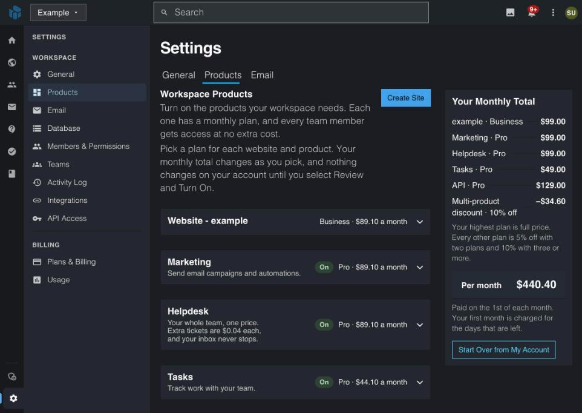
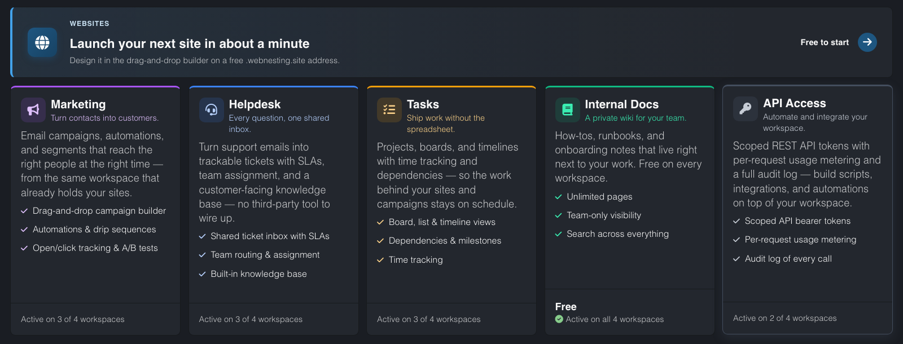

# Workspace products

**Last verified:** 2026-11-24 9:22am

WebNesting's workspace includes optional products you can enable to add powerful features to your team's workflow. Six products are available. Most are paid -- you only pay for the ones you use. Two are switched on by default: **Websites**, for building your sites, and **Internal Docs**, which is completely free.

---

## What Are Workspace Products?

Each product is a complete set of tools for one kind of work. Use any one on its own, or any mix. You don't need a website to use Marketing, Helpdesk or Tasks.

Every workspace includes your contact list, media and team collaboration. When you enable a product, its tools appear in your workspace sidebar right away.

---

## Available Products

### Websites

Build websites and put them on the web. **Websites is always on** and has no on/off switch. Each website you create is free to build and has no plan. You pick a paid Websites plan for each site when you use **Go Live** (Starter $15, Growth $25, Pro $49 or Business $99 a month; see [Usage and billing](../account/usage-and-billing.md#plans)). Each site has its own included bandwidth, set by its plan (see [Billing and usage](billing-and-usage.md#website-bandwidth)). Use **Create Site** at the top right of **Settings** > **Products** to create a website, your first one included. Once you have a website, the **Sites** section appears in your sidebar, where your websites live.

### Marketing

Email marketing with contacts, campaigns, and automations. When you enable Marketing, you get:

- **Email campaigns** -- Create, design, and send email campaigns to your contacts
- **Contact management** -- Organize your audience with lists and tags
- **Email templates** -- Build beautiful emails with a visual editor
- **Marketing automations** -- Set up automated emails triggered by form submissions, contact tags, and more
- **Campaign analytics** -- Track opens, clicks, and engagement for every campaign

### Helpdesk

Ticket management for customer support. When you enable Helpdesk, you get:

- **Ticket management** -- Create, assign, and track support tickets
- **Team inbox** -- A shared inbox for managing incoming support requests
- **Knowledge base** -- Write self-service articles so customers can find answers on their own
- **SLA policies** -- Set response time targets to keep your team on track
- **Canned responses** -- Save and reuse replies for common questions
- **Site connections** -- Connect your websites so a form on a site can send its submissions to your ticket list

### Tasks

Project and task management for your team. When you enable Tasks, you get:

- **Project organization** -- Group related work into projects
- **Multiple views** -- Switch between Board (Kanban), List, Timeline, and Calendar views
- **My Work** -- A personal hub showing all your assigned tasks across projects
- **Time tracking** -- Log time spent on tasks and Helpdesk tickets, by hand or with a start/stop timer
- **Milestones and tags** -- Mark key deadlines and organize tasks with tags
- **Task comments** -- Discuss work and see activity history on every task

### Internal Docs

A private wiki for your team -- how-tos, runbooks, and onboarding notes that only your workspace members can read. **Internal Docs is free and switched on by default**, so it's ready the moment you open your workspace. It has its own section in the sidebar, which lists your docs by category. A doc with no category is listed under **Uncategorized**. Click **Overview** at the top of its section for a dashboard of **Recently Updated Docs**, **Drafts**, **Stale Docs** (docs nobody has saved for 90 days or more; you can change that) and **Docs by Category**. You can turn it off any time to hide it, and turning it back on brings all your docs back exactly as they were -- nothing is ever deleted.

- **A shared team wiki** -- Write and organize documentation in a familiar folder tree
- **Always free** -- No plan to buy and no credits used
- **Optional GitHub sync** -- Keep your docs in a GitHub repository and edit them in either place

### API Access

Programmatic REST API access to your workspace for developers. When you enable API Access, you get:

- **API tokens** -- Create scoped access tokens so external software, scripts, and integrations can read and update your content
- **Usage controls** -- Your API plan sets your requests and data each month. The Pro plan has a higher rate limit, and the Growth and Pro plans keep your audit log for 365 days
- **API reference** -- The **API reference (OpenAPI)** button on the API Access page opens a description of every request a token can make, in the standard OpenAPI format that coding tools and AI assistants can read

> **Connecting an AI assistant (Claude, Cursor, or another MCP tool) is free and does not require API Access.** That is a separate, no-cost feature -- see [Connecting AI Tools](connecting-ai-tools.md).

---

## Enabling a Product

**Settings** > **Products** is where you pick a plan for each website and product. Nothing changes on your account until you select **Review and Turn On**.

1. Go to your workspace and select **Settings** at the bottom of the left icon rail.
2. Select **Products** (in the side menu, or the **Products** tab at the top of the page).
3. Each website and product shows as one row: its name on the left, and its plan and monthly price on the right.
4. Select the product's row to open it.
5. Pick a plan. **Your Monthly Total** changes as you pick.
6. Select **Review and Turn On**. A window shows what you pay now and what you pay each month.
7. Select **Subscribe With Obligation to Pay** to agree. The product appears in your workspace sidebar right away.

A closed row also shows a one-line description under the name and a status label such as **On**. A product is never on without a plan, so turning one on always starts with picking a plan. **Internal Docs** is free and has a **Turn on** button in its row.

If you cannot see **Billing**, **Products** shows each product without its plans. A product that costs money and has no plan yet has no **Turn on** for you: ask a member who can see **Billing** to pick its plan. Where **Turn on** shows and the product costs money, a window called **Check the price** opens. It shows what you pay now, what you pay each month and the day the plan renews. Select **Agree**, or **Cancel** to stop. If the price changes while the window is open, it shows the new price and asks you to check it again.

Once a product is enabled, new menu items will appear in your workspace sidebar. For example, enabling Marketing adds sections for contacts, campaigns, and email templates.

> **Tip:** Each product's row shows its plans and prices before you turn it on. Review them so there are no surprises.

### Add a product from your home page

The page that lists your workspaces, headed **Grow your workspace**, also shows every product available to your workspaces, each with its pricing and where it is already active (for example, **Active on 3 of 8 workspaces**). Select **Enable** on a product to turn it on. If you have more than one workspace, you can choose which workspaces to enable it on (one, several, or all) in a single step, and you will see the estimated added cost before you confirm. Then a **Check the price** window lists each workspace with what you pay now and each month, and you select **Subscribe With Obligation to Pay**. Workspaces where you already have the product, or where you do not have permission to manage products, are shown but cannot be changed from here. Once a product is active on every workspace, its card says so (for example, **Active on all 2 workspaces**), and clicking it shows where it is active with a **View products** link for each workspace.

---

## Understanding Product Pricing

Each product is a plan with a flat monthly price and an included amount that starts over on the 1st. Past the included amount, prepaid credits pay for the extra. Contacts, team members and API tokens are unlimited on every plan.

| Product | Starter | Growth | Pro |
|---|---|---|---|
| Marketing | $19: 6,000 emails | $59: 35,000 emails | $99: 65,000 emails |
| Helpdesk | $15: 200 tickets | $49: 1,750 tickets | $99: 4,000 tickets |
| Tasks | $10: 5,000 open tasks | $19: 40,000 open tasks | $49: 150,000 open tasks |
| API | $19: 25,000 requests, 3 GB data | $49: 110,000 requests, 11 GB data | $129: 340,000 requests, 34 GB data |

With two or more paid plans, your highest-priced plan is full price and every other plan is 5% off with two plans and 10% off with three or more. The details, what happens at a limit, and how credits work: [Usage and billing](../account/usage-and-billing.md).

Plans also list items we plan to launch, marked **Coming soon**. This includes AI search optimization on every Websites plan and the Payments, Memberships, Bookings, Restaurant ordering and Online courses modules. A coming soon item shows no price and no switch. You cannot buy or turn it on yet, and it never changes your monthly total. You see these items in the **Cost Calculator** on the **Billing** page and in **Settings**, **Products**.

The **Cost Calculator** on the **Billing** page only works out a price. Nothing you pick there changes your plans or charges you. Select **Change your plans in Products** to go to **Settings** > **Products**.

Helpdesk and Marketing offer a free trial. Open the product's row in **Settings** > **Products** and select **Start 14-Day Trial**. A window shows the date your card is charged, the price and how to cancel. Select **Subscribe With Obligation to Pay** to agree. You pay nothing until the trial ends, and nothing at all if you cancel before then. While the trial runs, the product shows a chip such as "Trial · 9 days left", and its first choice reads **Keep the free trial** and says what happens when the trial ends. Full terms: [Free trial of Helpdesk and Marketing](../account/usage-and-billing.md#free-trial-of-helpdesk-and-marketing). To cancel a trial, open **Billing** and select **Cancel Trial**. To stop a paid plan, select **Cancel Plan** on **Billing**, and **Keep Plan** to undo it before it ends: see [Cancel a plan](../account/usage-and-billing.md#cancel-a-plan). Trials and paid plans are for billing addresses in the United States for now: see [Where paid plans are available](../account/usage-and-billing.md#where-paid-plans-are-available).

If a plan ends or goes unpaid, the product turns off and keeps its data. It turns back on when you pay the unpaid plan. See [If a renewal payment fails](../account/usage-and-billing.md#if-a-renewal-payment-fails).

Your first plan, or a change, is charged for the days left in the month. Every plan renews on the 1st. A bigger plan starts at once. A smaller plan starts on the next 1st.

An open product row shows the day your plan renews. If its price is going up, the row also shows the new price and the date of your first bill at it, at least 30 days after we tell you. See [If a price goes up](../account/usage-and-billing.md#when-you-pay).

If WebNesting has set a lower credit price for your workspace, see [Your price](billing-and-usage.md#your-price).

### Marketing

Starter, Growth or Pro, by the emails you send each month. Emails sent by your automations count with campaign emails. Contacts are shared by Marketing, Helpdesk and your site forms, and they are unlimited.

### Helpdesk

Starter, Growth or Pro, by the tickets your team answers each month. A ticket counts once, when a reply from your team or an automatic reply goes out. Extra tickets cost $0.04 each, paid from your credits and then on your next bill. Helpdesk never stops and replies never lock. Your per-site knowledge base is included, with no per-article charge. (Internal Docs is a separate, always-free product.)

### Tasks

Free, Starter, Growth or Pro, by the open tasks you have. **Free** costs $0, needs no card and has 1 project and 20 open tasks at once. Turn on Tasks and you start on Free, unless you pick a paid plan. At 20 open tasks, a new task is refused with a message that points to Starter. A second project is refused with a message that points to Starter too. An archived project still counts as your 1 project, and a deleted one does not. If you move from a paid plan to Free with more than 20 open tasks or more than 1 project, you keep them all, and you cannot add more until you are under the limit. Paid plans have unlimited projects. The tasks in a project count as open tasks.

### API Access

An API plan sets your requests and data each month. Any workspace with a paid plan can make 5,000 API requests a month with no API plan. The Growth and Pro plans keep your audit log longer, and Pro has a higher rate limit.

API calls stop when your API data goes past your plan and your credits cannot pay for the extra. Each call then gets a "usage limit" message. Buy credits or move to a bigger API plan, and the calls work again at once. On the 1st, the month starts over and the calls work again too.

---

## Disabling a Product

If you no longer need a product with a paid plan:

1. Go to **Settings** > **Products** in your workspace.
2. Select the product's row to open it.
3. Pick **No plan**.
4. Select **Review and Turn On**. The window shows the last day you paid for and the 1st, when the plan stops billing and the product turns off.

A product that is on with no paid plan (such as Tasks Free or Internal Docs) has a **Turn off** button in its row:

1. Select **Turn off**.
2. A confirmation window states what happens up front: the plan ends, you have paid for it until the date it names, and its data is **permanently deleted 30 days after it turns off** unless you turn it back on before then. Below that it lists how many of your tickets, campaigns or projects are kept.
3. Confirm. **Keep it on** cancels and leaves everything as it was.

When a product is set to turn off, its row shows a banner naming the date, with a **Keep it on** button to cancel it any time before then. The row has no **Turn off** button until then, because the turn-off is already set.

A site add-on works differently, turning one off always takes effect right away (see [Modules and features](modules-and-features.md#how-to-disable-a-module)).

Once a product is off, its row shows a banner with:

- **Turn back on** -- turns the product back on with its data, as long as it's before the deletion date.
- **Delete now** -- permanently deletes the product's data right away instead of waiting. You'll be asked to type your workspace name to confirm, because this can't be undone.
- **Download a copy** -- makes a copy of the product's data (a spreadsheet file for each kind of record, plus attached files) and emails you a download link that works for 7 days. Your contacts are not included -- they stay in Contacts. You can download a copy any time the product is off, including right before you delete it.

> **Important:** Disabling a product removes it from your workspace for everyone on your team once it's off. Its data is **permanently deleted after 30 days** after that -- turn it back on before then if you want to keep it; turning it on after that starts it empty. Your contacts are never affected. **Internal Docs** is the exception -- it is free, so its documents are kept for as long as you like.

> **Helpdesk and your sites' knowledge bases:** once Helpdesk is off, the public knowledge base comes off each of your sites, but its articles are kept with the rest of your Helpdesk data. Turn Helpdesk back on and the knowledge base returns to your sites as it was; if the 30 days run out (or you choose **Delete now**), the articles are deleted along with your tickets.

> **Storage:** files the product stored (for example ticket attachments or campaign images) still count toward your workspace storage while they are being kept.

> **Websites** has no **Turn off** button -- it is always on, so the steps above don't apply to it.

---

## Who Can Manage Products?

Only workspace members with **Settings** edit permission can turn products on or off. If you do not see the buttons, ask your workspace owner or an admin with settings access to make the change for you. Plans and prices show only to members who can see **Billing**.

Agreeing to a charge also needs the right to manage billing. Workspace owners have it, and so do members whose role allows it. If you can turn on products but cannot manage billing, the button in the plan window reads **Ask a Workspace Owner**. It sends a request to the owners. A window called **Approval needed** says **Request sent**. A window called **A charge needs your OK** opens for the owners, and you get a notice when they answer. Nothing is charged until an owner selects **Approve**. After that, open the same plan again. The button then names the payment, and selecting it charges the card on file.

Every charge a workspace agreed to is listed under **Approved charges** on the **Settings** tab of **Plans & Billing**. It shows what the charge was for, where it applies, who agreed and when.

---

## Tips

- **Enable only what you need.** Each plan adds to your monthly bill. If you are not actively using a product, disable it to save money.
- **Disabling has real consequences, so it isn't undone lightly.** Its data is **permanently deleted after 30 days** unless you turn it back on. Weigh that before you turn something off, not after.
- **Enabling takes effect immediately.** A plan you turn off stays on until the end of the month you have paid for (see [Disabling a Product](#disabling-a-product)).
- **30 days is your window to change your mind, not a guarantee.** Turn a disabled product back on within 30 days and nothing is lost; after that, its data is permanently deleted and starting it again means starting empty.
- **All team members benefit.** When you enable a product, all workspace members with appropriate permissions can access it.

---

## Where to Go Next

- **[Modules and features](modules-and-features.md)**: Learn about site-level modules like Articles, Events, and E-Commerce.
- **[Billing and usage](billing-and-usage.md)**: Understand how billing works and how to manage your costs.
- **[Team and permissions](team-and-permissions.md)**: Learn how to manage team access and permissions.
