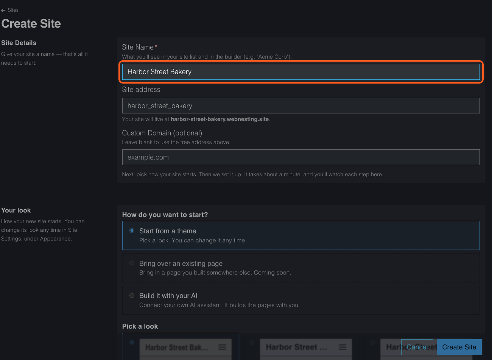
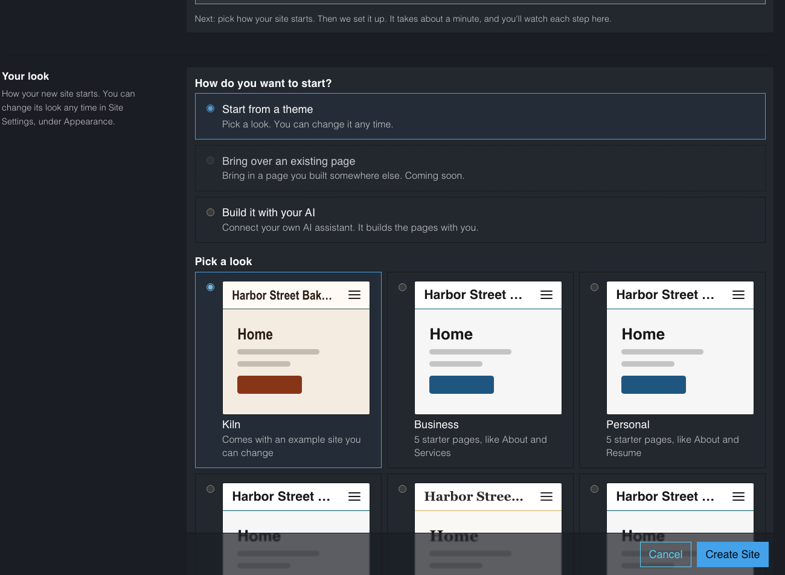
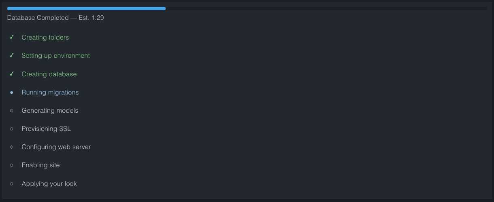
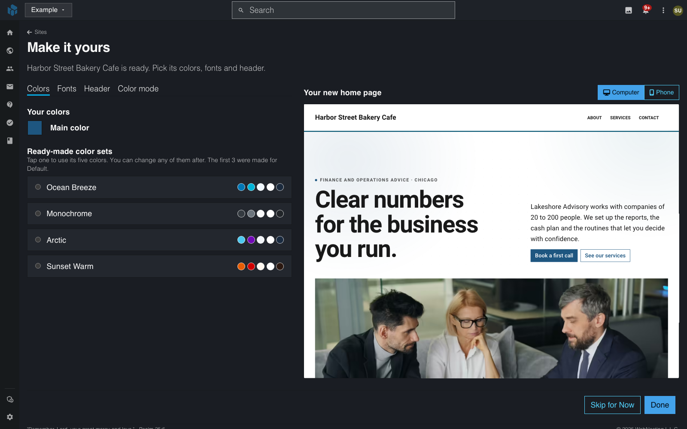
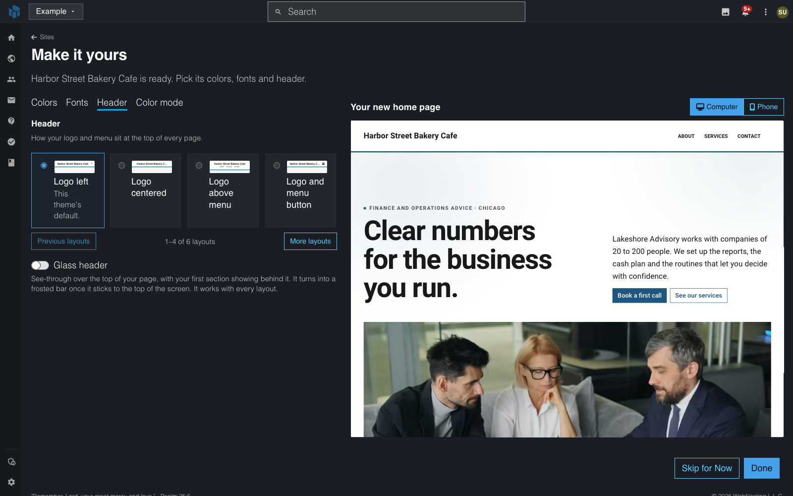
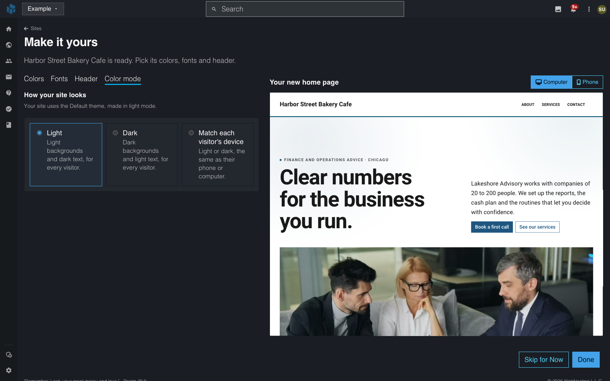
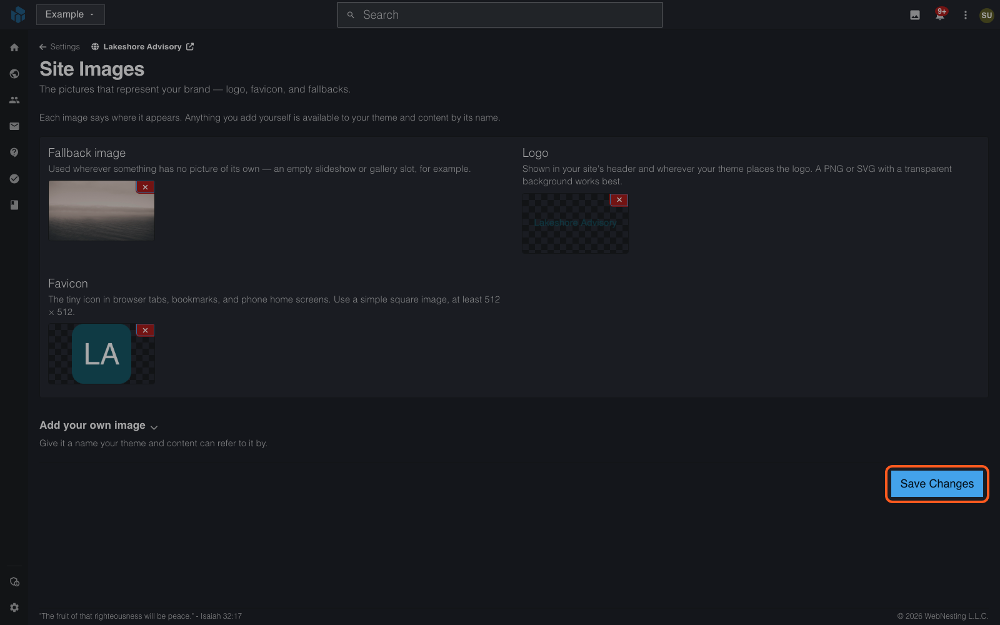

# Setting Up Your Site

**Last verified:** 2026-11-07 9:27am

When you create a new WebNesting site, you give it a name and pick how it starts. This page walks you through each choice so you know exactly what to expect.

The whole process takes about a minute. When it is done, your site has a name, a look, and -- if you want them -- ready-made pages to start changing.

---

## Where to Start

You can create a site from two places. Both ask the same questions:

- **Sites** in your workspace: select **Sites** in the left icon rail, then **Create site**. You can also select **+ New Site** on the **Sites** page. Everything is on one page.
- Your home page: click **Create a website**. A pop-up asks one question per screen. If you belong to more than one workspace, it first asks which workspace the site goes in.

---

## Step 1: Name Your Site

1. In **Site Name**, type the name you want (for example, "Sunny Day Bakery" or "Alex's Portfolio").
2. Check **Site address**. WebNesting fills it in from the name, and it becomes your site's free web address. You can change it before you create the site.
3. If you already own a domain, you can type it in **Custom Domain (optional)**. You can also connect one later.

---

## Step 2: Choose How to Start

Under **How do you want to start?**, pick one of these:

- **Start from a theme** -- pick a look, with or without example pages. This is the quickest way to a site that looks finished.
- **Bring over an existing page** -- bring in a page you built somewhere else. This one says **Coming soon** and can't be picked yet.
- **Build it with your AI** -- connect your own AI assistant (such as Claude or ChatGPT), and it builds the pages with you. WebNesting shows the steps to connect it and a starter prompt with your site's name. Click **Copy Prompt** and paste it into your assistant once it is connected. Your site starts on the Default look.

---

## Step 3: Pick a Look

If you chose **Start from a theme**, you see a list of looks. Each one is drawn with your own site name.

If you picked a theme on WebNesting.com before you signed up or signed in, that theme is already picked. The line above the list says "You picked <theme> on webnesting.com." You can still pick another look. Once you create a site, the next new site starts on the first look again.

The list comes in this order:

1. **Themes with an example site** -- a full look plus example pages and sample text.
2. **Starter pages** -- **Business**, **Personal** and **Portfolio**. Each brings a set of pages, like About and Contact, on the Default look.
3. **Themes with just a look** -- colors and fonts only. Your site starts with one empty home page.

Click the look you like. If it is a theme with an example site, choose one:

- **Start from this example site** -- your site gets its pages and sample text, ready to change.
- **Just the look** -- your site gets the theme's colors and fonts, and one empty home page.

> **Tip:** Not sure which to pick? Choose a theme with an example site. Changing sample text is faster than starting from an empty page, and you can delete any page you don't need.

---

## Step 4: Create Your Site

Select **Create Site** (or **Create Website** in the pop-up). A progress list shows each step. The last step is **Applying your look**, where your theme and example pages go on.

When every step is done, the list says **Complete!** and your site is ready to open. Select **Go to Sites** to return to your list, then select **Manage Site** on the site's card.

---

## Step 5: Make It Yours

If you chose **Start from a theme**, a **Make it yours** screen opens when the site is ready. It asks you to pick your site's colors, fonts and header. A live preview of your new home page sits beside the tabs. Use **Computer** and **Phone** above the preview to see both sizes.

The screen has four tabs:

- **Colors**: set your **Main color**, or choose a ready-made color set such as **Ocean Breeze**, **Monochrome**, **Arctic** or **Sunset Warm**.
- **Fonts**: choose a pair of fonts that work well together.
- **Header**: choose a layout (**Logo left**, **Logo centered**, **Logo above menu** or **Logo and menu button**). Turn on **Glass header** for a see-through header.
- **Color mode**: choose **Light**, **Dark**, or **Match each visitor's device**.

Select **Done** to save your choices. Your site shows them right away. Select **Skip for Now** to keep the theme as it is. You can change all of this later in Site Settings, under **Appearance**.

### If Your Look Can't Be Applied

Now and then a look can't be applied. Your site is still created, and it opens on the Default look. You see a notice that says so, with a **Try again in Appearance** link.

To try again:

1. In the site menu, open **Settings** and click **Site Settings**.
2. Under **Appearance**, click **Theme**.
3. In the notice at the top, select **Try Again**.

---

## After Setup: Adding Your Logo and Favicon

Now that your site is set up, you will want to add your own logo and favicon (the small icon that appears in browser tabs).

### Adding Your Logo

1. In the site menu, open **Settings** and click **Site Settings**.
2. Under **Content**, click **Site Images**.
3. Find the **Logo** field.
4. Select the **Logo** area, then choose your logo image from your files or upload a new one.
5. Select **Save Changes**.

Your logo will appear in your site's header area, replacing the default text. A PNG or SVG with a transparent background works best.

### Adding a Favicon

1. On the same **Site Images** page, look for the **Favicon** field.
2. Upload a small square image (a simplified version of your logo works well).
3. Select **Save Changes**.

> **Tip:** Favicons look best as square images, at least 512 by 512 pixels. Simple icons with bold shapes work better than detailed images because they display very small in the browser tab.

---

## Updating Your Site Name Later

If you ever want to change your site name or business name, or your search engine details:

1. In the site menu, open **Settings** and click **Site Settings**.
2. Under **Your site**, click **Site Configuration** for site name and business name, or **SEO Defaults** for SEO title and description.
3. Update the fields as needed.
4. Save your changes.

---

## Changing Your Theme or Colors Later

You are not locked into your initial theme choice. To change your theme or colors at any time:

1. In the site menu, open **Settings** and click **Site Settings**.
2. Under **Appearance**, click **Theme**.
3. Find the theme you want and click **Use This Theme**.

Your site shows the new look right away. To change colors and fonts, see [Themes and Customization](../dashboard/themes-and-customization.md).

---

## Where to Go Next

Your site is set up. Here are your next steps:

- **[Navigating the Dashboard](navigating-the-dashboard.md)** -- Learn your way around the Dashboard and discover all the tools at your disposal.
- **Edit your pages** -- Open the Website Builder to start replacing the sample content with your own text, images, and layout.
- **Upload files** -- Click **Files** in the top bar and add your photos, graphics, and documents so they are ready to use on your pages.

> **Tip:** The sample content from your template is there to show you what is possible and give you a starting structure. Feel free to change everything -- the text, images, layout, and colors are all yours to customize.
