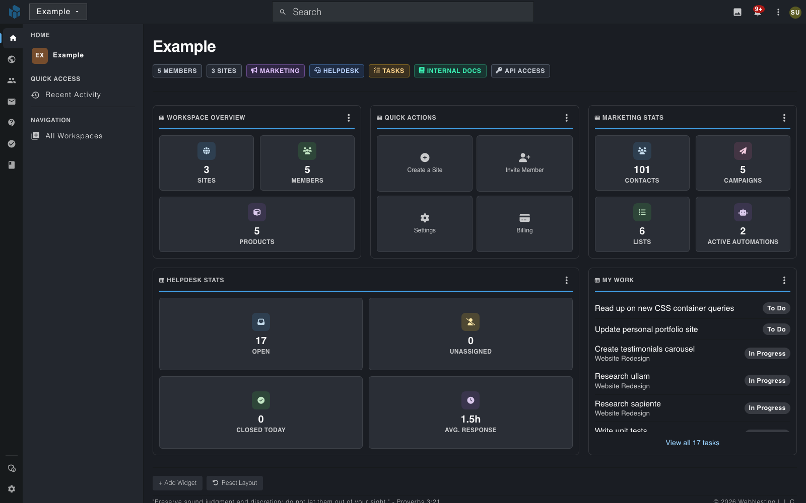

# Your Workspace Home: A Quick Daily Check-In

**Last verified:** 2026-10-31

Your workspace home shows the numbers you check most, on one screen. If your workspace has Marketing, Helpdesk and Tasks turned on, you can see your email results, your open tickets and your own tasks without opening each area. This guide shows a short daily routine that stays inside WebNesting.

---

## What the Home Screen Shows

Sign in and click your workspace. The home screen opens with cards. You may see:

- **Workspace Overview** -- how many sites, members and products the workspace has
- **Quick Actions** -- shortcuts such as **Create a Site** and **Invite Member**
- **Marketing Stats** -- your contacts, campaigns, lists and active automations
- **Helpdesk Stats** -- open tickets, unassigned tickets, tickets closed today and the average response time
- **My Work** -- the tasks assigned to you
- **Usage and Cost** -- this month's charges so far, your estimated total, the free amount still to come, your bill by product and a usage chart
- **Website Bandwidth** -- the GB your websites sent this month, the free GB left, and your top sites and files
- **Email Reputation** -- your bounce and complaint rates, your sending status and your daily sends
- **API Usage** -- API requests, data transfer, active tokens and the latest token activity
- **Media Library** -- how many files you have and how much storage they use, by file type
- **Workspace Activity** -- the latest changes in your workspace and who made them

The Marketing, Helpdesk and My Work cards appear only when that product is turned on for the workspace. The account cards (Usage and Cost, Website Bandwidth, Email Reputation, API Usage, Media Library and Workspace Activity) are not on by default: click **Add Widget** to add one. You see one only if you have permission to see its data. For example, Usage and Cost needs permission to see **Billing**. To change what shows, click **Add Widget** or **Reset Layout** at the bottom of the screen.

---

## A Five-Minute Morning Routine

### 1. Check for tickets nobody has picked up

1. Click **Helpdesk** in the left bar.
2. In the menu that opens, click **Unclaimed**.

If you see **No tickets found**, nobody is waiting for a first reply. If tickets are listed, open one and assign it to someone.

### 2. Check your tasks

1. Click **Tasks** in the left bar.
2. Click **Overview**.

You see your open tasks, anything overdue, your upcoming deadlines and your recent projects.

### 3. See how your emails did

1. Click **Marketing** in the left bar.
2. Click **Campaigns**.

Each campaign shows its status, how many people received it, and how many opened and clicked.

### 4. Look at your website

1. Click **Sites** in the left bar.
2. Click your site, then open **Pages** to see its pages.

### 5. Go back home

1. Click **Home** in the left bar.
2. Click your workspace name in the menu that opens.

> **Tip:** A rail icon opens a menu next to it. The page changes when you click a link inside that menu.

---

## Next Steps

- Read [Navigating the Dashboard](navigating-the-dashboard.md) to learn how the left bar works.
- Open [Workspace Products](../dashboard/workspace-products.md) to turn on Marketing, Helpdesk or Tasks.
