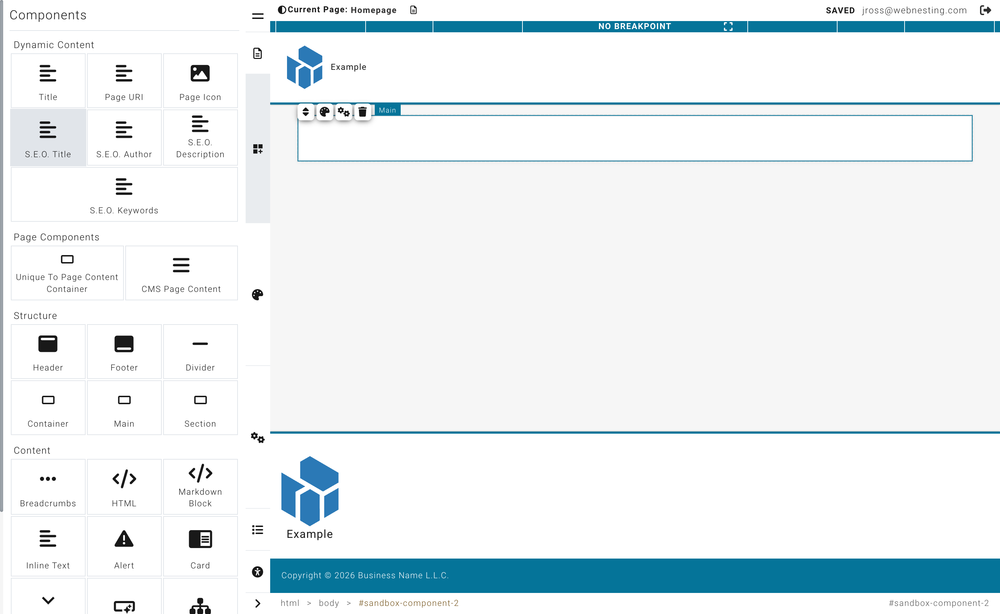

# Adding Components to Your Page

**Last verified:** 2026-10-22 10:41am

Components are the building blocks of your website. Every piece of content on your page -- text, images, buttons, sections, and more -- is a component. This guide shows you how to find, add, arrange, and manage components in the Website Builder.

---

## What Are Components?

Think of components like pieces of furniture in a room. Each one serves a purpose and can be placed wherever you need it. A text component holds your words. An image component shows a picture. A button component gives visitors something to click.

You combine these components to create complete pages. A typical page might have a header at the top, some text and images in the middle, and a footer at the bottom -- each one is a separate component.

---

## How to Add a Component

1. Open the **Website Builder** for the page you want to edit.
2. Click **Add** in the panel rail on the **right** side of the screen. You will see every available component, organized into groups. To find one fast, type a name or a plain word, such as "movie", in **Search blocks**.
3. Find the component you want to add.
4. **Click and hold** on the component, then **drag it** onto the Canvas (the main area showing your page).
5. Drop it where you want it to appear. You will see a visual guide showing you where the component will land.
6. Release your mouse button to place it.

The component will appear on your page immediately. You can now click on it to edit its content, or open the **Styles** panel to change how it looks.

> **Tip:** If you are not sure which component to use, try adding one and see how it looks. You can always delete it or move it later.

---

## Find a Block: Search and Groups

At the top of the **Add** panel, the **Search blocks** box finds a block by its name or by a plain word. Type "movie" and **Video** appears; "newsletter" finds **Email Signup**. A longer search needs every word to match. Under the box, a line says what you see: "32 blocks in 6 groups.", or "1 block matches “movie”." while you search. Press **Esc** or choose **Clear search** to see all the blocks again. If nothing matches, the panel says so and offers **Show all blocks**.

The blocks sit in groups by what you want to do. Select a group's name to open or close it. The first time you open the panel, only **Layout** is open; after that the panel remembers which groups you opened. While you search, every group with a match opens by itself.

## Component Categories

Components are grouped by what you want to do. The groups are Layout, Text, Media, Interactive, Marketing and Site modules, followed by **My Widgets**.

### Layout

The boxes that hold and organize everything else. Using them correctly also helps screen readers and search engines understand your page.

- **Content area** -- The primary content area, used once per page.
- **Section** -- A major division of your page.
- **Blank box** -- An empty box with no meaning of its own, for grouping or spacing other blocks.
- **Element** -- A box you can turn into any of 25 HTML elements, such as a quote, a list, a figure or a link. In its settings, **Element type** is a list you can search; each type has one plain line that says what it is for, and a note under it says which element your page gets. **Custom attributes** adds your own name and value pairs to the element, for styling hooks and screen readers: names that start with `aria-` or `data-`, and `role`, `title` and `lang`. A Link can also take `href`, and a Date or time can take `datetime`. A name the builder can't use (such as `id`, `class`, `style` or `onclick`) shows why under its row, and is never saved. Each row has its own **Remove** button.
- **Card** -- A self-contained block combining an image, heading, description, and button.
- **Divider** -- A horizontal line that visually separates content on your page.
- **Spacer** -- An empty block that adds a gap between two sections. Pick its **Height** from the list: the steps run from small to large and follow your theme's spacing. For a different height on a phone or tablet, pick that screen size at the top of the builder, open **Styles** and set **Height** there. Type a step such as `var(--spacing-3)` to stay on your theme's scale. Screen readers skip a Spacer. In the editor it shows as a faint striped box so you can select it; visitors see only the gap.
- **Header** and **Footer** -- The top and bottom regions of a layout.

### Text

Written content.

- **Inline Text** -- A rich text area with a floating formatting toolbar. This is the one you will reach for most often.
- **Markdown Block** -- A text area that uses Markdown formatting.
- **HTML** -- A block where you can paste raw HTML, useful for embedding third-party widgets.
- **Alert** -- A highlighted message box, good for notices, warnings, or tips.
- **Code block** -- Code that visitors can read and copy. Paste your code, pick its language from the list, and turn on **Show a Copy button** if you want one. Tags and scripts you paste show as text and never run on your page.
- **Progress bar** -- A bar that shows how far along something is, such as a goal, a skill or a fundraiser. Give it a **Label** and type how full it is, from 0 to 100. Under **More options**, pick its color (Primary, Success, Warning or Danger) and choose whether the percent shows. A number outside 0 to 100 is not accepted: the field tells you to type one in range. Screen readers read the label and the value. It is in the **Marketing** group of the **Add** panel.
- **Customer reviews** -- Cards that show what your customers say. It starts with three cards. For each one, type the quote under **What they said**, the **Name**, the **Job or company**, the **Stars** (0 to 5, in half steps such as 4.5) and a **Photo**. A number that is not in half steps, or is outside 0 to 5, is not accepted: the field tells you what to type. With no photo, the card shows the person's initials. Under the group settings, show the cards as a **Grid** or a **Carousel**, and turn on **Change reviews on their own** if you want the carousel to move without a click. Visitors can use the arrow buttons, the dots or the keyboard, and screen readers read the stars as text, such as "4.5 out of 5 stars". It is in the **Marketing** group of the **Add** panel.
- **Pricing table** -- A row of plan cards. It starts with three plans. For each one, type the **Plan name**, the **Price** (shown just as you type it, such as "$29" or "Free"), what it is **Per** (such as "per month"), and the features under **What is included** (use **+ Add feature** for more). Change the button under **Buttons**. Turn on **Highlight this plan** to raise one plan above the others with a colored edge. All plans in a row are the same height, so the buttons line up. On a narrow screen the plans stack. It is in the **Marketing** group of the **Add** panel.
- **Logo strip** -- A row of logos, such as your clients or partners. Under **Logos**, choose **Choose from my media** and pick the logo files. Choose **Add or remove logos** to change the set, or **Remove** to take one out. Each logo reads out the description (alt text) saved with its file in **Files**, so add one there for each logo. Turn on **Grey until hover** to show the logos in grey and turn each one to its own color when a visitor points at it. Under **More options**, set the **Alignment** (**Left**, **Center**, **Right** or **Spread out**) and the **Gap** (**Small** to **Extra large**). On a narrow screen the logos move onto more rows. It is in the **Marketing** group of the **Add** panel.
- **Countdown timer** -- A countdown to a date and time, such as a launch, a sale or an event. Under **Count down to**, pick the date and time. It is read in your site's time zone, and the panel shows which zone that is, so visitors anywhere see the same countdown. Under **Show**, choose which of **Days**, **Hours**, **Minutes** and **Seconds** appear; the largest one you pick counts all the time above it, so with **Days** off the hours can pass 23. Under **Text after the end**, type what shows in place of the numbers once the time has passed, such as "Doors are open!"; leave it empty to show nothing. The numbers count down on the page each second. A visitor who reloads after the end, or whose browser has JavaScript off, still sees the right numbers or the right text. A date with a time zone added to it, or a date that does not exist, is not accepted. It is in the **Marketing** group of the **Add** panel.

### Media

Visual content.

- **Image** -- A single image. Click it to pick a picture from your files or upload a new one.
- **Slideshow** -- A rotating set of images that transitions between slides.
- **Video** -- A YouTube or Vimeo video, or one from your files. Paste the link or choose **My media**, then pick a shape. Under **More options** you can add a cover image, round the corners, and set whether it plays on its own, repeats, shows the player controls, and where it starts. A visitor who prefers less motion never sees it play on its own.
- **Google Maps** -- An embedded, interactive map showing a specific location. Ideal for contact pages and store locators. Configure the location by entering an address or coordinates. Your site may need a Google Maps API key configured for the map to display.

### Interactive

Blocks a visitor can click or open.

- **Button** -- A clickable button linking to another page, a section of your site, or an external website.
- **Accordion Item** -- An expandable section visitors can open and close. Good for FAQs: turn on **Mark as FAQ for search engines** in its settings so Google can show your questions in search results.
- **Tabs** -- Panels that visitors switch between with a row of tab names. It starts with three tabs, each holding a text block. Select a tab in **Layers** to edit its panel, and rename it under **Tab name**. Use the **+** in the toolbar to add a tab, and Alt with the arrow keys to move one. In the settings, put the tab bar across the top or down the side, and choose which tab shows first. Visitors can also use the arrow keys, Home and End.
- **Disqus Comments** -- A comments section powered by Disqus, letting visitors comment and reply. You need a Disqus account and a site shortname, set in the component's settings. Comments are then managed from the Disqus moderation dashboard, which handles spam filtering and user accounts for you.

### Marketing

- **Email Signup** -- A newsletter signup form for collecting subscribers. Requires the Marketing product.

### Site modules

The parts that frame every page, and blocks that show content from your site's modules. Blocks from a module only appear when that module is enabled.

- **Site logo** -- Your logo and site name, linking to your home page. In its settings, **Show** picks the logo and name, only the logo, or only the name. Change the logo itself in **Site Settings**.
- **Site menu** -- One of your site's menus. In its settings, **Which menu** picks the menu and **Levels shown** says how many levels of pages show (1 shows only the top items). Click the menu on your page and its toolbar sets the **Submenu style**: **Flat** shows only the top items, **Dropdown** opens the pages under an item in a short list below it, and **Mega menu** opens a wide panel below your header with the item's pages in columns, or a widget you pick (see [Mega Menus](site-navigation.md#mega-menus)). **Open on the page** opens one item's list or panel in the builder so you can see it. Edit the pages of a menu in **Pages**.
- **Menu button** -- The button that opens your menu on smaller screens. Drop a **Site menu** (or a button, or some text) into it. In its settings, **Show it on** picks the screens that show the button (phones, tablets and phones, laptops, tablets and phones, or every screen); wider screens show the menu itself. **Menu slides in from** picks the side, and **Button shows** picks three lines or the word Menu. While you work on it, the builder shows your page at phone width with the menu open, so you can drop blocks into it.
- **Site details** -- One of the details you keep in **Site Settings**: your social links, your footer details, your copyright line (with this year and your business name) or your extra footer text. In its settings, **Show** picks which one. It changes when you change it in Site Settings. If the detail is empty, your page shows nothing there, and the builder shows a note that says where to add it.
- **Light / dark switch** -- A sun and moon button that lets each visitor pick light or dark mode. It shows on your site once **Show a light / dark switch on my site** is on in **Site Settings → Appearance → Color Mode** (see [Light and Dark Mode](../dashboard/themes-and-customization.md#light-and-dark-mode)).
- **Breadcrumbs** -- A trail of links showing where the visitor is (for example: Home > Services > Web Design).
- **Site Map** -- An automatically generated list of all the pages on your site.
- **Article List / Article Detail** -- Articles from your Articles module.
- **Event List / Event Detail** -- Events from your Events module.
- **Product List / Product Detail** -- Products from your Store module.
- **Form** -- Embeds a form from your Forms module. Requires the Forms module.
- **Login Form**, **Registration Form**, **Forgot Password Form**, **Reset Password Form**, **Account Security** and **Two-Factor Code Form** -- The pages a visitor uses to sign up, sign in, reset a password and manage their account on your site.

> **Tip:** If you do not see the module blocks, the related module is not enabled. You can enable modules from the **Modules** section of your site menu.

### My Widgets

Your own custom, reusable components. Build something once and use it across multiple pages. If you have not created any widgets yet, this group will be empty -- use the **+** on the group header to create one without leaving the builder.

---

## Moving Components Around

You can rearrange components on your page at any time.

1. Hover over the component you want to move. A border or highlight will appear around it.
2. **Click and hold** on the component.
3. **Drag it** to the new position on the page.
4. You will see visual guides showing you where the component will land.
5. **Release your mouse button** to drop it in the new spot.

Your component will snap into place and the rest of the page will adjust automatically.

---

## Nesting Components Inside Other Components

Some components can hold other components inside them. These are called **containers**. Sections, containers, and other layout components all work this way.

For example, you might:

- Put a text block and an image inside a section
- Place multiple cards inside a container to create a row of cards
- Add buttons and text blocks inside a card

To nest a component:

1. Drag the component from the **Add** panel.
2. Drop it **inside** an existing container component on the Canvas.
3. You will see a visual guide indicating that the component will be placed inside the container (rather than above or below it).

This nesting is how you create structured, professional-looking page layouts.

Avoid nesting too many levels deep. Two or three levels (for example, Section > Container > Content) is usually enough for most layouts.

> **Tip:** Sections are the most common starting point. Add a section to your page first, then place your text, images, and other components inside it.

---

## Deleting a Component

If you want to remove something from your page:

1. Click on the component you want to delete to select it.
2. Look for the **delete option** that appears (usually a trash icon or a delete button near the selected component).
3. Click it to remove the component.

The component and its content will be removed from the page.

> **Tip:** If you accidentally delete something, use the **Undo** button in the top toolbar (or press Ctrl+Z on Windows, Cmd+Z on Mac) to bring it back.

---

## Duplicating a Component

If you want a copy of something that already exists on your page:

1. Click on the component you want to copy to select it.
2. Look for the **duplicate option** that appears near the selected component.
3. Click it to create an identical copy.

The copy will appear right next to the original. You can then drag it to a different position and edit its content independently.

> **Tip:** Cmd+D (Ctrl+D on Windows) duplicates the selected component instantly.

---

## Tips for Building Good Page Layouts

Here are some suggestions to help you create pages that look great and are easy for visitors to use.

- **Start with sections.** Before adding text and images, lay out the major sections of your page first. Then fill in the details inside each section.
- **Keep it simple.** A clean page with clear sections is easier to read than a cluttered one. Do not try to fit too much into one area.
- **Use headings to organize.** Add heading text at the top of each section so visitors can quickly scan the page and find what they are looking for.
- **Mix content types.** Combine text with images, cards, and buttons to keep things visually interesting. A page full of only text can feel overwhelming.
- **Think about flow.** Arrange your content in a logical order. Lead with the most important information and end with a clear next step (like a button or a contact section).
- **Save often.** As you build, save your progress frequently. This protects your work in case anything unexpected happens.

---

## Next Steps

- **[Editing Content](editing-content.md)** -- Learn how to edit text, images, buttons, and other content you have added to your page
- **[Website Builder Overview](builder-overview.md)** -- Go back to the interface overview to review the Builder layout and controls
