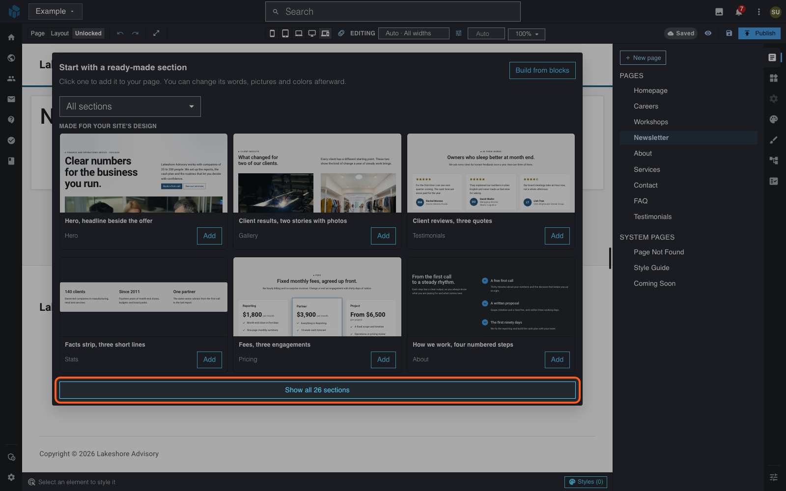
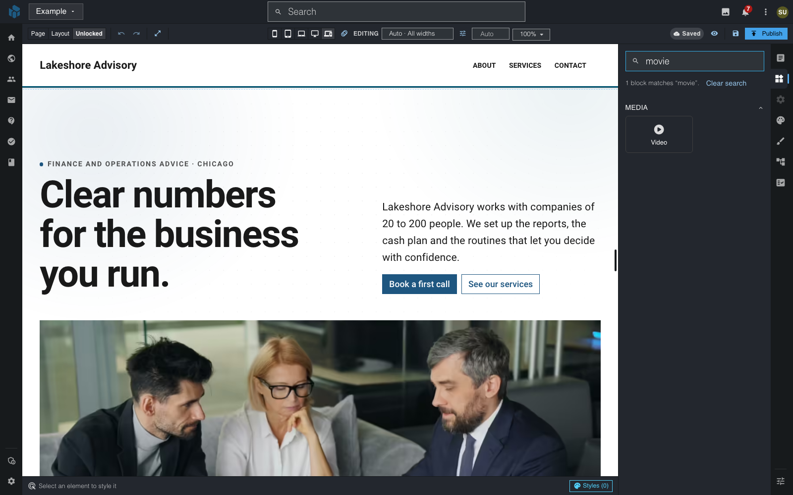
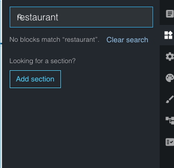
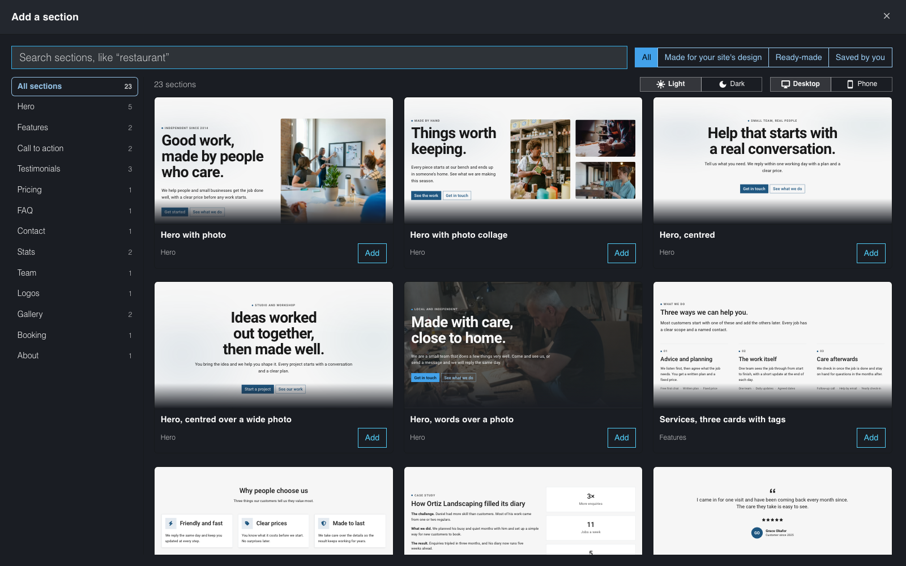
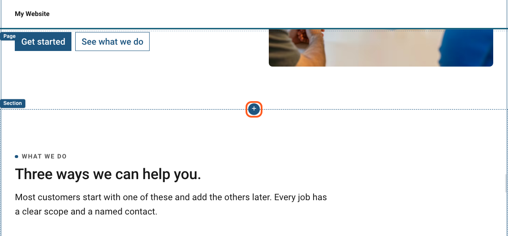
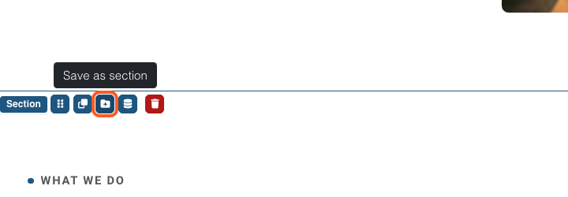
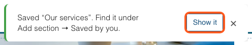
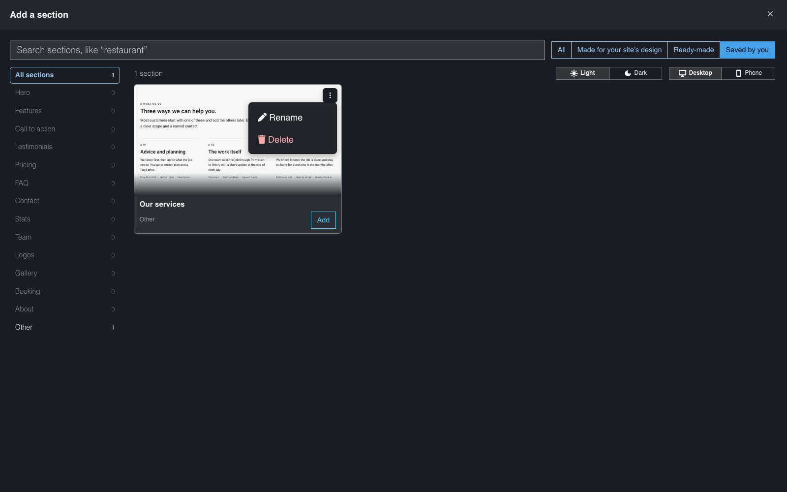
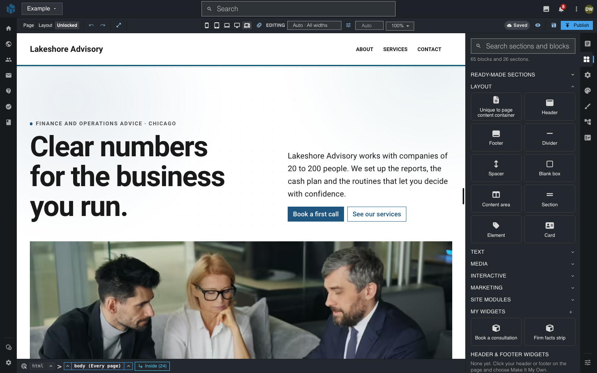
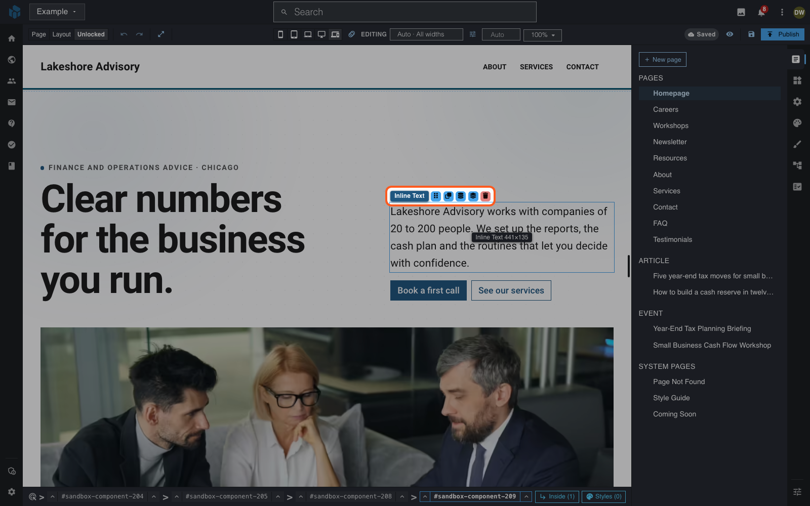

# Adding Components to Your Page

**Last verified:** 2026-11-12 10:19am

Components are the building blocks of your website. Every piece of content on your page -- text, images, buttons, sections, and more -- is a component. This guide shows you how to find, add, arrange, and manage components in the Website Builder.

---

## What Are Components?

Think of components like pieces of furniture in a room. Each one serves a purpose and can be placed wherever you need it. A text component holds your words. An image component shows a picture. A button component gives visitors something to click.

You combine these components to create complete pages. A typical page might have a header at the top, some text and images in the middle, and a footer at the bottom -- each one is a separate component.

---

## Start a New Page

A new, empty page opens on a list of ready-made sections, right on the Canvas. This is the plain way to start any page.

1. Open the **Website Builder** for your new page.
2. Under **Start with a ready-made section**, find one you like. To see one type, such as Pricing, use the list above the pictures.
3. Select the picture, or press **Add**. The section goes on your page. To add the next one, press **Add section** at the top of the builder.

To see them all, choose **Show all**. The **Add section** window opens (see [Add a Section](#add-a-section)). To start with an empty page and single blocks, choose **Build from blocks**. To take a section back, press the **Undo** arrow at the top of the builder.

The sections at the top of the list, under **Made for your site's design**, come with your site's theme. **More sections** take their colors and fonts from your theme too.

---

## How to Add a Component

1. Open the **Website Builder** for the page you want to edit.
2. Click **Add** in the panel rail on the **right** side of the screen. You will see every available block, organized into groups. To find one fast, type a name or a plain word, such as "movie", in **Search blocks**. To add a whole designed section instead, see [Add a Section](#add-a-section).
3. Find the component you want to add.
4. **Click and hold** on the component, then **drag it** onto the Canvas (the main area showing your page).
5. Drop it where you want it to appear. You will see a visual guide showing you where the component will land.
6. Release your mouse button to place it.

You can also add a component without dragging. Click it, or Tab to it and press Enter or Space. WebNesting puts it after the block you selected, or at the end of the page when nothing is selected. A line for screen readers says where it went. The new component is then selected, so you can change its settings and styles right away.

The component will appear on your page immediately. You can now click on it to edit its content, or open the **Styles** panel to change how it looks.

> **Tip:** If you are not sure which component to use, try adding one and see how it looks. You can always delete it or move it later.

---

## Find a Block: Search and Groups

At the top of the **Add** panel, the **Search blocks** box finds a block by its name or by a plain word. Type "movie" and **Video** appears; "newsletter" finds **Email Signup**. A longer search needs every word to match. Under the box, a line says how many blocks you see, such as "56 blocks." The count depends on your site, because a block for a module you have not turned on is not listed. While you search, the line reads like "2 blocks match "hero"." Press **Esc** or choose **Clear search** to see everything again.

When no block matches but your words fit a section, the panel shows **Looking for a section?** with an **Add section** button under it. Select **Add section** and the **Add section** window opens with your words in its search box. When nothing matches at all, the panel says so. Choose **Clear search** to see every block again.

The blocks sit in groups by what you want to do. Select a group's name to open or close it. The first time you open the panel, **Layout** is open. After that the panel remembers which groups you opened. While you search, every group with a match opens by itself.

## Add a Section

A section is a designed part of a page, such as a banner at the top or three customer reviews, made of several blocks. You choose one in the **Add section** window. The window fills the screen, so each section shows as a large live picture in your theme. Every picture is the same size and shows the top of its section. A long section is cut off at the bottom of its picture. On a phone, the filter rows are labelled **Show** and **Type**; slide a row sideways to see all of it.

There are four ways to open the window. All four open the same window.

1. **From the top of the builder.** Press **Add section**, the button with the plus sign next to the Undo and Redo arrows. On a narrow screen, it is in the **More** menu.
2. **From a plus under a section.** Point at the bottom edge of a section, or Tab to it with the keyboard. A round **+** appears, with a dashed line where the section will go. Select it to add a section right after that section. On a touch screen, every **+** shows all the time.
3. **From an empty page.** Choose **Show all** under **Start with a ready-made section**.
4. **From the Add panel.** Search for something that is not a block, such as "restaurant", and select **Add section** in the line **Looking for a section?**.

In the window:

1. Type in **Search sections** to narrow the list. Use plain words, such as "restaurant" or "prices". The box is ready for you to type when the window opens.
2. Pick a type on the left, such as **Hero**, **Pricing** or **FAQ**. The number beside each type counts its sections.
3. Use **Light** or **Dark** above the pictures to see the sections in either mode. Use **Desktop** or **Phone** to see how they look on a phone. The window remembers both choices.
4. Select a picture, or press **Add**.

The section goes in, the window closes, and the page scrolls to the new section. It is selected, so you can start changing its words. A message says where it went and names the section above it by its heading, such as "Added "Hero, centered" after "Tell us what you need"." If you gave that section a name of your own in **Layers**, the message uses your name. From the top button, from the empty page and from the **Add** panel, the section goes right after the section you selected. With nothing selected, it goes at the end of the page. From a **+**, it goes right after the section above that **+**.

To take a section back, press the **Undo** arrow at the top of the builder. One press removes the whole section.

You can add sections only on a page, and only if you may edit the website builder. In a layout or a widget, the **Add section** button and the **+** do not show.

The **Ready-made** source holds 23 sections: five heroes (**Hero with photo**, **Hero, centered**, **Hero, words over a photo**, **Hero, centered over a wide photo** and **Hero with photo collage**), two that describe what you do (**Three reasons** and **Services, three cards with tags**), **How we work, four numbered steps**, two call-to-action bands (**Call to action band** and **Closing call to action**), three that show proof (**Customer reviews**, **Customer quote** and **Case study**), **Results, two stories with photos**, two with numbers (**Facts strip, three short lines** and **Numbers that count**), **Pricing, three plans**, **Questions and answers**, **Contact details**, **Meet the team**, **Logos of clients**, **Portfolio gallery** and **Book a time**. With the Forms add-on, the list has two more: **Hero with contact form** and **Contact with form**. Each one takes its colors, fonts and corners from your theme, so it looks right in light and dark mode on every built-in theme. Search finds them by the words you would use, for example "restaurant" finds **Book a time**.

The heroes with photos, **Results**, **Meet the team** and **Portfolio gallery** have example photos. When you add one, its photos go into your media library under **Files**. To use your own picture, select the photo on your page and choose another from your media library. The words, prices and names are examples. Change them to yours. **Contact details** has your phone number and email as links. **Contact with form** puts a contact form beside them, and **Hero with contact form** puts one beside your headline. When you add either, it uses your form made from the **Contact Form** template, or makes that form for you. To change the questions, open the form under **Forms**. In **Book a time**, open the booking block and enter your booking address.

Use **Show** at the top of the window to narrow the list to one source: **All**, **Made for your site's design** (sections that come with your theme, shown only while that theme is on your site), **Ready-made** or **Saved by you**. A type, a source and your search work together. If nothing matches, the window says so. After a search, **Clear search** shows every section again; after a type or a source, **Clear filters** does. If you have saved no sections yet, **Saved by you** says how to save one and offers **Show all sections**. If a picture does not load, the tile says "Preview not available". You can still add the section, and **Try again** loads the picture again.

Bold Deco has three sections of its own: a centred poster with the date of the show and two buttons, a wide photo above a timetable of the evening, and a tab for each night with a photo. Kiln has five for a studio or workshop: a tab for each class, a feature piece beside four more, four numbered steps from clay to finished pot beside a photo, a first-visit guide with a photo, steps and what to bring, and a visit card with a photo and opening hours. Midnight Slate has four for a design studio or portfolio: a project with a wide photo and a table of facts, a project index with a tab for each kind of place, a client brief with a photo and a large quote, and a payment schedule beside what the fee covers. Soft Elegant has none right now, so **Made for your site's design** stays empty on it. Every theme uses the **Ready-made** sections. Together, they make a whole page: a hero, what you offer, how you work, reviews, prices, questions and a closing call to action. They come with real photos, so a section looks finished when you add it. When you add one, its photos go into your media library under **Files**. Add the same section again and it uses the same files, so nothing is copied twice. To use your own picture, select the photo on your page and choose another from your media library. If the photos cannot be added, a message says so and the section is not added; try again. If you change to another theme, **Made for your site's design** shows that theme's sections, and the sections already on your pages stay and take the new theme's look.

## Save Your Own Section

When you have made a part of a page you like, save it as a section and add copies of it to other pages. It keeps its blocks, its words and its look.

1. Select the section on your page.
2. In the small toolbar on the section, press the folder button with a plus sign, **Save as section**. Point at a button to see its name. You can also right-click the section and choose **Save as section** (on a keyboard, press **Shift+F10** or the menu key). Under it, the menu says "A copy to reuse. Each copy changes on its own."
3. Check the name. It starts as the section's heading, without its end full stop. A section with no heading starts with an empty name, so type one. If you already have a section with that name, the window says the name it will get, such as "Open day (2)".
4. Optional: pick a **Type** from the list, such as Hero or Pricing, or type a new one in the box. The type is where the section shows in the **Add section** window.
5. Choose **Save section**.

A picture of the top of the section shows above the name, so you can check what you save. After the save, a message says "Saved "Name". Find it under Add section → Saved by you." Press **Show it** in the message to see it: the **Add section** window opens on **Saved by you**, and the new section wears "Just saved". Add it to any page of the site, as you add a ready-made one. If the save does not work, the window says "We couldn't save the section. Try again." and keeps the name and type you entered.

A saved section is a copy. Changing it on one page never changes the other pages, and never changes the saved section. For one block that stays the same everywhere you use it, make a [widget](widgets.md) instead.

You cannot save the page content area itself, or a part of the page that holds it: the menu item is off and says "Pick a section on your page. The page content area cannot be saved." A section with an **HTML** block in it cannot be saved either, because an HTML block holds code.

**Rename or delete a saved section:** in the **Add section** window, choose **Saved by you** and open the **⋮** menu in the top right corner of its picture.

- **Rename** gives it a new name.
- **Delete** asks first. It removes the section from your saved sections for good. Pages that already use it keep their copy.

Saving, renaming and deleting a section needs permission to edit the website builder.

## Component Categories

The **Add** panel groups blocks by what you want to do: Layout, Text, Media, Interactive, Marketing and Site modules. **Header & Footer Widgets**, at the end, holds your own header and footer widgets. Sections are not in this panel. Add them from the **Add section** window, described above.

### Layout

The boxes that hold and organize everything else. Using them correctly also helps screen readers and search engines understand your page.

- **Content area** -- The primary content area, used once per page.
- **Unique to page content container**: the spot in a layout where each page's own content goes. A layout needs one. You rarely add it to a page.
- **Section** -- A major division of your page.
- **Blank box** -- An empty box with no meaning of its own, for grouping or spacing other blocks.
- **Element** -- A box you can turn into any of 25 HTML elements, such as a quote, a list, a figure or a link. In its settings, **Element type** is a list you can search; each type has one plain line that says what it is for, and a note under it says which element your page gets. **Custom attributes** adds your own name and value pairs to the element, for styling hooks and screen readers: names that start with `aria-` or `data-`, and `role`, `title` and `lang`. A Link can also take `href`, and a Date or time can take `datetime`. A name the builder can't use (such as `id`, `class`, `style` or `onclick`) shows why under its row, and is never saved. Each row has its own **Remove** button.
- **Card**: a self-contained block combining an image, heading, description, and button. Under **Card** in **Settings**, set **Style** to **Top line** for a card with no box: a thin line runs along the top, with the title, text and button below it. Choose **Strong top line** for a thick line in your primary color. Under **Number**, choose **Circle** for a number in a filled circle above the title, or **Large** for a big number in your heading font. The cards are numbered 01, 02, 03 in order. To use your own number or word on one card, type it under **Number text** (up to 6 characters). Under **Tags**, type a short list of words separated by commas, such as "Logo and colors, Signs and print". They show under the text as small muted words with a dot between them. Set **Tag look** to **Line of text** to run the words on as one line that wraps like a sentence, with a dot between them. Set **Tag look** to **Badges** to show each tag as a small rounded label. With Badges, **Tag color** sets the color behind the words. **Theme** keeps your theme's badge color. **Primary**, **Secondary** and **Tertiary** use those theme colors, and any extra colors your theme names appear as more choices. The words turn black or white so they stay easy to read in light and dark mode. Set **Line above tags** to **Line** to draw a thin line between the text and the tags. Leave **Tags** empty to show none. **Tags** and **Number text** belong to one card; **Tag look**, **Tag color** and **Line above tags** can also be set on the whole group. To set the space between a group of cards, select the group and open **Space between cards** in **Settings**. **Space between cards** sets the space between cards side by side. **Space between rows of cards** sets the space between rows. **Space between cards on a phone** sets the space between stacked cards on a phone. For cards of different heights, select the group and set **Layout**, then **Arrange**, to **Masonry**: each card goes into the shortest column, in your order ([Masonry Cards](layouts-and-structure.md#masonry-cards)).
- **Divider** -- A horizontal line that visually separates content on your page.
- **Spacer** -- An empty block that adds a gap between two sections. Pick its **Height** from the list: the steps run from small to large and follow your theme's spacing. For a different height on a phone or tablet, pick that screen size at the top of the builder, open **Styles**, choose the **Visual** tab and pick a **Height** step from 1 to 10. Screen readers skip a Spacer. In the editor it shows as a faint striped box so you can select it; visitors see only the gap.
- **Header** and **Footer** -- The top and bottom regions of a layout.

### Text

Written content.

- **Inline Text** -- A rich text area with a floating formatting toolbar. This is the one you will reach for most often.
- **Markdown Block** -- A text area that uses Markdown formatting.
- **HTML** -- A block where you can paste raw HTML, useful for embedding third-party widgets.
- **Alert** -- A highlighted message box, good for notices, warnings, or tips.
- **Code block** -- Code that visitors can read and copy. Paste your code, pick its language from the list, and turn on **Show a Copy button** if you want one. Tags and scripts you paste show as text and never run on your page.
- **Progress bar** -- A bar that shows how far along something is, such as a goal, a skill or a fundraiser. Give it a **Label** and type how full it is, from 0 to 100. Under **More options**, pick its color (Primary, Success, Warning or Danger) and choose whether the percent shows. A number outside 0 to 100 is not accepted: the field tells you to type one in range. Screen readers read the label and the value. It is in the **Marketing** group of the **Add** panel.
- **Customer reviews** -- Cards that show what your customers say. It starts with three cards. For each one, type the quote under **What they said**, the **Name**, the **Job or company**, the **Stars** (0 to 5, in half steps such as 4.5) and a **Photo**. A number that is not in half steps, or is outside 0 to 5, is not accepted: the field tells you what to type. With no photo, the card shows the person's initials. To make one quote carry a whole section, select the card and, under **Customer review** in **Settings**, set **Size** to **Large**. The quote then shows in big type with a quote mark above it, centered, with no box, and the name and job sit small below it. **Normal** is the usual card in a box. Large works best for a section that holds only one review. Under the group settings, show the cards as a **Grid** or a **Carousel**, and turn on **Change reviews on their own** if you want the carousel to move without a click. Visitors can use the arrow buttons, the dots or the keyboard, and screen readers read the stars as text, such as "4.5 out of 5 stars". It is in the **Marketing** group of the **Add** panel.
- **Button**: One or more buttons that link somewhere. For each button, type the **Label** and the link, then pick a **Size**, a **Shape** and a color. Under **Icon**, type a word such as arrow or phone to find a small picture for the button, and choose **Before the label** or **After the label** under **Icon position**. Clear the box to remove the icon. Screen readers skip the icon and read the label. **Shape** is **Theme** (your theme's own corners), **Square**, **Rounded** or **Pill** (fully round ends). **Hero** is the size for the main button at the top of a page: a tall, wide button with a large label. Each size in the list is bigger than the one before it, also on a phone, where **Hero** is a little lower and narrower so two buttons can sit side by side. Under **Settings**, **Width** **Auto** keeps every button as wide as its words, on a phone too: two buttons stay side by side while they fit and drop to a second line only when they do not. **Full** fills the column. A button is always as tall as its own label, also in a column that is taller than its content. The weight of the label comes from your theme.
- **Pricing table**: A row of plan cards. It starts with three plans. For each one, type the **Plan name**, the **Price** (shown just as you type it, such as "$29" or "Free"), what it is **Per** (such as "per month"), and the features under **What is included** (use **+ Add feature** for more). Change the button under **Buttons**. The button fills the width of the plan. To make it only as wide as its label, set **Width** to **Auto** under **Buttons**, then pick where it sits with **Alignment**. Turn on **Highlight this plan** to raise one plan above the others with a colored edge. A highlighted plan can show a short **Label** on its top edge, such as "Most popular". Leave it empty for no label. All plans in a row are the same height, so the buttons line up. On a narrow screen the plans stack. It is in the **Marketing** group of the **Add** panel.
- **Image comparison** -- Two pictures with a divider that visitors drag to reveal one or the other, such as a before and an after. Under **Pictures**, choose a **Before picture** and an **After picture** from your media library. Use two pictures of the same shape; if they differ, the second is cropped to fit the first. Each picture reads out the alt text saved with its file in **Files**. Under **More options**, choose where the divider starts (a quarter, half or three quarters) and type your own **Before label** and **After label**, up to 30 characters each. Visitors can drag the divider with a mouse or a finger, or tab to it and press the left and right arrow keys to move it 5% at a time. Nothing animates. If a visitor's browser runs no scripts, both pictures show, one under the other.
- **Lightbox gallery**: A grid of small pictures that open large when a visitor clicks one. Under **Pictures**, choose **Choose from my media** and pick the files. Choose **Add or remove pictures** to change the set, or **Remove** to take one out. A visitor clicks a picture to see it full size, then moves with the **Previous** and **Next** buttons, the left and right arrow keys, or a swipe on a phone. After the last picture, **Next** shows the first. **Escape**, the close button or a click on the dark background closes it and puts the visitor back on the picture they were looking at. The large view shows the picture's alt text and caption from **Files**, so add them there. Under **More options**, set the **Columns** (2 to 6; a phone always shows two), the **Thumbnail shape** (**Square**, **Wide**, **Tall** or **Original**, which keeps each picture's own shape) and the **Gap**. Turn on **Show captions** to show each picture's caption under its thumbnail on the page. It is the description you wrote in **Files**, and a picture with no description shows nothing. Thumbnails are cropped to the shape you pick; the large view never is. Only pictures are shown: a video in the list is left out. It is in the **Media** group of the **Add** panel.
- **Logo strip** -- A row of logos, such as your clients or partners. Under **Logos**, choose **Choose from my media** and pick the logo files. Choose **Add or remove logos** to change the set, or **Remove** to take one out. Each logo reads out the alt text saved with its file in **Files**, so add one there for each logo. Turn on **Grey until hover** to show the logos in grey and turn each one to its own color when a visitor points at it. Under **More options**, set the **Alignment** (**Left**, **Center**, **Right** or **Spread out**) and the **Gap** (**Small** to **Extra large**). On a narrow screen the logos move onto more rows. It is in the **Marketing** group of the **Add** panel.
- **Icon**: One icon, such as a phone, a star or a company logo. Under **Icon from**, choose **Icon list** and type a word in the **Icon** box, such as "phone" or "star". Pick one from the list that shows. Solid icons are filled, outline icons are drawn with a line and brand icons are company logos. Or choose **My SVG file**, then **Choose from my media** and pick an SVG file. A file with one color takes the color you choose; a file with two or more colors keeps its own. Set the **Size** (**Small** to **Extra large**) and the **Color**. The colors come from your theme, so the icon follows light and dark mode. Set **Background** to **Tile** to put the icon on a soft square in its own color, sized to the icon. A tile looks good beside a heading. Under **More options**, type a **Link** to make the icon a link, such as `https://example.com`, `/contact`, `mailto:hi@example.com` or `tel:+15551234567`. Under **Description for screen readers**, say where the link goes, such as "Call us". An icon with no link and no description is skipped by screen readers. A link with no description is read by the icon's name. It is in the **Media** group of the **Add** panel.
- **Share buttons** -- A row of icon buttons that let a visitor share the page they are on. It starts with five: **X**, **Facebook**, **LinkedIn**, **Email** and **Copy link**. Under **Show**, tick the buttons you want; ticking none is not accepted. Set the **Size** (**Small**, **Medium** or **Large**). Each button shares the web address and the title of the page it sits on. The **X**, **Facebook** and **LinkedIn** buttons open that network's own share page in a new tab, and **Email** opens the visitor's mail app with the title and the link filled in. Nothing loads from X, Facebook or LinkedIn until a visitor presses one of their buttons. **Copy link** copies the page address and shows "Link copied". If the visitor's browser cannot copy, it shows the address so they can copy it by hand. Screen readers read each button by name, such as "Share on LinkedIn". It is in the **Marketing** group of the **Add** panel.
- **Table of contents** -- A list of links to the headings on your page, so visitors can jump to a section. Under **Title**, type the words above the list, such as "On this page"; leave it empty to show no title. Under **Headings to list**, choose **Main headings only (H2)** or **Main headings and sub headings (H2 and H3)**. The list is made on your published page from the headings you wrote, so in the editor it shows a sample list with a note, and the real list appears on the live page. A visitor who uses a link goes to that heading, and the keyboard focus goes there too. The section a visitor is reading is marked in the list. The page scrolls smoothly, unless the visitor's device is set to reduce motion. A heading you gave no link of its own gets one, and it stays the same when the page changes. A title over 80 characters is not accepted. It is in the **Text** group of the **Add** panel.
- **Page navigation**: Links to other pages of your site, chosen from where the block sits. Under **Show**, choose **Pages in this section** for a side menu: it lists the pages of the section this page belongs to and marks the page the visitor is on. Choose **Pages under this page** on a page that introduces a group of pages: it shows each page under it as a card, with the page's SEO description when **Show page descriptions** is on. Choose **Previous and next page** for links to the pages before and after this one, at the end of a page. Turn on **Wrap around** to make the first page link back to the last page, and the last page link on to the first. It does nothing for a section of two pages or fewer. Under **Previous link label** and **Next link label**, type the words you want on the two links, such as "Older" and "Newer" on a blog. Leave a label empty to keep "Previous" or "Next". A label can have up to 30 characters. The pages come from each page's **Parent** setting, in the order your pages have under **Pages**. Under **Title**, type the words above the list; leave it empty to show the section's top page above a section list. A page with nothing to list shows nothing to visitors, and in the editor it says why. A title over 80 characters is not accepted. It is in the **Site modules** group of the **Add** panel.
- **Countdown timer** -- A countdown to a date and time, such as a launch, a sale or an event. Under **Count down to**, pick the date and time. It is read in your site's time zone, and the panel shows which zone that is, so visitors anywhere see the same countdown. Under **Show**, choose which of **Days**, **Hours**, **Minutes** and **Seconds** appear; the largest one you pick counts all the time above it, so with **Days** off the hours can pass 23. Under **Text after the end**, type what shows in place of the numbers once the time has passed, such as "Doors are open!"; leave it empty to show nothing. The numbers count down on the page each second. A visitor who reloads after the end, or whose browser has JavaScript off, still sees the right numbers or the right text. A date with a time zone added to it, or a date that does not exist, is not accepted. It is in the **Marketing** group of the **Add** panel.
- **Counter** -- A big number on a card that counts up when a visitor scrolls to it, such as "1,000+ happy customers". Under **End number**, type the number it counts up to, with up to two decimal places. Type a **Label** for the line under it, and, if you like, something **Before the number** (such as $) and **After the number** (such as +, % or k). Under **More options**, set **How long the count takes** (from 0.5 to 10 seconds) and the **Thousands separator** (**Comma**, **Period**, **Space** or **None**). A number with more than two decimals, or a time outside 0.5 to 10 seconds, is not accepted: the field tells you what to type. A visitor with scripts turned off, or with reduced motion turned on in their device, sees the end number at once and nothing counts. In the editor the card always shows the end number. It is in the **Marketing** group of the **Add** panel.
- **Popup** -- A box that opens over your page, such as a sign-up note or an offer. Drag in the blocks you want inside it, such as text, a picture or a button. Under **Title**, type the words at the top. Under **Open it**, choose **When a visitor clicks a button** (then type the **Button text**), **When the page loads**, or **When a visitor is about to leave**. The last one works for visitors on a computer, when the pointer moves up to the browser's tabs; phones and tablets never see it. For the last two, **Show once per visit** keeps the popup from coming back on the next pages of the same visit. Under **More options**, choose the **Width**. A visitor closes the popup with the close button, the Escape key, or a click outside it, and the page stays where it was. In the editor the popup never opens by itself: you see what is inside it on the page, under a "Popup" label, and you edit it there. A title longer than 80 characters, or button text longer than 40, is not accepted: the field tells you what to type.
- **Team member** -- A card for one person on your team. It starts with three cards. For each one, type the **Name**, the **Job title** and a few lines under **About them**, and pick a **Photo**. With no photo, the card shows their initials. Under **Photo shape**, choose **Round** or **Square**. Under **Links**, choose **+ Add link**, pick a network (such as LinkedIn, Instagram or X, or a website), and type a handle such as @maria or a link that starts with https://. Each link shows as an icon under their name. A link the field cannot use is not accepted: it tells you what to type. It is in the **Marketing** group of the **Add** panel.
- **Table** -- A table of rows and columns, such as a plan comparison or a price list. It starts with four rows and three columns, with a header row. Click a cell and type. Under **Rows** and **Columns**, type how many you want; taking some away removes the last ones and what is in them, and **Undo** brings them back. Turn on **First row is a header** to make the top row the column headings: a screen reader reads each heading before the cells under it. Type a **Caption** to give the table a title. Under **More options**, tint every other row, draw lines around every cell, or put the caption above or below. On a narrow screen the table scrolls sideways inside its own box and the page stays still. It is in the **Text** group of the **Add** panel.

### Media

Visual content.

- **Image**: A single image. Click it to pick a picture from your files or upload a new one. You don't need to resize it first: a few moments after an upload, WebNesting makes smaller copies in a modern format, and each visitor's browser loads the copy that fits their screen. To choose which part of the photo stays in view when a page crops it, open the photo in **Files** and drag the dot under **Where should this crop from?** (see [Files (File Manager)](../dashboard/media-library.md)). The Image crops around that dot. To crop the picture to a shape, choose one under **Image shape** in **Settings**: **Original** keeps the picture's own shape, and **Wide banner**, **Landscape**, **Square**, **Golden** (a little wider than Landscape, about 8 by 5) and **Portrait** crop it to fit. On a phone, a **Wide banner** crops to the taller Landscape shape, so it does not shrink to a thin strip, and it keeps the same crop point. To stop a picture from growing as wide as its column, set **Maximum width** under **Image shape** to **Large**, **Medium** or **Small**. **Position** then puts the narrower picture at the **Start**, **Center** or **End** of the column. On a phone the picture still fills the screen. If you set **Object position** under **Media Object** in **Settings**, that choice wins for this Image. Under **Advanced** in **Settings** (a closed row that opens by itself once it holds a choice), **Load this picture first** is **Auto**, **Yes** or **No**. Leave it on **Auto** and WebNesting loads the first large picture on the page first and the rest as visitors scroll to them. Choose **Yes** for the main picture at the top, so it loads before the rest of the page. Choose **No** for a picture far down the page, so it loads last. **Sizes (advanced)** tells the browser how wide the picture shows. Leave it empty and the browser decides. The box shows a suggestion made from your styles: press **Use suggestion** to keep it, or type your own, such as `(min-width: 768px) 50vw, 100vw`. A value you keep is used as written and does not follow later layout changes. Clear the box to go back to automatic.
- **Slideshow** -- A rotating set of images that transitions between slides.
- **Video** -- A YouTube or Vimeo video, or one from your files. Paste the link or choose **My media**, then pick a shape. Under **More options** you can add a cover image, round the corners, and set whether it plays on its own, repeats, shows the player controls, and where it starts. A visitor who prefers less motion never sees it play on its own.
- **Video background** -- A looping video behind your headline, text and buttons, such as at the top of a page. Add it, then drop a heading, text or a button inside it. Under **Video from**, choose **My media** and pick a video from your files, or choose **A link** and paste a YouTube or Vimeo link. Pick a **Cover image**: it shows while the video loads, if the video cannot play, and for every visitor who prefers less motion. Choose the **Height**, then the **Color over the video** (**Dark**, **Light**, **Primary** or **Secondary**) and **How strong** it is, from 0 to 100, so your text stays easy to read. The text turns light or dark to match the color. Under **More options**, **Keep in view** says which part of the video stays on screen when it is cropped on a narrow screen: 0 is the left edge (or the top) and 100 is the right edge (or the bottom). A number that is not a whole number from 0 to 100 is not accepted: the field tells you what to type. The video has no sound and no controls, so a visitor cannot turn sound on. Keyboard users and screen readers skip it, and your text and buttons stay clickable above it. A visitor who prefers less motion is never sent the video and sees the cover image. If your site's cookie notice is on, a YouTube or Vimeo video starts only after the visitor accepts it. In the editor the video never plays: you see the cover image. It is in the **Media** group of the **Add** panel.
- **Embed a page**: Shows another page of your own site inside a frame, such as a pricing page, so you build it once and show it in more than one place. Under **Page address**, type the address of a page on your site, starting with a single `/` (for example `/pricing`). The field refuses a link to another website and tells you what to type. Set the **Height** in pixels, from 50 to 4000. **Load when on screen** is on by default, so the page in the frame loads when a visitor scrolls near it and a page with several frames opens quickly. Turn it off to load the frame with the rest of the page. Turn on **Fit the page** to make the frame as tall as the page inside it, so the frame has no scroll bar of its own. The **Height** then only holds the space until the page loads. Under **More options**, **Title for screen readers** names the frame for visitors who use a screen reader. In the editor the frame is a box with the page's name and address, and the page itself does not load. It is in the **Media** group of the **Add** panel.
- **Animation (Lottie)** -- A light animation that plays on your page, such as an animated icon or a check mark. Choose **My media** and pick a `.json` or `.lottie` animation file from your files, or choose **A link** and paste the address of one (it must start with https:// and end in .json or .lottie). Pick a **Shape**: **Match it** uses the animation's own shape. Under **More options**, turn **Play when it scrolls into view** and **Repeat** on or off, and set the **Speed** (from 0.25 to 4, where 1 is normal). Type a description under **Describe it for screen readers** if the animation means something. A link that is not safe or a speed outside the range is not accepted: the field tells you what to type. The animation plays only while a visitor can see it. A visitor with reduced motion turned on in their device sees the first picture and nothing moves. In the editor it shows the first picture only.
- **Audio** -- A player for one audio file, such as a podcast trailer, a song or a recorded message. Under **Audio file**, choose **Choose from my media** and pick an audio file, such as an MP3, or upload one in the media window. Type a **Title** to show over the player, or leave it empty to show only the player. Under **More options**, turn **Repeat** on to play it again from the start when it ends. It never plays on its own: a visitor presses play. The player is the visitor's own browser player, and it turns dark on a dark page. A title over 120 characters is not accepted. If you delete the file, make it private in your media, or the virus scan holds it back, nothing shows on your published page, and the editor shows a note that says why. It is in the **Media** group of the **Add** panel.
- **Podcast episodes** -- A list of the newest episodes of your podcast, each with its title, its date, a short text and a player. Under **Podcast feed address**, paste the RSS feed address from your podcast host (it starts with https://). Your host shows it in your show's settings, often as "RSS feed". The address of your show in a listening app, such as Apple Podcasts or Spotify, is not the feed, so it is not accepted: the field tells you what to paste. The panel reads the feed and says what it found, such as "Feed found: Kitchen Garden Hour. 43 episodes.", or why it cannot read it. Under **Episodes to show**, type a whole number from 1 to 20 (5 if you leave it empty). Under **More options**, turn **Show episode descriptions** off to show only titles, dates and players. New episodes show on your page within an hour. If the feed cannot be read for a while, your page keeps showing the last episodes it read, for up to a week; after that, or if it never could, visitors see "Episodes are not available right now." An episode whose file is not on a secure (https://) address shows with no player. Nothing plays on its own. It is in the **Media** group of the **Add** panel.
- **Timeline**: A vertical list of dated entries, such as your history, your milestones or the steps of a process. It starts with three entries. Click the date, the title or the text of an entry and type; each is edited right where it sits. To add an entry, select one and choose **Add item to group**. To remove one, select it and press Delete. To change the order, drag an entry. On a wide screen the entries alternate on the two sides of a line. On a phone they stack in one column. The date is ordinary text, so visitors and search engines can read it, and a screen reader reads the whole block as a list. The colors come from your theme, in light and dark. To show a process instead of a history, select the whole Timeline and, under **Timeline** in **Settings**, set **Style** to **Numbered steps**. Each step then shows a number in a circle filled with your theme's primary color, its title in your heading font and its text, with a thin line between steps, in one column. The dates are not shown. **Dated list** is the usual look, and it has three more settings under **Timeline** in **Settings**. **Line fills as you scroll** draws the line over in your theme's main color while a visitor scrolls down. A visitor who has asked their device for less motion sees the full line. **Number the dots** puts each step's number in its dot. To add a picture, select one step and choose a **Picture**. It shows under that step's text. Set **Picture position** to **Across the line** and, on a wide screen, each picture sits on the opposite side of the line from its words. On a phone, everything stays in one column. Timeline is in the **Marketing** group of the **Add** panel.

### Interactive

Blocks a visitor can click or open.

- **Button** -- A clickable button linking to another page, a section of your site, or an external website. Under **Width**, choose **Auto** (the button is as wide as its label, and the default), **Full** (the button fills the row) or **Full on phones** (full width on a phone, label width on larger screens). A group of buttons shares one choice. Buttons you placed before keep their look, because **Auto** is how they always showed.
- **File download** -- A button that gives visitors a file from your media, such as a menu, a price list or a brochure. Under **File**, choose **Choose from my media** and pick any file, or upload one in the media window. Type the **Button text**, or leave it empty to use the file's name. The button shows a small label with the file's type and size, such as "PDF · 2.4 MB". It is read from your media, so a file you replace shows its new size. Turn **Show file type and size** off to hide the label. Under **More options**, pick the **Theme**, **Size** and **Style**, the same choices as a Button. A button text over 80 characters is not accepted: the field tells you what to fix. Visitors get the real file when they click. If you delete the file, make it private in your media, or the virus scan holds it back, nothing shows on your published page, and the editor shows a note that says why. On a narrow screen a long button text wraps onto more lines instead of being cut.
- **Accordion Item** -- An expandable section visitors can open and close. Good for FAQs: select the **Accordion** that holds your items and turn on **Mark as FAQ for search engines** in its settings, so Google can show your questions in search results.
- **Tabs**: panels that visitors switch between with a row of tab names. It starts with three tabs, each holding a text block. Select a tab in **Layers** to edit its panel, and rename it under **Tab name**. Use the **+** in the toolbar to add a tab, and Alt with the arrow keys to move one. In the settings, put the tab bar across the top or down the side, and choose which tab shows first. Under **Box**, keep the tabs in a box that matches the cards of your theme, or choose **No box** to put them straight on the page. Turn on **Roomy** to add space under the content and at its sides, so a shadow or outline inside a tab does not get cut off, and to make pill tab names larger. It suits **No box**. Under **Tab look**, **Underline** draws a line under the open tab and **Pill** shows rounded buttons, with corners that follow your buttons. You can also pick the **Tab size**, the **Tab alignment** (**Fill the row** works only with the tab bar across the top), the **Space between tabs and content**, and a **Change effect** of **Slide**, **Fade** or **None**. On a phone, a tab bar down the side moves to the top, so the panel keeps the full width of the screen. Visitors can also use the arrow keys, Home and End.

### Marketing

- **Email Signup** -- A newsletter signup form for collecting subscribers. Requires the Marketing product.

### Site modules

The parts that frame every page, and blocks that show content from your site's modules. Blocks from a module only appear when that module is enabled.

- **Site logo** -- Your logo and site name, linking to your home page. In its settings, **Show** picks the logo and name, only the logo, or only the name. Change the logo itself in **Site Settings**.
- **Site menu** -- One of your site's menus. In its settings, **Which menu** picks the menu and **Levels shown** says how many levels of pages show (1 shows only the top items). Click the menu on your page and its toolbar sets the **Submenu style**: **Flat** shows only the top items, **Dropdown** opens the pages under an item in a short list below it, and **Mega menu** opens a wide panel below your header with the item's pages in columns, or a widget you pick (see [Mega Menus](site-navigation.md#mega-menus)). **Open on the page** opens one item's list or panel in the builder so you can see it. Edit the pages of a menu in **Pages**.
- **Language switcher** -- Links from a page to the same page in your other languages. It only appears in the **Add** panel once your site has two or more languages (add them in **Site Settings → Languages**). Each language shows in its own name, such as "Français" or "العربية", with no flags. The language the visitor is reading is underlined. Under **Show as**, pick **Dropdown** (one button that opens the list) or **List** (every language side by side; on phones and tablets it shows as the dropdown, so your header keeps one row). Under **When a page has no translation**, pick **Hide it** or **Link to that language's home page**. A translation counts only once you publish it. A site with one language, or a page with no other language to go to, shows nothing. Put it in your header to make it part of your menu, or anywhere else on the page.
- **Menu button** -- The button that opens your menu on smaller screens. Drop a **Site menu** (or a button, or some text) into it. In its settings, **Show it on** picks the screens that show the button (phones, tablets and phones, laptops, tablets and phones, or every screen); wider screens show the menu itself. **Menu slides in from** picks the side, and **Button shows** picks three lines or the word Menu. While you work on it, the builder shows your page at phone width with the menu open, so you can drop blocks into it.
- **Site details** -- One of your site's details: your social links, your footer details, your copyright line (with this year and your business name), your extra footer text, the text under your logo or your footer's button. In its settings, **Show** picks which one. Your social links come from **Site Settings**. The footer details, extra text, text under the logo and button are the words you typed in your footer's **Settings**. If the detail is empty, your page shows nothing there, and the builder shows a note that says where to add it.
- **Light / dark switch** -- A sun and moon button that lets each visitor pick light or dark mode. It shows on your site once **Show a light / dark switch on my site** is on in **Site Settings → Appearance → Color Mode** (see [Light and Dark Mode](../dashboard/themes-and-customization.md#light-and-dark-mode)).
- **Breadcrumbs** -- A trail of links showing where the visitor is (for example: Home > Services > Web Design).
- **Site Map** -- An automatically generated list of all the pages on your site.
- **Article List / Article Detail** -- Articles from your Articles module.
- **Event List / Event Detail** -- Events from your Events module.
- **Product List / Product Detail**: Products from your Store module. The Product List shows your products as cards in a grid, three across on a wide screen. Each card has the product's photo, name, price and a **More info** button that opens the product's page. Prices show in US dollars, the currency your store charges.
- **Form** -- Embeds a form from your Forms module. Requires the Forms module.
- **Login Form**, **Registration Form**, **Forgot Password Form**, **Reset Password Form**, **Account Security** and **Two-Factor Code Form** -- The pages a visitor uses to sign up, sign in, reset a password and manage their account on your site.

> **Tip:** If you do not see the module blocks, the related module is not enabled. You can enable modules from the **Modules** section of your site menu.

### My Widgets

Your own custom, reusable components. Build something once and use it across multiple pages. If you have not created any widgets yet, this group will be empty -- use the **+** on the group header to create one without leaving the builder.

---

## Moving Components Around

You can rearrange components on your page at any time.

1. Hover over the component you want to move. A border or highlight will appear around it.
2. **Click and hold** on the component.
3. **Drag it** to the new position on the page.
4. You will see visual guides showing you where the component will land.
5. **Release your mouse button** to drop it in the new spot.

Your component will snap into place and the rest of the page will adjust automatically.

---

## Nesting Components Inside Other Components

Some components can hold other components inside them. These are called **containers**. Sections, containers, and other layout components all work this way.

For example, you might:

- Put a text block and an image inside a section
- Place multiple cards inside a container to create a row of cards
- Add buttons and text blocks inside a card

To nest a component:

1. Drag the component from the **Add** panel.
2. Drop it **inside** an existing container component on the Canvas.
3. You will see a visual guide indicating that the component will be placed inside the container (rather than above or below it).

This nesting is how you create structured, professional-looking page layouts.

Avoid nesting too many levels deep. Two or three levels (for example, Section > Blank box > Content) is usually enough for most layouts.

> **Tip:** Sections are the most common starting point. Add a section to your page first, then place your text, images, and other components inside it.

---

## Deleting a Component

If you want to remove something from your page:

1. Click on the component you want to delete to select it.
2. In the small toolbar that appears on the selected component, click **Delete** (the red trash button).
3. The component is removed.

The component and its content will be removed from the page.

> **Tip:** If you accidentally delete something, use the **Undo** button in the top toolbar (or press Ctrl+Z on Windows, Cmd+Z on Mac) to bring it back.

---

## Duplicating a Component

If you want a copy of something that already exists on your page:

1. Click on the component you want to copy to select it.
2. In the small toolbar that appears on the selected component, click **Duplicate**.
3. An identical copy is created.

The copy will appear right next to the original. You can then drag it to a different position and edit its content independently.

> **Tip:** Cmd+D (Ctrl+D on Windows) duplicates the selected component instantly.

---

## Tips for Building Good Page Layouts

Here are some suggestions to help you create pages that look great and are easy for visitors to use.

- **Start with sections.** Before adding text and images, lay out the major sections of your page first. Then fill in the details inside each section.
- **Keep it simple.** A clean page with clear sections is easier to read than a cluttered one. Do not try to fit too much into one area.
- **Use headings to organize.** Add heading text at the top of each section so visitors can quickly scan the page and find what they are looking for.
- **Mix content types.** Combine text with images, cards, and buttons to keep things visually interesting. A page full of only text can feel overwhelming.
- **Think about flow.** Arrange your content in a logical order. Lead with the most important information and end with a clear next step (like a button or a contact section).
- **Save often.** As you build, save your progress frequently. This protects your work in case anything unexpected happens.

---

## Next Steps

- **[Editing Content](editing-content.md)** -- Learn how to edit text, images, buttons, and other content you have added to your page
- **[Website Builder Overview](builder-overview.md)** -- Go back to the interface overview to review the Builder layout and controls
