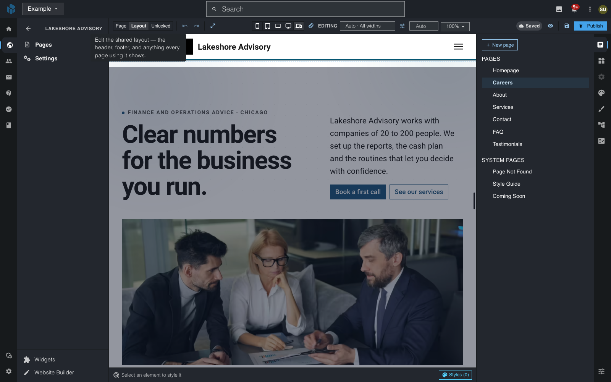
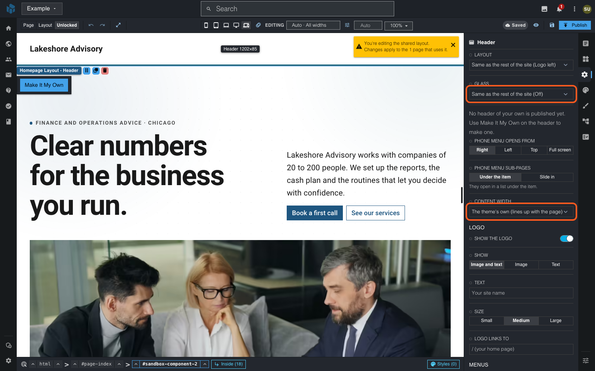
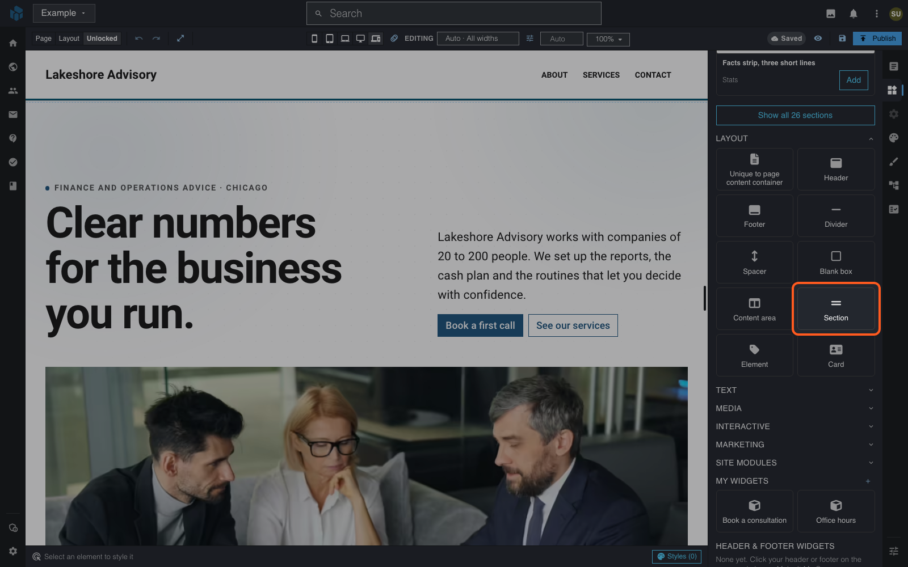
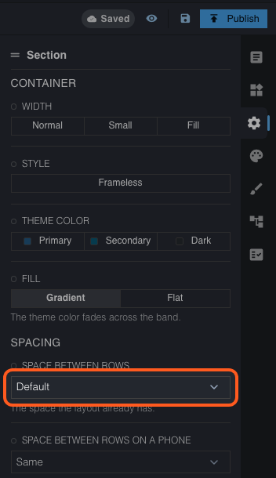
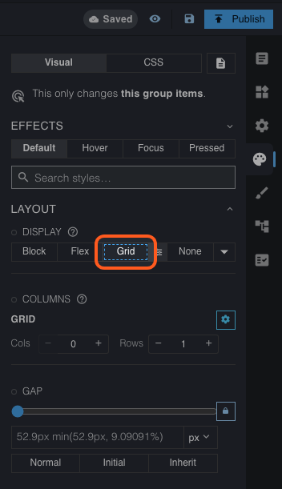
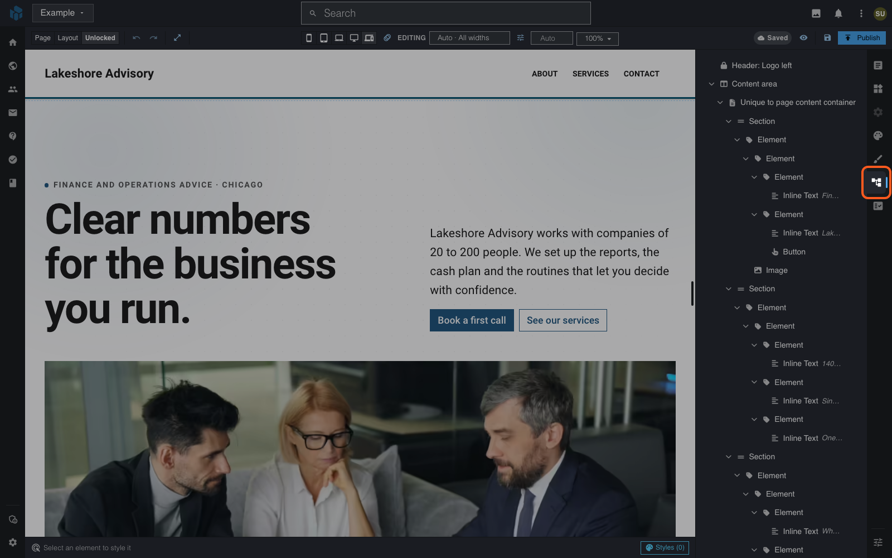

# Page Layouts and Structure

**Last verified:** 2026-11-10 12:36pm

A great website is built on a solid structure. Before you add text, images, and buttons, you need to set up the framework that holds everything in place. This guide explains how pages are organized in WebNesting and how to build clean, well-structured layouts.

---

## How Pages Are Structured

Every page in WebNesting is made up of layers, like a sandwich:

- **Header** -- The top of your page. This usually holds your logo, navigation menu, and any content that should appear at the very top of every page.
- **Main Content** -- The middle section where most of your page content lives. This is where you add sections, text, images, and other components.
- **Footer** -- The bottom of your page. This typically holds contact information, links, copyright notices, and social media icons.

The header and footer usually stay the same across all pages on your site. The main content area is where each page gets its own unique content.

### Choosing what your header and footer show

Every header and footer layout can show every part. The layout only decides where each part sits and which parts are on to start with.

1. In the Website Builder, click the header (or the footer). **Settings** opens.
2. Turn each part on or off, and fill in its words.

The header's parts:

- **Logo** -- your logo picture, your site's name, or both (**Image and text**, **Image**, **Text**), in three sizes. **Text** starts as your site's name; type other words to replace it. Upload the picture in **Site Settings → Content → Site Images**. If you pick **Image** and have no picture yet, your site's name shows instead. **Logo links to** is the page the logo opens, such as `/shop`; leave it empty for your home page.
- **Menus** -- the main menu and a second, smaller menu. Pick which of your menus each one shows, how many levels show, and whether the pages under an item open in a list (**Dropdown**) or a wide panel (**Mega menu**). Under each menu you pick, **Edit this menu's pages** opens your Pages list showing only the pages in that menu. Open a page's settings there to add it to a menu or take it out.
- **Links and switches**: your social links, the language switcher and the light and dark switch. Your social profiles are in **Site Settings → Connections → Social Settings**. On a wide screen they sit with your second menu in a small row of their own, apart from the main menu. Your layout puts that row across the top of the header or above the main menu. When the menu folds behind its button, on phones and tablets or where a long menu does not fit, the second menu, the language links and the social links move into the menu with it.
- **Button**: a button with your own words and link, such as "Book a call". It can open in a new tab. Its **Style** is **Filled**, **Outline** or **Dark**. A new button starts as **Outline**, so your header button and footer button match. If you picked **Filled** before, your button stays **Filled**. **Dark** is a solid button in your header's text color: dark on a light header, light on a dark header and in dark mode. Its corners come from your theme's buttons, so your header and footer buttons match the buttons on your pages. To change them, change your theme's button corners. **Button on phones** decides where the header button goes on a phone. **In the phone menu** puts it last in the menu's list. **Pinned at the menu's foot** keeps it at the bottom of the phone menu, where it stays in view while visitors scroll a long menu. **In the phone bar** keeps it in view, small, next to the menu button, so keep its words short. On a narrow phone it gets narrower, and your logo keeps its room.
- **Category row**: a row of links across the foot of the header, such as your shop's categories. **Three rows** shows it to start with. For any other layout, turn on **Show the category row**. It shows the top pages of your **Header category menu**; pick another menu under **Which menu**. On phones, its links move into the menu, under your main menu.
- **Top bar** -- a thin bar above the header with a short message, a phone number, an email address and your social links. Your whole message always shows: when it does not fit on one line, it wraps and the bar gets taller. On tablets and phones, a bar with a message leaves out the social links, which are still in your footer. On phones, the phone number and email address show as icons.
- **Announcement bar** -- a short message in your theme's main color, above everything else. See [Announcement bar](#announcement-bar).

With **Dropdown** or **Mega menu**, **Page details** decides what each page under an item shows:

- **Simple** -- each page shows its name. A page with a **Page Icon** shows it small, beside its name.
- **Icon and description** -- each page shows its **Page Icon** and its **Menu Description** under its name, as on many software sites. Set both in each page's settings (see [Page management](page-management.md#menu-description)). The top items never show a description.

With **Mega menu**, three more settings fill each wide panel:

- **Show a feature card** shows a card for the menu item: its page's **Share Image**, its name and its **Menu Description**. Set both in the page's settings. A page with neither shows no card.
- **Show a "See all" link** ends each panel with a link to the item's own page, such as "See all Services".
- **Wide panel layout** is **Columns** (each page under the item is a column) or **Two groups**. With **Two groups**, the first page under the item is a wide group with its pages in two columns, and the other pages stack beside it. Each group's label is its own page, so put a group's pages under that page in Pages. The item needs at least two pages under it.

To show a page as a promo card in its mega menu panel, such as a sale or a case study:

1. Open the page properties of a page under a mega menu item.
2. Under **Navigation**, set **Menu look** to **Promo card in a mega menu**.
3. Give the page a **Share Image**, a **Menu Description** or both.
4. Save your changes.

The card has the picture, the page's name and its description, and sits beside the feature card. A page with neither a picture nor a description stays a link in its column. Drop-down menus and the phone menu show the page as a normal link.

With **Dropdown** and three or more levels, **Third level opens** decides where the pages under a page in the list go:

- **Under its item** -- they open in place, under their page.
- **Beside its item** -- they open in a list next to their page, on the side with room. Rest the mouse on a page to open its list. With the keyboard, the right arrow opens a list, the left arrow closes it, and Escape goes back one level. On a phone, the pages still open under their item.

Both settings change the page in the Website Builder at once.

The header's **Settings** also has **Phone menu opens from**: **Right**, **Left**, **Top** or **Full screen**. On phones and small tablets, the menu sits behind a menu button and opens from this side. **Full screen** covers the whole screen with large, well-spaced links. With the **Minimal** layout, the menu button shows on every screen, so the full-screen menu opens on a computer too.

When your menu has pages under its items, **Phone menu sub-pages** decides how they show in the phone menu:

- **Under the item** -- the pages open in a list under their item. This is how the phone menu has always worked.
- **Slide in** -- tap the arrow next to an item, and its pages slide in on their own. A **Back** button at the top names the item and takes you back. Pages under those pages slide in the same way.

Both settings change the page in the Website Builder at once. Open the phone view and tap the menu button to try them.

**Phone menu animation** decides how the phone menu opens and closes. It closes the same way it opened:

- **Slide**: the menu moves in from its side. A full-screen menu fades in and lifts a little.
- **Fade**: the menu fades in where it stops.
- **None**: the menu shows and hides at once.

**Phone menu speed** is **Fast**, **Normal** or **Slow**. It does nothing when the animation is **None**. A visitor whose device asks for less motion gets the menu at once.

The **Phone menu** group in the header's **Settings** adds parts to the phone menu:

- **Second menu on phones**: **In the menu** lists your second menu's links with the others. **Pinned at the foot** shows them as buttons at the bottom of the phone menu, where they stay in view while visitors scroll. Use it for two or three short links, such as Apply and Give. If **Button on phones** is pinned too, your button sits under them.
- **Audience links**: pick a page such as "Information for". The phone menu shows its name as a heading, with links to the pages under it, such as Students and Parents. Those pages can stay out of your menus.
- **Help box**: a short note near the end of the phone menu, such as "Questions? Call (555) 010-2030", with a link. Leave it empty for none.

The phone menu shows its parts in this order: your main menu, the category row, audience links, the second menu, languages, social links, the help box and the button. A part you pin at the foot shows only there.

The footer's parts:

- **Logo and text** -- the logo, as in the header, and a short text under it.
- **Menus**: the footer menu, a second menu and your legal links (such as Privacy and Terms). A menu with pages under its items shows each item as a heading with its pages below it, in columns that line up at the top. A menu with no pages under its items spreads its links into even columns. The second menu sits under the first, past a thin line. **On phones** decides how a menu with headings shows on a phone:
  - **Fold into sections**: each heading becomes a button that opens and closes its pages. The footer stays short, and every link is one tap away.
  - **Headings only**: only the headings show. Visitors reach the pages under them from each heading's own page.
  - **Every link**: every heading and page shows in columns, as on a computer. The footer gets longer.

  **Second menu look** is **Links** or **Buttons**. **Buttons** makes the first link your theme's button and the second its outline button; the rest stay links. Put your most important page first in the menu, such as Donate. Your header's second menu has the same looks.
- **Email sign-up**: **Show an email sign-up** adds a box where visitors type their email to join your list, with a heading and a short text of your own. It shows while your workspace has the Marketing product on.
- **Details** -- your footer details (such as your address), the copyright line and an extra line of text. **Name in the copyright line** shows a name of your choice, such as your own on a personal site. Leave it empty to use your business name from Site Settings. Under **Extra text position**, choose **Left** to put the extra line first in the bottom bar, where a copyright line usually sits, or **Right** to keep it at the end.
- **Locations**: turn it on to list your offices or stores. Under **Your locations**, add up to six. Each has a **Name**, an **Address** and an optional **Phone**. Each line of the address shows on its own line, and visitors tap a phone number to call it. The locations sit side by side where they fit, after your footer details.
- **Award logos**: turn it on to show small logos, such as a license or an award. Under **Your award logos**, add up to six. Each has a **Picture**, a **Description** and an optional **Link**, such as the page that confirms the logo. Leave **Description** empty to use the picture's description from your media library. A logo with no description stays off your live site, because screen readers need words to read. The Website Builder shows such a logo faded, with a note.
- **Legal text**: a short paragraph of fine print, such as your license number or a note about prices. It sits with your award logos, above the copyright line.
- **Links and switches** -- your social links, the language switcher and the light and dark switch.
- **Button** -- a button with your own words and link.

A part with nothing in it shows nothing on your site. In a footer you made your own, a **Site details** block can show **Locations (footer)**, **Award logos (footer)** or **Legal text (footer)**.

The boxes for the top bar's message, the text under the logo, your footer details and the extra line have three buttons: **Bold**, **Italic** and **Link**. The top bar's message and the extra line stay on one line. The text under the logo and your footer details can have more than one paragraph: press Enter to start a new one. Text from before with headings, lists or sizes now shows as plain paragraphs, with its words and links kept.

The words you type here replace the header and footer text that used to be in **Site Settings → Content → Site Messages**. Your old words were moved here for you.

**More than one language.** If your site has more than one language, each box for words (the logo's text, the button's words, the top bar, the footer text and details, and the announcement bar) has a row of your languages above it. Pick a language and type the words for it. A hollow mark beside a language means it has no words yet. Visitors then read your main language's words. **Start from the English text** copies your main language's words into the box so you can translate them. Pick a language once and every box shows it. With one language, you see the plain box.

### Your header's and footer's colors and sizes

Each header and footer can have its own colors, lines, sizes and text style. The rest of your site keeps your theme's look.

1. In the Website Builder, click the header (or the footer). **Settings** opens.
2. Open **Header colors**, **Header border and shadow**, **Header size and spacing** or **Header text**. The footer's groups start with **Footer**.
3. Pick a color, or type a size in pixels. The page shows the change at once.
4. Save the page.

What you can change:

- **Colors** -- the background, the text and its hover color, the menu links, the site name, the icons and small text. The header also has the drop-down menu, the phone menu and the top bar, and a header with Glass on has **Text before scrolling**. The footer also has the bottom strip with your copyright line.
- **Border and shadow** -- the color and thickness of the line under the header (or above the footer), and a shadow: **None**, **Soft**, **Medium** or **Strong**.
- **Size and spacing** -- the header's **Bar height** (on phones too) and the space at the sides. The footer has the space between its columns, the space at the sides and the size of the social icons.
- **Text** -- the menu's text size and weight, and **Menu letters**: **As typed**, **CAPITALS** or **Each Word**. Also the site name's size and weight.

Leave a box empty, or pick **Same as the theme**, to use your theme's value. A color picked from your theme's list also changes in dark mode. A color you mix yourself stays the same in light and dark mode.

### A picture behind your header or footer

1. In the Website Builder, click your header (or your footer). **Settings** opens.
2. Open **Header colors** (or **Footer colors**) and pick a **Background picture** from your media library.
3. Set **Picture color layer**, the color laid over the picture so your words stay readable. Leave it empty to use the **Background** color.
4. Set **Picture color layer strength**. **Light** shows more of the picture. **Strong** hides more of it and reads best.

The header's and footer's words take a color that reads on the color layer. The header's picture does not show while **Glass** is on.

### A full-screen picture header

With the **Full-screen picture** layout, your header's picture fills the first screen your visitors see. Your logo and menu sit in a bar at its foot.

1. In the Website Builder, click your header. **Settings** opens.
2. Under **Layout**, pick **Full-screen picture**.
3. Open **Header colors** and pick a **Background picture**. Set its color layer as in [A picture behind your header or footer](#a-picture-behind-your-header-or-footer).
4. Publish the page.

How it works:

- **The picture and the bar fit the first screen**, on phones and on wide screens. An announcement bar or a top bar sits above the picture, and the picture gets shorter to make room for it.
- **Your logo and menu take a color that reads on the picture's color layer.**
- **When visitors scroll**, the picture scrolls away first. Then the bar at its foot does what you picked under **When visitors scroll**, as with **Logo above menu**. With **Stays as is**, the bar stays at the top at its full size.
- **Without a picture**, the header looks like **Logo above menu**.
- **Glass does not apply**, so its setting does not show.
- **Your picture loads first**, before the rest of the page, so the page does not feel slow.

### A see-through Glass header

**Glass** is a switch every header layout has, and a header of your own too. Turn it on and your header lies over the top of your page, so your first section's picture or color shows through it. The header stays see-through until it sticks to the top of the screen. From then on it is a frosted bar with a thin line under it.

1. In the Website Builder, click your header. **Settings** opens.
2. Under **Glass**, pick **On**. **Same as the rest of the site** follows your site's choice. To turn it on for every page, go to **Site Settings → Appearance → Header & Footer** and turn on **Glass header**. The **Site design** panel in the Website Builder has the same switch.
3. Publish the page.

How it works:

- **It works with every layout**: **Logo left**, **Logo centered**, **Logo above menu**, **Logo and menu button**, **Menu on both sides**, **Menu in the middle** and **Three rows**, and with a header you made your own. **Full-screen picture** has no Glass, because its picture already fills the top of the page. While it is picked, the **Glass** setting does not show.
- **Your first section starts at the top of the screen**, behind the header. Its words, pictures and buttons start below the header, so nothing is hidden. With **Logo above menu**, the space is as tall as the logo row and the menu row together.
- **A section you hide at one screen size** (its display set to **None** in that device view, see [Responsive design](responsive-design.md)) is skipped at that size. The next section starts behind the header there instead.
- **With an announcement bar or a top bar above it**, the header stays see-through while the bar scrolls away. It frosts the moment it sticks to the top of the screen. The announcement bar and the top bar keep their own solid colors.
- **The header's words and icons** take a color that reads on your first section. Over a **Video background**, they take the color of that section's own words. Over a section set to a dark or a theme color, they take that section's text color. Otherwise they take the header's own text color.
- **To pick the color yourself**, open **Header colors** and set **Text before scrolling**. Pick a light color over a dark picture. This setting shows only while Glass is on.
- **Over a picture or a video**, a shade sits behind the header's words and fades out below the header. It is dark under light words and light under dark words, so the words stay readable on any picture you choose. The shade goes away when the header sticks and turns frosted.
- **Once the header sticks**, the bar is your header's **Background** color, a little see-through and blurred. To change it, set **Background** in **Header colors**.
- **Glass changes only how the header looks.** Its width and the place of the logo and the menu stay the same with Glass on or off. To line them up with your page, use **Content width** (below).
- **On phones**, the menu, the second menu and the button move into the menu, as without Glass.

### What your header does when visitors scroll

1. In the Website Builder, click your header. **Settings** opens.
2. Under **When visitors scroll**, pick one:
   - **Stays and shrinks**: the header stays at the top. The announcement bar, the top bar and the small links above the menu scroll away, and on wide screens the header gets shorter and the logo smaller. This is the default.
   - **Stays as is**: the whole header stays at the top at its full size.
   - **Scrolls away**: the header scrolls away with the page and shows only at the top of the page.
   - **Hides while scrolling down**: the header shrinks first, as with **Stays and shrinks**. Then it slides out of view while visitors scroll down, and comes back shrunk as soon as they scroll up. At the top of the page it is full size again.
3. With **Stays and shrinks** or **Hides while scrolling down**, you can set **Shrink after scrolling**: how far visitors scroll, in pixels, before the header gets smaller. Leave it at 0 to shrink the header as soon as it reaches the top of the screen. Type 200 to show the full header until visitors scroll 200 pixels down.
4. With the same two choices, pick **How the header shrinks**:
   - **At a set point**: the header shrinks in one quick step when visitors pass **Shrink after scrolling**. This is the default.
   - **Follows the scroll**: the header shrinks a little with each bit visitors scroll, and grows back the same way when they scroll up. With **Hides while scrolling down**, it then slides out of view as fast as the page scrolls.
5. With **Follows the scroll**, you can also set:
   - **Fully shrunk after scrolling**: how far visitors scroll, in pixels, before the header is at its smallest. Leave it empty to shrink at the same speed as the page scrolls.
   - **Finish when scrolling stops**: when visitors stop part of the way, the header finishes to its full or its small size, whichever is nearer.
6. Publish the page, then scroll the published page to see it.

Every choice works with Glass, with every layout and with a header you made your own. A visitor who moves through the page with the keyboard always sees the header when they reach it. A visitor whose device asks for less motion sees no sliding of its own. With **Follows the scroll**, the header moves only as they scroll. On phones, the header shrinks and hides the same way with either choice of **How the header shrinks**.

> **Tip:** Glass looks best over a first section with a large picture, such as a **Video background** with a cover picture. **Menu in the middle** (your logo on the left, your menu in the middle and your button on the right) with Glass on looks like a modern product page.

### Set a menu item apart and change your header's shape

Each setting below works with every header layout and every theme, on phones and on wide screens.

To make one page stand out in your main menu:

1. Open the page properties of a page in your header's main menu.
2. Under **Navigation**, set **Menu look** to **Highlighted** or **Button**.
3. Save your changes.

A **Highlighted** page is bolder and underlined, in your menu's hover color. On a phone it stays in the phone bar, next to the menu button, while your header has no button there. In a header you made your own, a **Site details** block set to **Highlighted page (phone bar)** does this. **Make It My Own** adds it for you. A **Button** page looks like your theme's outline button, with your theme's corners, for a sale or an event. Only the top items of your main menu take these looks. Your second menu and your footer show the page as a normal link.

Click your header in the Website Builder to find these in its **Settings**:

- **Second menu look** draws your second menu as **Links** (the default) or **Buttons**. With **Buttons**, the first page is your theme's button, the second its outline button, and the rest stay links. Put your most important page first, such as Donate, then Membership.
- **Top row look** shows for layouts with a row of small links above the menu. **Tab** draws that row as a box at the right end only, with rounded lower corners.
- **Shape** set to **Floating** makes your header a rounded bar with a gap above it and at its sides, so the page shows around it. It works with Glass and with every scroll setting. **Full-screen picture** has no **Shape**, because its picture fills the first screen.
- **While shrunk, show** shows when **When visitors scroll** is **Stays and shrinks** or **Hides while scrolling down**. On wide screens, **Only the button** fades the menu away once the header shrinks and keeps your header's button. With no button, your **Highlighted** page stays. Point at the header, or move into it with the keyboard, and the whole menu comes back.

### How wide your header and footer spread

On a large screen, you choose how far your header's logo, menu and buttons spread, and how far your footer's columns spread. The background color always fills the whole width of the screen.

1. In the Website Builder, click your header (or your footer). **Settings** opens.
2. Under **Content width**, pick one:
   - **The theme's own** -- the header and the footer line up with your page, unless your theme sets another width.
   - **Line up with the page** (header only) -- the logo and the menu start and end where your page's sections do, whatever your theme sets. If a menu is a little too long, its words move closer together. If it still does not fit, it moves behind the menu button; **Full screen** gives it more room.
   - **Full screen** -- the content spreads to the sides of the screen, however wide it is.
   - **Custom** -- type the **Largest width** in pixels, from 480 to 3840.
3. The page in the Website Builder changes at once. Publish the page.

This works with every header and footer layout, and with a header or footer you made your own from a layout. Each layout keeps its own choice, so a landing page can have a full-screen header while the rest of your site lines up with the page. On a phone, the header and footer always fit the screen.

### Announcement bar

The announcement bar is a short message in a bar above your header. Use it for a sale, a closing day or a new address. It shows on every page that uses this header.

1. In the Website Builder, click your header. **Settings** opens.
2. Under **Announcement bar**, turn on **Show an announcement bar**.
3. Type your **Message**. Use 140 characters or fewer. A line break becomes a space, so the bar stays on one line where it fits.
4. If you want a link, type it in **Link**. Use a web address that starts with `https://`, `mailto:` or `tel:`, or a page on your site like `/sale`.
5. Type the **Link text**, up to 30 characters. If you leave it empty, the link reads **Learn more**.
6. Turn **Visitors can close it** on or off.
7. Publish the page.

The bar shows on the page in the builder as you type. Click the bar to open the header's **Settings**. While the message is empty, the bar shows a note in its place, and visitors see no bar. If a message or link needs a fix, the field says so under it.

**When visitors close the bar.** A visitor who closes the bar does not see it again on that browser. When you change the message, every visitor sees the bar again. A change to the link or the link text does not bring it back. If you turn off **Visitors can close it**, the bar has no close button and every visitor sees it.

**Turning it off.** Turn off **Show an announcement bar** and publish. Your message, link and link text stay saved for the next time you turn it on.

**More than one language.** If your site has more than one language, write the message in each language with the language row above the box, as for the header's other words. A language you leave empty shows your main language's message. Empty link text reads **Learn more** in each visitor's language, such as "En savoir plus" in French.

The bar used to be in **Site Settings → Appearance → Header & Footer**. Your bar was moved onto your header for you. The bar never shows on your Coming Soon page.

### A different header for some pages

A page layout can show its own header or footer. The other pages keep the header of your site.

1. Open a page that uses the layout, in the Website Builder.
2. Click the header (or the footer) on the page. **Settings** opens.
3. Pick a **Layout**, or **Use** one of your own headers.

Each choice starts as **Same as the rest of the site**, so you only change what you want. Everything in the header's **Settings** changes this header only, never your whole site. Visitors see the change when you publish the page. To make a header of your own, click **Make It My Own** on the header. When it is ready, click **Publish & Use as Header**, then publish the page: the pages of this layout then show your own header.

To go back, pick **Same as the rest of the site** again. **Settings → Header & Footer** lists the layouts that keep their own header or footer, with a link to the Builder.

**Make This the Site Default.** While a header shows another layout than the rest of your site, its toolbar has **Make This the Site Default**. Click it to make that layout your site's header. Every page that follows the site then shows it, and this header goes back to **Same as the rest of the site**. The footer works the same way. You need permission to change Site Settings to see this button.

The **Content area** block represents the primary content area of your page. Most pages use one **Content area** between the header and footer. Layouts include one by default.

---

## Choosing a Page Layout

When you create a new page (or edit an existing one), you choose a **layout**. The layout determines the overall structure of the page -- where the header, footer, and main content area are placed, and whether there are sidebars or other structural elements.

Your layout acts like a blueprint. Once you choose it, you fill in the main content area with your own components.

> **Tip:** If you are unsure which layout to use, start with a simple full-width layout. You can always change it later.

---

## Layout Blocks

The blocks in the **Layout** group of the **Add** panel are the building blocks you use to organize content within the main content area. Think of them as invisible containers that hold and arrange your visible content.

### Sections

A **Section** is a full-width horizontal band that stretches across your page. Think of sections as chapters in a book -- each one covers a different topic or area of your page.

Common uses for sections:
- A hero area at the top of your page with a big headline and image
- A features section showcasing what you offer
- A testimonials section with customer quotes
- A contact section with your information and a form

#### Adding a Section

1. In the builder, open the **Add** panel from the rail on the right.
2. Look under **Layout** for the **Section** block.
3. Drag it onto your page where you want it.
4. The section will appear as an empty area, ready for you to add content inside it.

#### Giving a Section a Dark Background

1. Click the section, then open its settings.
2. Under **Theme color**, pick **Dark**.

The section turns dark and its words, links, buttons and cards change to stay easy to read. Solid buttons in a dark section use your theme's primary color. **Primary**, **Secondary** and **Tertiary** give a band of your theme's brand colors in the same way.

A **Primary**, **Secondary** or **Tertiary** section has a **Fill** setting. **Gradient** fades the color across the band. **Flat** paints one solid color. Text and buttons stay easy to read on both.

#### Giving a Section a Link Name

A link name lets a menu item or button jump to a section of the page.

1. Click the section, then open its settings.
2. In **Page link**, type a name in **Anchor name**, such as `work`. Use lowercase letters, numbers and dashes.
3. Save the page.

The page can now link to `/#work`. Each name works once per page. The page stops below your sticky header, so the section title stays visible. To use it in a menu, see [Linking a Menu Item to a Section](site-navigation.md#linking-a-menu-item-to-a-section).

> **Tip:** Build your page by stacking sections from top to bottom. Each section should focus on one idea or purpose. This keeps your page organized and easy for visitors to scan.

### Groups and Blank Boxes

A **Blank box** (listed under **Layout** in the **Add** panel) is an empty box that holds other elements together. While a section spans the full width of your page, blank boxes are used inside sections to group related content.

Think of a blank box like a box on a shelf. You might have one box for photos, another for documents, and another for supplies. Each blank box groups related items together.

#### Adding a Blank Box

1. Open the **Add** panel.
2. Under **Layout**, find the **Blank box** block.
3. Drag it into a section on your page.
4. Now you can drag other components (text, images, buttons) into the box.

### Dividers

A **Divider** is a simple horizontal line that separates content visually. Use dividers when you want to create a visual break between two areas without starting a whole new section.

#### Adding a Divider

1. Open the **Add** panel.
2. Under **Layout**, find the **Divider** block.
3. Drag it between the elements you want to separate.

> **Tip:** Use dividers sparingly. Too many dividers can make your page look cluttered. Often, adding spacing (padding or margin) between sections is a cleaner alternative.

### Spacing Inside a Section or Box

Sections, blank boxes and Elements have a **Spacing** panel in **Settings**.

- **Space between rows** sets the space between the rows inside the block, such as between a heading and a grid of photos under it. Choose **Small**, **Medium**, **Large** or **X-large**. Each size is smaller on a phone and larger on a wide screen. **Default** keeps the block's own spacing. It does not change the space between columns that sit side by side.
- **Space between rows on a phone** sets a different space for a phone only, where the columns stack. **Same** keeps **Space between rows**. Use it when cards look too close or too far apart on a phone.
- **Line above** draws a thin line across the top of the block, with space between the line and the content. Use it for a row of facts under a photo. Your theme sets the line's color. It replaces a Divider when you want the space under the line to stay even.

To use them:

1. Select the section, blank box or Element.
2. Click **Settings**.
3. Open **Spacing**.
4. Pick a size in **Space between rows**, or tick **Line above**.

A Section also has a **Section style** panel. **Background** sets the look of the section's background: **Plain** (the default) keeps the page's own background, **Page heading** adds a soft glow and faint dots behind the title with extra space above (it works anywhere on the page, and the glow stays inside the section), and **Tinted** gives a light tinted background with a thin line at the top and bottom. Pick one at a time. Your theme chooses the colors, so each style fits every theme, in light and dark mode.

A Section also has a **Band spacing** panel. **Space above and below** sets the space between the section's edges and its content: **Small**, **Medium**, **Large** or **X-large**. Each size looks the same in every theme. It is smaller on a phone. **Theme default** keeps your theme's space.

#### Text Width

Text fills the column it is in. For shorter lines, such as long reading text on a wide page, put the text in a narrower column: see [Creating Multi-Column Layouts](#creating-multi-column-layouts).

---

## Creating Multi-Column Layouts

One of the most common things you will want to do is place content side by side -- like text next to an image, or three feature cards in a row.

### Method 1: Side-by-Side (Flex) Layout

The easiest way to put items next to each other is to use a Flex layout on a blank box.

1. Add a **Blank box** (or Section) to your page.
2. Add the items you want side by side inside the box. For example, drag in two text blocks or a text block and an image.
3. Select the box (not the items inside it).
4. Open the **Styles** panel and find the **Layout** section.
5. Click the **Flex** button.
6. The items inside will now appear next to each other.

You can further adjust the layout:
- Click the gear icon next to "Flex" to set direction, wrapping, and alignment.
- Set the direction to **Row** (items go left to right) or **Column** (items stack top to bottom).

### Method 2: Grid Layout

For evenly spaced columns, use the Grid layout.

1. Add a **Blank box** to your page.
2. Add the items you want in the grid inside the box.
3. Select the box.
4. In the **Styles** panel, find the **Layout** section.
5. Click the **Grid** button.
6. Under **Grid**, set **Cols** (columns) and **Rows**. The gear icon beside **Grid** opens more grid options.

### Common Layout Examples

#### Two-Column: Text + Image

This is perfect for an "About" section or a feature highlight.

1. Add a Section to your page.
2. Add a Blank box inside the section.
3. Add an Inline Text block and an Image block inside the box.
4. Select the box and set its display to **Flex**.
5. Both items will sit side by side -- text on the left, image on the right.

> **Tip:** To control how much space each item takes, select each item individually and set its width to a percentage. For example, set the text to 60% and the image to 40%.

#### Three-Column Features

Great for showcasing services, features, or team members.

1. Add a Section to your page.
2. Add a Blank box inside the section.
3. Add three child blank boxes or Card blocks inside.
4. Select the parent box and set its display to **Grid**.
5. Under **Grid**, set **Cols** to 3.
6. Each item will take up one-third of the width.

#### Staggered Columns

For a zigzag, where every second column sits lower than its neighbor.

1. Select the **Element** that holds your columns.
2. Click **Settings**.
3. Find **Columns layout** and click **Staggered**.

With two columns, the second column of each pair sits lower. With three columns, the middle one sits lower. **Even** puts every column at the same height again. On a phone, the columns stack in one even column, so nothing is offset.

#### Space Between and Before Columns

The **Columns layout** panel has three more settings.

- **Columns stack**, on the Element that holds your columns, sets where the columns stack in one column, one under the other. **On phones**, the default, stacks them on a screen narrower than 768px. A tablet then shows them side by side. **On phones and tablets** stacks them on a screen narrower than 1024px, so a tablet shows one column, as a phone does. A laptop or a wider screen shows them side by side. With **On phones and tablets**, the **Space between rows on a phone** of that Element shows on a tablet too.

- **Space between columns**, on the Element that holds your columns, sets the space between the columns. Choose **Small**, **Medium**, **Large** or **X-large**. **Default** keeps the space the layout already has.
- **Space before this column**, on a column, moves the column 1, 2 or 3 columns to the right. A row has 12 columns. For example, a 5-column heading and a 6-column list with 1 column before it fill the row, with a gap in the middle.

The column's width plus the space before it must be 12 columns or less, or the column moves to a new line. Where the columns stack, each one is full width, so the space before a column is not used.

> **Tip:** When you stack columns on tablets, open **Site design**, then **Sizes and shapes**, and set **Text size on a tablet** to **Phone size**. The theme editor's **Sizes and shapes** tab has the same slider. Headings and text then keep their phone size until the screen is 1024px wide, so a stacked tablet page does not get oversized headings.

#### Card Grid

For a gallery of cards, product listings, or a portfolio.

1. Add a Section to your page.
2. Add a Blank box inside the section.
3. Add as many cards or child blank boxes as you need.
4. Select the parent box and set its display to **Grid**.
5. Set the columns to 2, 3, or 4 depending on how many cards you want per row.
6. Set the **Gap** to add space between the cards (16 or 24 pixels works well).

---

## Nesting: Putting Components Inside Other Components

Nesting is when you place one component inside another. This is how you build complex layouts.

For example:
- A **Section** contains a **Blank box**.
- That box contains an **Inline Text** block and an **Image**.
- Or that box contains two more **Blank boxes**, each with their own content.

You can nest components several levels deep. The structure works like a family tree -- each component can have children, and those children can have their own children.

### How to Nest Components

1. Drag a component from the **Add** panel.
2. Drop it on top of (or inside) a blank box or section on your page.
3. The box will highlight to show it is ready to receive the new component.
4. Release to drop it inside.

### Moving Components Between Blank Boxes

1. Click and hold the component you want to move.
2. Drag it to a different box.
3. Drop it when the target box highlights.

> **Tip:** If you are having trouble dropping a component inside a box, make sure the box is set to accept children (nestable). Sections and blank boxes are nestable by default, but some components (like dividers) are not.

---

## When to Use Sections vs. Blank Boxes

| Use a Section When... | Use a Blank Box When... |
|----------------------|------------------------|
| You want a full-width band across the page | You want to group items within a section |
| You are starting a new "chapter" of your page | You need to arrange items side by side |
| You want a distinct background color or image for an area | You want to control the width of a group of items |
| You are separating major areas (hero, features, contact) | You are nesting content inside a section |

**Rule of thumb:** Sections are the big horizontal slices of your page. Blank boxes go inside sections to organize the content within each slice.

---

## Common Layout Patterns

Here are some popular page layouts you can build with sections and blank boxes.

### Hero Section

A large, eye-catching area at the top of your page.

1. Add a **Section** at the top of your page.
2. Inside, add a **Blank box** with a text block for your headline and a button.
3. Style the section with a background color or image.
4. Add generous padding (60-100 pixels top and bottom) to give it height.
5. Set the box to Flex with centered alignment to center the content.

### Features Grid

Showcase 3-6 features or services in a grid.

1. Add a **Section**.
2. Inside, add a heading text block and a **Blank box** below it.
3. Inside the box, add cards or blank boxes for each feature.
4. Set the outer box to Grid with 3 columns.
5. Add a gap of 24 pixels between the items.

### Two-Column With Sidebar

Content on the left, sidebar on the right.

1. Add a **Section**.
2. Inside, add a **Blank box** and set it to Flex.
3. Add two child blank boxes inside.
4. Set the left box width to 70% and the right box width to 30%.
5. Add your main content to the left box and sidebar content to the right.

### Contact Section

A section with contact information and a call-to-action.

1. Add a **Section** near the bottom of your page.
2. Give it a contrasting background color.
3. Inside, add a **Blank box** set to Flex.
4. Add your contact information on one side and a button or form on the other.

### Full-Width Image Banner

A dramatic full-width image with text overlay.

1. Add a **Section**.
2. Set the section's background to your image.
3. Add a **Blank box** inside with a text block.
4. Center the text using Flex alignment.
5. Add padding to give the section height.

---

## Tips for Clean, Organized Page Structures

1. **Plan before you build.** Sketch out your page structure on paper first. Decide what sections you need and what content goes in each one.

2. **Keep nesting shallow.** Try not to nest more than 3-4 levels deep. Deep nesting makes your page harder to manage and can cause unexpected layout issues.

3. **Name your sections mentally.** As you build, think of each section as having a name: "Hero," "Features," "Testimonials," "Contact." This helps you stay organized.

4. **Use consistent widths.** If you create a two-column layout in one section, use the same column proportions in other sections for a cohesive look.

5. **Start simple.** Begin with one section at a time. Get each section looking good before adding the next one.

6. **Use the component hierarchy.** The **Layers** panel in the panel rail shows a tree view of all your components. Use it to check your structure and make sure everything is nested correctly.

