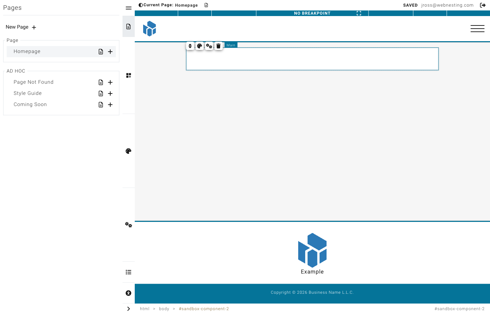

# Page Layouts and Structure

**Last verified:** 2026-10-27 6:23pm

A great website is built on a solid structure. Before you add text, images, and buttons, you need to set up the framework that holds everything in place. This guide explains how pages are organized in WebNesting and how to build clean, well-structured layouts.

---

## How Pages Are Structured

Every page in WebNesting is made up of layers, like a sandwich:

- **Header** -- The top of your page. This usually holds your logo, navigation menu, and any content that should appear at the very top of every page.
- **Main Content** -- The middle section where most of your page content lives. This is where you add sections, text, images, and other components.
- **Footer** -- The bottom of your page. This typically holds contact information, links, copyright notices, and social media icons.

The header and footer usually stay the same across all pages on your site. The main content area is where each page gets its own unique content.

### Choosing what your header and footer show

Every header and footer layout can show every part. The layout only decides where each part sits and which parts are on to start with.

1. In the Website Builder, click the header (or the footer). **Settings** opens.
2. Turn each part on or off, and fill in its words.

The header's parts:

- **Logo** -- your logo picture, your site's name, or both (**Image and text**, **Image**, **Text**), in three sizes. **Text** starts as your site's name; type other words to replace it. Upload the picture in **Site Settings → Content → Site Images**. If you pick **Image** and have no picture yet, your site's name shows instead. **Logo links to** is the page the logo opens, such as `/shop`; leave it empty for your home page.
- **Menus** -- the main menu and a second, smaller menu. Pick which of your menus each one shows, how many levels show, and whether the pages under an item open in a list (**Dropdown**) or a wide panel (**Mega menu**). **Edit This Menu in Pages** opens your pages, where you choose the menu each page is in.
- **Links and switches** -- your social links, the language switcher and the light and dark switch. Your social profiles are in **Site Settings → Connections → Social Settings**. On phones, the social links move into the menu.
- **Button** -- a button with your own words and link, such as "Book a call". It can open in a new tab and be filled or outlined. On phones, it moves into the menu.
- **Top bar** -- a thin bar above the header with a short message, a phone number, an email address and your social links.
- **Announcement bar** -- a short message in your theme's main color, above everything else. See [Announcement bar](#announcement-bar).

The header's **Settings** also has **Phone menu opens from**: **Right**, **Left** or **Top**. On phones and small tablets, the menu sits behind a menu button and opens from this side.

The footer's parts:

- **Logo and text** -- the logo, as in the header, and a short text under it.
- **Menus** -- the footer menu, a second menu and your legal links (such as Privacy and Terms).
- **Details** -- your footer details (such as your address), the copyright line and an extra line of text.
- **Links and switches** -- your social links, the language switcher and the light and dark switch.
- **Button** -- a button with your own words and link.

The words you type here replace the header and footer text that used to be in **Site Settings → Content → Site Messages**. Your old words were moved here for you.

### Announcement bar

The announcement bar is a short message in a bar above your header. Use it for a sale, a closing day or a new address. It shows on every page that uses this header.

1. In the Website Builder, click your header. **Settings** opens.
2. Under **Announcement bar**, turn on **Show an announcement bar**.
3. Type your **Message**. Use 140 characters or fewer. A line break becomes a space, so the bar stays on one line where it fits.
4. If you want a link, type it in **Link**. Use a web address that starts with `https://`, `mailto:` or `tel:`, or a page on your site like `/sale`.
5. Type the **Link text**, up to 30 characters. If you leave it empty, the link reads **Learn more**.
6. Turn **Visitors can close it** on or off.
7. Publish the page.

The bar shows on the page in the builder as you type. Click the bar to open the header's **Settings**. While the message is empty, the bar shows a note in its place, and visitors see no bar. If a message or link needs a fix, the field says so under it.

**When visitors close the bar.** A visitor who closes the bar does not see it again on that browser. When you change the message, every visitor sees the bar again. A change to the link or the link text does not bring it back. If you turn off **Visitors can close it**, the bar has no close button and every visitor sees it.

**Turning it off.** Turn off **Show an announcement bar** and publish. Your message, link and link text stay saved for the next time you turn it on.

**More than one language.** If your site has more than one language, write the message in each language the way you write the header's other words. A language you leave empty shows your main language's message. Empty link text reads **Learn more** in each visitor's language, such as "En savoir plus" in French.

The bar used to be in **Site Settings → Appearance → Header & Footer**. Your bar was moved onto your header for you. The bar never shows on your Coming Soon page.

### A different header for some pages

A page layout can show its own header or footer. The other pages keep the header of your site.

1. Open a page that uses the layout, in the Website Builder.
2. Click the header (or the footer) on the page. **Settings** opens.
3. Pick a **Layout**, or **Use** one of your own headers.

Each choice starts as **Same as the rest of the site**, so you only change what you want. Everything in the header's **Settings** changes this header only, never your whole site. The change is saved when you save the page. To make a header of your own, click **Make It My Own** on the header.

To go back, pick **Same as the rest of the site** again. **Settings → Header & Footer** lists the layouts that keep their own header or footer, with a link to the Builder.

**Make This the Site Default.** While a header shows another layout than the rest of your site, its toolbar has **Make This the Site Default**. Click it to make that layout your site's header. Every page that follows the site then shows it, and this header goes back to **Same as the rest of the site**. The footer works the same way. You need permission to change Site Settings to see this button.

The **Content area** block represents the primary content area of your page. Most pages use one **Content area** between the header and footer. Layouts include one by default.

---

## Choosing a Page Layout

When you create a new page (or edit an existing one), you choose a **layout**. The layout determines the overall structure of the page -- where the header, footer, and main content area are placed, and whether there are sidebars or other structural elements.

Your layout acts like a blueprint. Once you choose it, you fill in the main content area with your own components.

> **Tip:** If you are unsure which layout to use, start with a simple full-width layout. You can always change it later.

---

## Layout Blocks

The blocks in the **Layout** group of the **Add** panel are the building blocks you use to organize content within the main content area. Think of them as invisible containers that hold and arrange your visible content.

### Sections

A **Section** is a full-width horizontal band that stretches across your page. Think of sections as chapters in a book -- each one covers a different topic or area of your page.

Common uses for sections:
- A hero area at the top of your page with a big headline and image
- A features section showcasing what you offer
- A testimonials section with customer quotes
- A contact section with your information and a form

#### Adding a Section

1. In the builder, open the **Add** panel from the rail on the right.
2. Look under **Layout** for the **Section** block.
3. Drag it onto your page where you want it.
4. The section will appear as an empty area, ready for you to add content inside it.

> **Tip:** Build your page by stacking sections from top to bottom. Each section should focus on one idea or purpose. This keeps your page organized and easy for visitors to scan.

### Groups and Blank Boxes

A **Blank box** (listed under **Layout** in the **Add** panel) is an empty box that holds other elements together. While a section spans the full width of your page, blank boxes are used inside sections to group related content.

Think of a blank box like a box on a shelf. You might have one box for photos, another for documents, and another for supplies. Each blank box groups related items together.

#### Adding a Blank Box

1. Open the **Add** panel.
2. Under **Layout**, find the **Blank box** block.
3. Drag it into a section on your page.
4. Now you can drag other components (text, images, buttons) into the box.

### Dividers

A **Divider** is a simple horizontal line that separates content visually. Use dividers when you want to create a visual break between two areas without starting a whole new section.

#### Adding a Divider

1. Open the **Add** panel.
2. Under **Layout**, find the **Divider** block.
3. Drag it between the elements you want to separate.

> **Tip:** Use dividers sparingly. Too many dividers can make your page look cluttered. Often, adding spacing (padding or margin) between sections is a cleaner alternative.

---

## Creating Multi-Column Layouts

One of the most common things you will want to do is place content side by side -- like text next to an image, or three feature cards in a row.

### Method 1: Side-by-Side (Flex) Layout

The easiest way to put items next to each other is to use a Flex layout on a blank box.

1. Add a **Blank box** (or Section) to your page.
2. Add the items you want side by side inside the box. For example, drag in two text blocks or a text block and an image.
3. Select the box (not the items inside it).
4. Open the **Styles** panel and find the **Layout** section.
5. Click the **Flex** button.
6. The items inside will now appear next to each other.

You can further adjust the layout:
- Click the gear icon next to "Flex" to set direction, wrapping, and alignment.
- Set the direction to **Row** (items go left to right) or **Column** (items stack top to bottom).

### Method 2: Grid Layout

For evenly spaced columns, use the Grid layout.

1. Add a **Blank box** to your page.
2. Add the items you want in the grid inside the box.
3. Select the box.
4. In the **Styles** panel, find the **Layout** section.
5. Click the **Grid** button.
6. Click the gear icon to set the number of columns and rows.

### Common Layout Examples

#### Two-Column: Text + Image

This is perfect for an "About" section or a feature highlight.

1. Add a Section to your page.
2. Add a Blank box inside the section.
3. Add an Inline Text block and an Image block inside the box.
4. Select the box and set its display to **Flex**.
5. Both items will sit side by side -- text on the left, image on the right.

> **Tip:** To control how much space each item takes, select each item individually and set its width to a percentage. For example, set the text to 60% and the image to 40%.

#### Three-Column Features

Great for showcasing services, features, or team members.

1. Add a Section to your page.
2. Add a Blank box inside the section.
3. Add three child blank boxes or Card blocks inside.
4. Select the parent box and set its display to **Grid**.
5. Click the gear icon and set the columns to 3.
6. Each item will take up one-third of the width.

#### Card Grid

For a gallery of cards, product listings, or a portfolio.

1. Add a Section to your page.
2. Add a Blank box inside the section.
3. Add as many cards or child blank boxes as you need.
4. Select the parent box and set its display to **Grid**.
5. Set the columns to 2, 3, or 4 depending on how many cards you want per row.
6. Set the **Gap** to add space between the cards (16 or 24 pixels works well).

---

## Nesting: Putting Components Inside Other Components

Nesting is when you place one component inside another. This is how you build complex layouts.

For example:
- A **Section** contains a **Blank box**.
- That box contains an **Inline Text** block and an **Image**.
- Or that box contains two more **Blank boxes**, each with their own content.

You can nest components several levels deep. The structure works like a family tree -- each component can have children, and those children can have their own children.

### How to Nest Components

1. Drag a component from the **Add** panel.
2. Drop it on top of (or inside) a blank box or section on your page.
3. The box will highlight to show it is ready to receive the new component.
4. Release to drop it inside.

### Moving Components Between Blank Boxes

1. Click and hold the component you want to move.
2. Drag it to a different box.
3. Drop it when the target box highlights.

> **Tip:** If you are having trouble dropping a component inside a box, make sure the box is set to accept children (nestable). Sections and blank boxes are nestable by default, but some components (like dividers) are not.

---

## When to Use Sections vs. Blank Boxes

| Use a Section When... | Use a Blank Box When... |
|----------------------|------------------------|
| You want a full-width band across the page | You want to group items within a section |
| You are starting a new "chapter" of your page | You need to arrange items side by side |
| You want a distinct background color or image for an area | You want to control the width of a group of items |
| You are separating major areas (hero, features, contact) | You are nesting content inside a section |

**Rule of thumb:** Sections are the big horizontal slices of your page. Blank boxes go inside sections to organize the content within each slice.

---

## Common Layout Patterns

Here are some popular page layouts you can build with sections and blank boxes.

### Hero Section

A large, eye-catching area at the top of your page.

1. Add a **Section** at the top of your page.
2. Inside, add a **Blank box** with a text block for your headline and a button.
3. Style the section with a background color or image.
4. Add generous padding (60-100 pixels top and bottom) to give it height.
5. Set the box to Flex with centered alignment to center the content.

### Features Grid

Showcase 3-6 features or services in a grid.

1. Add a **Section**.
2. Inside, add a heading text block and a **Blank box** below it.
3. Inside the box, add cards or blank boxes for each feature.
4. Set the outer box to Grid with 3 columns.
5. Add a gap of 24 pixels between the items.

### Two-Column With Sidebar

Content on the left, sidebar on the right.

1. Add a **Section**.
2. Inside, add a **Blank box** and set it to Flex.
3. Add two child blank boxes inside.
4. Set the left box width to 70% and the right box width to 30%.
5. Add your main content to the left box and sidebar content to the right.

### Contact Section

A section with contact information and a call-to-action.

1. Add a **Section** near the bottom of your page.
2. Give it a contrasting background color.
3. Inside, add a **Blank box** set to Flex.
4. Add your contact information on one side and a button or form on the other.

### Full-Width Image Banner

A dramatic full-width image with text overlay.

1. Add a **Section**.
2. Set the section's background to your image.
3. Add a **Blank box** inside with a text block.
4. Center the text using Flex alignment.
5. Add padding to give the section height.

---

## Tips for Clean, Organized Page Structures

1. **Plan before you build.** Sketch out your page structure on paper first. Decide what sections you need and what content goes in each one.

2. **Keep nesting shallow.** Try not to nest more than 3-4 levels deep. Deep nesting makes your page harder to manage and can cause unexpected layout issues.

3. **Name your sections mentally.** As you build, think of each section as having a name: "Hero," "Features," "Testimonials," "Contact." This helps you stay organized.

4. **Use consistent widths.** If you create a two-column layout in one section, use the same column proportions in other sections for a cohesive look.

5. **Start simple.** Begin with one section at a time. Get each section looking good before adding the next one.

6. **Use the component hierarchy.** The **Layers** panel in the panel rail shows a tree view of all your components. Use it to check your structure and make sure everything is nested correctly.
