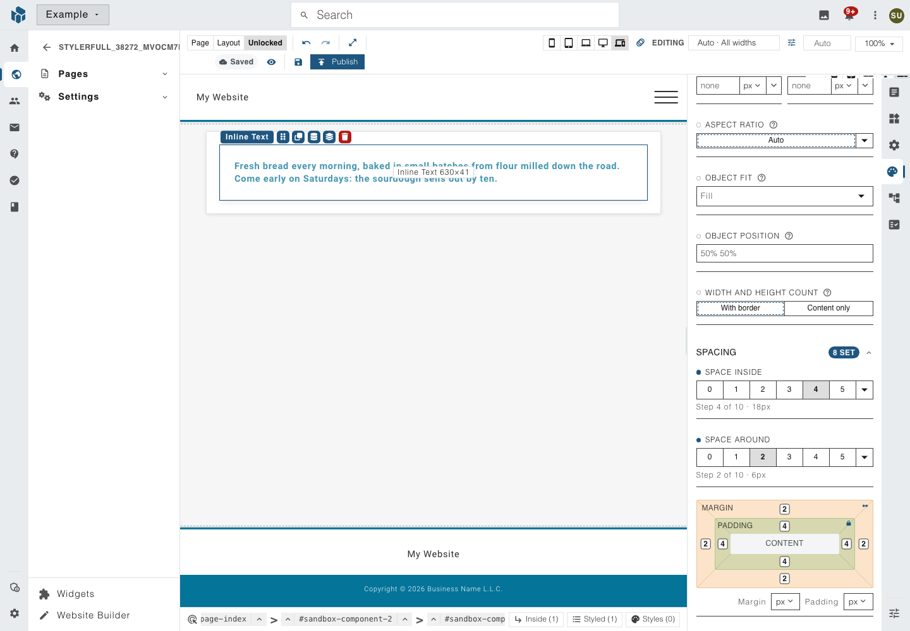
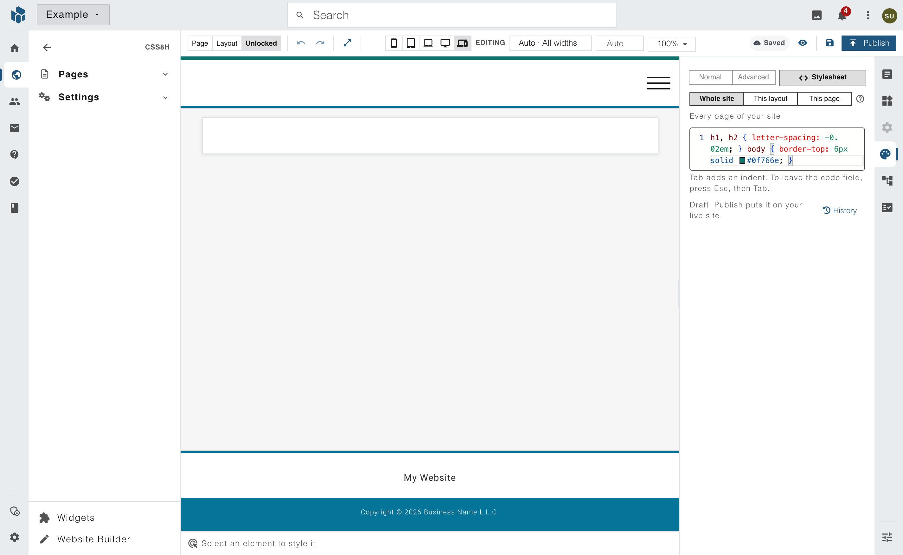

# Styling Your Page Elements

**Last verified:** 2026-10-22 3:01pm

Every element on your page -- text, images, buttons, sections -- can be customized to look exactly the way you want. This guide walks you through the styling tools in WebNesting's Website Builder.

---

## What Is the Styler?

The Styler is the **Styles** panel, opened from the icon rail on the right side of the builder. It controls how things look -- colors, spacing, size, shadows, and more.

Think of the Styler as a set of dials and switches for each element on your page. Select something, and the Styler shows you all the ways you can customize it.

---

## How to Open the Styler

1. Open your page in the Website Builder.
2. Click on any element on your page (a heading, image, section, button, etc.).
3. Click **Styles** in the panel rail on the right.
4. You will see different sections you can expand, like Spacing, Layout, Position, and more. The Styler remembers which sections you keep open or closed, on every page and every element, until you change them.

> **Tip:** If Styles shows your own CSS instead of the element controls, nothing is selected. Click directly on an element -- clicking empty space deselects everything. See [Your Own CSS](#your-own-css) for that view.

---

## Fine-Tuning Values with Your Keyboard

Every number and text box in the Styler works like a design tool.

- **Type a value.** The page shows it after a short pause, so you see the result without it flickering on every key.
- **Press Enter** to apply the value. If the box is inside a small editor (like a spacing value), the editor stays open.
- **Press Esc** to go back to the value you started with. In a small editor, press Esc once to undo your typing and a second time to close the editor.
- **Press the up or down arrow** to nudge a number by one step (for example 1px, or 0.1 for rem).
- **Hold Shift** with the arrows for bigger steps (ten times as big), or **hold Alt** (Option on a Mac) for smaller steps (a tenth of a step).
- **Scroll with the mouse wheel** over a box you are typing in to nudge it the same way. Hold Shift for bigger steps.
- **Drag** a spacing value in the Spacing diagram, or a margin or padding handle on the page, to change it with your mouse. Hold Shift or Alt while you drag for bigger or finer steps. Press Esc while you drag to cancel.

Each change is one step in your undo history. Press **Cmd+Z** (Ctrl+Z on Windows) once to undo the whole change, however you made it.

> **Tip:** Hover over the **?** next to a length or number setting to see these keys as a reminder.

> **Working with a teammate?** Esc only takes back your own change. If a teammate changes something while you type, their change stays.

---

## Colors

You can change the background color and text color of most elements.

### Changing a Background Color

1. Select the element you want to change.
2. In the Styler, find the **Background** section and its **Color** field.
3. Click the color swatch (the small colored square).
4. A color picker will appear. Choose your color by clicking in the color area, or type in a specific color code.
5. The change appears instantly on your page.

### Changing Text Color

1. Select the text element.
2. In the Styler, find the **Typography** section.
3. Click the color swatch next to **Color**.
4. Pick your color from the color picker.

### Using Your Theme's Colors

Next to each color swatch is a **Theme token** menu. It lists the colors your theme already has, each with a plain name such as **Main color**, **Page background** or **Text on main-color buttons**. The names sit in groups: **Main colors**, **Made from your main colors**, **Messages** and **Grays and neutrals**. Type in the search box to find one.

Pick a theme color instead of a color code. When you change the theme's colors later, every element that uses a theme color changes with it. A color a theme adds later shows up in the menu on its own.

### Color Contrast

When choosing text colors, make sure your text is easy to read against its background. Dark text on a light background or light text on a dark background works best. Avoid putting light gray text on a white background, for example -- your visitors will struggle to read it.

> **Tip:** If your text seems hard to read, try increasing the contrast. Use very dark colors (close to black) on light backgrounds, or very light colors (close to white) on dark backgrounds.

---

## Backgrounds

An element's background can hold several images, gradients and colors, stacked on top of each other. In the Styler's **Background** section, they are the rows of the **Layers** list. The first layer is drawn on top. The **Color** field below the list paints under every layer.

### Adding a Background Image

1. Select the element.
2. In the **Background** section, click **Add a layer** and choose **Image**.
3. Click the Media button beside **File** to choose an image from your Media library, or paste an image's web address into **File**.
4. The image covers the element, once, from its center. Change that with **Size**, **Position** and **Repeat**.

A private file from Media cannot be used, because your visitors could not see it. Make it public in Media, then pick it again.

### Adding a Gradient

1. Click **Add a layer** and choose **Gradient**. It starts with your theme's two main colors.
2. Under **Kind**, choose **Linear** (a straight blend), **Radial** (rings out from a center) or **Conic** (a sweep around a center).
3. Under **Pattern**, choose **Repeat** to repeat the colors as stripes or rings.
4. Click a color's circle on the strip to pick it. Change its **Color**, drag it along the strip, or press the left and right arrow keys to move it.
5. Use **Add a color**, **Remove color** and **Reverse** to change the list of colors.

For a linear gradient, turn the **Direction** dial, or type the angle beside it. With the dial selected, the arrow keys turn it one degree at a time, and Shift jumps to the next 15 degrees. A conic gradient has a **Start** dial. A radial gradient has a **Shape** (circle or ellipse) and a **Size** (how far it reaches). Radial and conic gradients have a **Center**.

### Adding a Color Layer

Choose **Color** under **Add a layer**. A color layer covers every layer below it, so use a see-through color to tint an image under it.

### Layer Options

Each image or gradient layer has its own settings:

- **Size** -- **Auto**, **Cover** (fill the element), **Contain** (show all of it), or a size you type, such as `200px` or `50% auto`.
- **Position** -- Drag the dot in the square pad, or pick one of the nine spots beside it, such as **Top right**.
- **Repeat** -- **Repeat**, **Across**, **Down** or **Once**.

Under **More layer options**:

- **Scrolling** -- **Scroll** moves with the element, **Fixed** stays still while the page scrolls, and **Local** scrolls with the element's own content.
- **Starts at** and **Painted to** -- Whether the layer starts at, and is painted up to, the element's **Border**, **Padding** or **Content**. **Painted to: Text** shows the layer only through the element's text.
- **Blend** -- How the layer mixes with the layers below it, such as **Multiply** or **Screen**.

### Working With Several Layers

The layer rows work like the shadow rows (see [Working With Several Shadows](#working-with-several-shadows)): drag a row to change the order, or use **Move up** and **Move down** in its **⋮** menu. Click the eye icon to hide a layer without removing it. Use **Duplicate** and **Remove** in the **⋮** menu. Each change is one step, so one **Undo** puts it back.

A layer written by hand in a form the settings cannot show says **Custom**. It is kept exactly as written, and you can edit its text.

---

## Text and Fonts

Select a text element and open the **Typography** section in the Styler. It holds the font, size, weight, spacing and decoration of the text.

### Choosing Fonts

**Font Family** is a list of fonts. A visitor's device shows the first font in the list that it has, so put the font you want first and the fallbacks after it.

1. Click **Add a font**.
2. Pick a font from the menu. **Your theme** lists your theme's fonts, **Safe on every device** lists fonts that nearly every computer and phone has, and **Last resort** lists kinds of font, such as **Any serif font**. To use a font by its name, pick **A font name you type**.
3. Drag a row by its grip to change the order, or use the row's **⋮** menu to **Move up**, **Move down** or **Remove** it.

Keep a **Last resort** kind at the end of the list, so a device without your fonts still shows the right kind of letters.

A theme font, such as **Heading font**, follows your theme: when you change the theme's fonts, the text changes with it. To add a new font to your site, click **Add a font to your theme** under a theme font. It opens the **Fonts** tab of your theme in a new tab. A font you type by name shows only if your site loads it.

### Size, Weight and Line Height

- **Font Size** and **Letter Spacing** have a slider and a box for an exact value.
- **Font Weight** has a button for each common weight, from 300 (light) to 700 (bold). The arrow beside the buttons has the rest.
- **Line Height** is the space each line of text takes. Type a plain number, such as 1.5, and the unit shows "–". A plain number grows with the text size, so it is usually the best choice. You can also pick px, em or rem from the unit menu.

### Capitals and Decoration

- **Text Transform** changes the capitals: **Aa** capitalizes each word, **AA** makes all capitals and **aa** makes all small letters.
- **Text Decoration** draws a line **Under**, **Over** or through (**Strike**) the text. Set the line's **Thickness**, **Style** (such as solid, dashed or wavy) and **Color**. For an underline, **Gap below the text** moves the line away from the letters.

### Limiting Lines

**Limit Lines** cuts the text after a number of lines and ends it with "…". Use it for card text or summaries that must stay the same height. Clear the value to show all of the text again.

### Line Breaks

**Line breaks** sets how lines of text break. **Normal** breaks wherever the text runs out of room. **Even** makes the lines about the same length, which suits a heading. **No orphan** avoids a single word alone on the last line. The arrow at the end of the row adds **One line, never wrap** and **Stable while you type**.

### More Text Options

Less-used settings are under **More text options** at the end of the section. They include how the text wraps (**White Space**, **Word Break**, **Overflow Wrap** and **Hyphens**), **Vertical Align**, **Font Variant** (small capitals), **Direction** (left to right or right to left) and **Writing Mode** (across or down). When one of them is set, the row starts open. When the row is closed, it says how many are set.

---

## Contain to Width, Form Fields, List and Content

**Contain to width** lets the blocks inside an element change with the element's own width, not the screen's. Set **Children follow its size** to **Width**, and give it a **Name** if more than one container is nested. Then write an `@container` rule in the **Stylesheet**.

**Form fields** sets the **Tick and slider color** (checkboxes, radio buttons, sliders), the **Typing cursor color**, the **Look** (**Browser** or **Plain**) and **Visitor can resize**.

In **List**, pick the **Marker**, whether it sits **Outside** or **Inside**, and a **Marker image** from your **Media**.

To style a part added before or after a block, pick **::before** or **::after** in the selector bar at the bottom of the builder. A **Content** section then shows at the top of **Styles**. Choose **Text**, an opening or closing quote mark, **1.** for a counting number, or **Empty**, and set the **Quote marks** if you use quotes.

**Float** and **Clear** are in **Position**. **Width and height count** is in **Sizing**. **Blends inside** is in **Filter & Blend**. **Touch gestures** is in **Visibility**.

---

## Spacing

Spacing controls how much room an element has around and inside it. Think of it like the breathing room around your furniture in a room.

### Two Types of Spacing

- **Padding** is the space *inside* an element, between its edge and its content. Imagine the cushioning inside a picture frame -- it pushes the content away from the border.
- **Margin** is the space *outside* an element, between it and the things around it. Imagine the gap between two picture frames hanging on a wall.

### How to Adjust Spacing

1. Select the element you want to adjust.
2. In the Styler, find the **Spacing** section.
3. You will see a visual box diagram. The outer box represents the margin, and the inner box represents the padding.
4. Click on any value in the diagram (top, right, bottom, or left).
5. A small editor will appear where you can type a number, drag a slider, or choose a preset value.

### Quick Preset Values

When you click a spacing value, you will see preset buttons like 0, 4, 8, 16, 24, and 32. These let you quickly set common spacing amounts without typing.

> **Tip:** Start with even, consistent spacing. Using the same spacing values throughout your page (like 16 for small gaps and 32 for large gaps) creates a clean, professional look.

---

## Size

Size controls how wide and tall an element is.

### Width and Height

1. Select the element.
2. In the Styler, look for the **Width** and **Height** controls. These may appear in the Spacing or Size section.
3. Type a number or drag the slider to set the size.
4. Choose your unit from the dropdown next to the number.

### Understanding Units

- **Pixels (px)** -- An exact, fixed size. Use pixels when you want something to be a specific size no matter what. For example, "200px" will always be 200 pixels wide.
- **Percent (%)** -- A size relative to the parent container. If you set something to "50%", it will take up half of its parent's width. Great for flexible, responsive layouts.
- **Auto** -- Lets the browser decide the best size based on the content. This is often the default and works well in most cases.

### When to Use Each Unit

| Unit | Best For | Example |
|------|----------|---------|
| Pixels (px) | Icons, specific image sizes, exact spacing | A logo that should always be 150px wide |
| Percent (%) | Flexible layouts, columns, responsive elements | A sidebar that should always be 30% of the page width |
| Auto | Letting content determine the size naturally | A text block that grows with the amount of text |

> **Tip:** When in doubt, leave width and height on "auto." Elements usually size themselves correctly based on their content.

---

## Borders

The **Border** section of the Styler has two settings: **Line** and **Corners**.

**Line** draws a line around the element. Set its **Width**, its **Style** (**Solid**, **Dashed** or **Dotted**, with more styles behind the arrow) and its **Color**. If you set a width or a color first, the line is solid, so you see it at once.

- Choose **All sides** to set the line on all four sides together.
- Choose **Top**, **Right**, **Bottom** or **Left** to set that side on its own. For example, give a card a thicker line at the top.
- When the sides are not all the same, **All sides** shows **Mixed** and says "The sides differ. A change here sets all four." A change there sets all four sides to the new value.

**Corners** makes the corners round. Drag the slider or type a number to round all four corners the same. To set each corner on its own, select the link button. Four boxes then appear, each where its corner is: top left, top right, bottom left and bottom right. Select the link button again to round all four corners the same as the top left one.

If you wrote a border yourself in **Advanced**, such as `border: 2px dashed red`, the **Line** setting shows its width, style and color, and you can change them there. A border that the Styler cannot show as settings (for example, one that uses a CSS variable for the whole line) shows as **Custom**, with the CSS you wrote. The Styler keeps it as you wrote it.

### Outline

The **Outline** section draws a line outside the element's border. An outline takes up no space, so the content around it does not move. Its **Line** has the same **Width**, **Style** and **Color** as a border, and one more style, **Auto**, the browser's own focus style. **Gap from the edge** sets the space between the outline and the element. A negative number puts the outline inside the element.

---

## Effects

Effects change how an element looks without changing its content: how see-through it is, filters such as blur, and a shape to cut it to. They are in three sections of the Styler: **Visibility**, **Filter & Blend** and **Clip & Mask**.

### Opacity

**Opacity**, in the **Visibility** section, makes an element see-through. Drag the slider or type a number: 1 is solid and 0 is invisible. With the slider selected, the arrow keys change it in small steps.

### Filters

**Filters, in order**, in the **Filter & Blend** section, changes how the element looks, like a photo filter.

1. Select the element, for example an image.
2. Click **Add a filter** and choose one: **Blur**, **Brightness**, **Contrast**, **Saturate**, **Grayscale**, **Sepia**, **Hue rotate**, **Invert**, **Opacity** or **Drop shadow**.
3. Drag the filter's slider or type its amount.
4. Add more filters the same way.

The filters apply from the top row down, so the order changes the result. The rows work like the shadow rows (see [Working With Several Shadows](#working-with-several-shadows)): drag a row, or use **Move up** and **Move down** in its **⋮** menu. Click the eye icon to hide a filter without removing it.

A **Drop shadow** filter follows the element's shape, such as the outline of a logo with a see-through background. **Other filter CSS, like url()** lets you type a filter yourself. A filter the settings cannot show says **Custom** and is kept exactly as written.

### Frosted Glass (Behind It)

**Behind it**, below the filters, filters what shows through the element, not the element itself. Use it for frosted glass:

1. Put a card or box over a photo, for example in a section with a background image.
2. Give the card a see-through background color.
3. Under **Behind it**, click **Add a filter** and choose **Blur**.

The photo behind the card is now blurred, and the card's own text stays sharp. Behind it shows only through a see-through background.

### Cutting to a Shape

**Clip to a shape**, in the **Clip & Mask** section, cuts the element to a shape. Pick a tile: **None**, **Inset**, **Circle**, **Ellipse**, **Triangle**, **Diamond**, **Arrow**, **Hexagon** or **Custom**. Each tile shows its shape.

- **Inset** cuts in from each side. Set how far from the top, right, bottom and left, and **Round** to round the cut corners.
- **Circle** has a **Size**, and **Ellipse** a **Width** and a **Height**. Pick the shape's center on the nine-point grid.
- **Triangle**, **Diamond**, **Arrow** and **Hexagon** list their points. Change a point's across and down numbers to make your own shape.
- **Custom** lets you type the shape yourself.

To cut a picture into a circle, give it the same width and height, then pick **Circle**. With the tiles selected, the arrow keys move between them and Enter picks one.

### Masks

**Mask**, below **Clip to a shape**, hides parts of the element. Where the mask is solid, the element shows. Where it is clear, the element is hidden. Click **Add a mask** and choose:

- **Gradient fade** fades the element out at the bottom. Change the gradient as in [Adding a Gradient](#adding-a-gradient).
- **Image** uses a picture from your Media library as the mask, for example a logo shape.

Masks have **Size**, **Position** and **Repeat**, like background layers.

---

## Motion

Motion moves, turns and scales an element, animates a change such as a hover, and plays animations. It is in three sections of the Styler: **Transform**, **Transition** and **Motion**.

### Moving, Turning and Scaling (Transform)

**Steps, in order**, in the **Transform** section, moves, turns, scales or skews the element.

1. Select the element, for example a card.
2. Click **Add a transform** and choose a step. **Flat** has **Move**, **Scale**, **Rotate** and **Skew**. **3D** has **Perspective**, **Move in depth**, **Tilt forward** and **Turn sideways**.
3. Set the step: drag the pad or type **X** and **Y** for **Move**, turn the dial or type the degrees for **Rotate**, or drag the slider for **Scale**.
4. Add more steps the same way.

Each step starts where the one above it ends, so the order changes the result. A card that turns, then moves, moves along its turned direction. A card that moves, then turns, moves straight across. Reorder the steps like the shadow rows (see [Working With Several Shadows](#working-with-several-shadows)): drag a row, or use **Move up** and **Move down** in its **⋮** menu. Click the eye icon to hide a step. **Another function, typed in CSS** lets you type a step yourself, and a step the settings cannot show says **Custom** and is kept as written.

For a 3D look, add **Perspective** first: the steps after it are seen from that far away.

### The Turn Point

**Turns around** sets the point the element turns and scales around. Pick one of the nine points on the grid, such as the top left corner, or type how far across (**X**) and down (**Y**). Until you pick one, the element turns around its center. With the grid selected, the arrow keys move between the points and Enter picks one.

### Move, Turn and Scale on Their Own

Open **Move, turn and scale on their own** at the end of the **Transform** section for three more settings: **Move**, **Turn** and **Scale**. They add to the steps above, and each one is easy to animate by itself. **3D view from** sets where a 3D element is seen from, and its **Depth** sets how deep its 3D steps look.

### Animating a Change (Transition)

**Animate changes**, in the **Transition** section, makes a change happen smoothly instead of at once. For example, a button can lift slowly when a visitor points at it:

1. Select the button.
2. In the bar under the page, add the **:hover** state to the button, then add a **Move** step in **Transform** with **Y** set to -4.
3. Set the state back to **Normal**.
4. In **Transition**, click **Animate a change**.
5. Under **Animate**, choose **Transform**. **Everything that changes** animates every change.
6. Under **Takes**, pick one of your theme's speeds or type a time, such as 0.2 (seconds).
7. Under **Curve**, choose how it moves, such as **Ease out · slows at the end**.

**Delay** waits before the change starts. Add more rows to animate more than one change.

### Playing an Animation

The **Motion** section holds every effect on the element, such as a fade-in, one row each.

1. Select the element, for example a heading.
2. Click **Add motion**.
3. Under **Effect**, choose an animation. **Your keyframes** lists the animations you made for your site, and **Built in** lists the ones every site has.
4. Under **When it plays**, choose **Always**, **When it scrolls into view** or **On hover**.
5. For **Always** and **On hover**, set **Takes**, **Curve** and **Delay** as for a change. Under **Plays**, choose **Once**, **Twice** or **Forever**, or type a number.

**More ways it plays** has the rest. **Direction** plays it **Forward**, **Backward**, **Back and forth**, or **Back and forth, starting backward**. **Look** sets how the element looks before and after it plays: for a fade-in, **First look before, end look after** keeps it hidden until it starts and shown after it ends. **State** pauses it. For the scroll and hover effects, see [Animations and Interactions](animations-and-interactions.md).

> **Tip:** A visitor who asks their device for less motion sees no animations and no animated changes: each one jumps to its end at once.

---

## Shadows

Shadows add depth to your elements, making them look like they are lifted off the page. This is great for cards, buttons, and images.

### Adding a Shadow

1. Select the element.
2. In the Styler, find the **Box Shadow** section (or **Text Shadow** for the shadow behind text).
3. Click **Add Box Shadow**. The new shadow appears as a row in the list, and its settings open below the list.
4. Adjust the shadow settings:
   - **The square pad** -- Drag the dot to move the shadow. You can also click the pad and use the arrow keys; hold Shift to move 10 at a time.
   - **X** and **Y** -- How far the shadow moves left or right, and up or down.
   - **Blur** -- How soft or sharp the shadow edges are. Higher blur makes a softer shadow.
   - **Spread** -- How large the shadow is overall.
   - **Side** -- **Outset** puts the shadow outside the element; **Inset** puts it inside.
   - **Color** -- The color of the shadow (usually a semi-transparent black or gray).

### Working With Several Shadows

An element can have several shadows. Each one is a row in the list, with a small picture of the shadow and a short description.

- **Edit a shadow:** click its row. Its settings open below the list.
- **Change the order:** drag a row by its handle (the dots on the left). Or open the row's **⋮** menu and choose **Move up** or **Move down**. The first shadow in the list is drawn on top.
- **Hide a shadow:** click the eye icon. The shadow stays in the list but is not drawn. Click the eye again to show it. A hidden shadow is kept when you save and publish.
- **Copy a shadow:** open the row's **⋮** menu and choose **Duplicate**. The copy appears below the original.
- **Remove a shadow:** open the row's **⋮** menu and choose **Remove**.

Each of these changes is one step, so one **Undo** puts it back.

If a shadow was written by hand in a form the settings cannot show (for example, sizes in `rem`), its row says **Custom**. Click the row to edit its text directly. It is kept exactly as written.

### Shadow Tips

- A subtle shadow (small offset, moderate blur, light color) looks professional. Try something like X: 0, Y: 2, Blur: 8 for a gentle lift effect.
- Avoid very dark or very large shadows unless you want a dramatic effect.
- Two soft shadows often look more natural than one: a small, tight shadow under a larger, softer one.

---

## Display and Layout

The Display and Layout controls determine how an element arranges the items inside it. This is how you put things side by side, stack them vertically, or create grids.

### Display Options

In the Styler, the **Layout** section shows display buttons:

- **Block** -- The element takes up the full width available and stacks on top of the next element. This is the default behavior for most elements.
- **Flex** -- Items inside the element can be arranged side by side or with flexible spacing. Great for navigation bars, card rows, and any horizontal layout.
- **Grid** -- Items inside the element are arranged in a structured grid of rows and columns. Perfect for image galleries, feature grids, and evenly spaced layouts.
- **None** -- Hides the element completely.

### Using Flex Layout

When you choose Flex, a gear icon appears. Click it to open additional layout options:

1. **Direction** -- Choose whether items flow left-to-right (row) or top-to-bottom (column).
2. **Wrap** -- Choose whether items wrap to the next line when they run out of space, or if they squeeze together.
3. **Justify** -- Controls how items are spread out along the main direction (start, center, end, space between, etc.).
4. **Align** -- Controls how items line up in the other direction (top, center, bottom, stretch).

### Using Grid Layout

When you choose Grid, a gear icon appears with grid-specific options:

1. Set the number of columns.
2. Set the number of rows (optional).
3. The items inside will automatically fill the grid cells.

### Gap (Spacing Between Items)

When using Flex or Grid, you can set the **Gap** -- the space between each item. This is different from margin because it only adds space between items, not around the outside.

1. Find the **Gap** control in the Layout section.
2. Drag the slider or type a number.
3. Click the link icon to set different gaps for horizontal and vertical spacing, or keep them the same.

On a phone, the space between side-by-side items in a grid row shrinks if it would make the row wider than the screen. The space above and below each item stays as you set it.

> **Tip:** Using Flex with "center" alignment and "space between" justification is a great way to create a navigation bar where the logo is on the left and the menu is on the right.

---

## Position

The Position controls determine where an element sits on the page.

### Position Types

Most of the time, you will not need to change an element's position. But when you do, here are the options:

- **Static** -- The default. The element flows naturally with the rest of the page content.
- **Relative** -- The element stays in its normal place but can be nudged up, down, left, or right from where it would normally be.
- **Absolute** -- The element is removed from the normal flow and placed at a specific spot within its parent container. Useful for overlays and badges.
- **Fixed** -- The element stays in the same spot on the screen even when the visitor scrolls. Useful for sticky headers or floating buttons.
- **Sticky** -- The element scrolls normally until it reaches a certain point, then sticks in place. Great for section headers that should remain visible.

### Anchor Presets

When you choose Absolute, Fixed, or Sticky, a set of nine anchor points appears in the Styler. These let you quickly position the element:

- Top-left, top-center, top-right
- Middle-left, center, middle-right
- Bottom-left, bottom-center, bottom-right

Click any anchor point to snap the element to that position.

---

## Clearing and Resetting Styles

If you have made changes and want to start fresh, you can clear individual style properties.

### Clearing a Single Property

1. Find the property you want to reset in the Styler.
2. Look for a clear button (an "x" icon) next to the property value.
3. Click it to remove your custom value and return to the default.

### Clearing Values from the Spacing Box

1. Click on the value you want to clear in the visual spacing diagram.
2. In the popover that appears, look for preset buttons.
3. Click the "0" preset to remove spacing, or use the clear button to reset the value entirely.

> **Tip:** Clearing a style does not delete the element -- it just removes your customization, letting the default or theme style show through.

---

## Reusable Styles

A **Style** is a look you can put on more than one element. Change the Style once, and every element that uses it changes, on every page.

### See What a Change Reaches

At the top of the Styles panel, a line tells you who your next change reaches:

- **This changes every element using Card Shadow.** You are editing a Style. The line under it says where it is used, for example "Used on 12 elements across 4 pages".
- **This changes every card on your site.** You are editing every element of that kind.
- **This only changes this card.** You are editing only the selected element.

When an element has a Style, the builder opens it on that Style. An element with no Style opens on itself.

### Make a Style

1. Select the element whose look you want to reuse.
2. In the bar under the page, click the arrow on the left of the selected element's name.
3. Click **+ New style** at the bottom of the menu.
4. Type a name, such as "Card Shadow", and click **Create**.

The Style is now on the element, and the Styles panel edits it. Every change you make from now on is saved in the Style. A name can have up to 64 characters, and two Styles cannot have the same name.

### Put a Style on Another Element

1. Select the other element, on any page.
2. Open the same menu in the bar under the page.
3. Under **Add a Style**, click the Style.

As you type a name in the **+ New style** field, the Styles you already have show above it, so you can add one instead of making a copy.

### Choose What You Edit

The menu lists the element's Styles under **On this element**, with a tick on the one you are editing. Click another Style to edit it instead. Under **By selector**, pick the element itself (its `#` name) or every element of its kind.

To take a Style off an element, click **Remove** beside it. The Style stays on its other elements.

### Rename, Delete and Restore

Click **Styles** at the right end of the bar under the page to open your list of Styles. Each one says where it is used.

- **Rename:** click the pencil, type the new name and click **Save**. Only the name changes. Every element keeps its look.
- **Delete:** click the bin. The builder tells you where the Style is used before you confirm. The elements keep their other styles and lose this look.
- **Restore:** open **Recently deleted** and click **Restore**. The look comes back on every element that still has the Style. If another Style took the name in the meantime, it comes back with a number, such as "Card Shadow (2)".

### Make an Existing Class a Style

An AI assistant you connect to WebNesting can style your site with its own class names. Those show under **Classes that aren't Styles yet**. Click **Make it a Style**, check the name and click **Make Style**. Every element with that class now uses the Style, and you can rename it or put it on other elements.

> **Tip:** Your AI assistant can list, make, rename and delete your Styles too. It asks for your yes before it deletes one.

---

## Your Own CSS

The Styler can do most things with its controls. For anything it cannot do yet, write your own CSS. In a website's builder, the top of the **Styles** panel has a **Stylesheet** button beside **Normal** and **Advanced**. With nothing selected, Styles opens on it.

### Where Your CSS Applies

Pick where the CSS applies with the switch at the top:

- **Whole site** -- every page of your site.
- **This layout** -- every page that uses the same layout as the page you are editing. The line under the switch names the layout and counts its pages. If you delete a layout, its CSS and that CSS's history are deleted with it.
- **This page** -- only the page you are editing.

Your CSS comes after the Styler's own styles: first the whole site's, then the layout's, then the page's. So when two rules match the same element equally, the later one wins.

### Writing and Publishing CSS

1. Open your page in the Website Builder.
2. Click on empty space so that nothing is selected, then click **Styles**. Or click **Stylesheet** at the top of Styles.
3. Choose **Whole site**, **This layout** or **This page**.
4. Type your CSS. The page in the builder shows it as you type.
5. Click **Publish** in the builder. Your CSS goes live on your site with the page.

What you type saves as a draft by itself. Visitors do not see it until you publish. The line under the editor says "Draft. Publish puts it on your live site." until you do.

> **Tip:** Publishing a page puts the drafts of all three places live: the whole site's, the layout's and the page's. A draft you saved on another page goes live with it too.

### What Is Removed

CSS that can load or run code is removed when it saves. This keeps your site safe. Under the editor, a yellow box lists each part removed and why. For example:

- `@import` -- it loads another style sheet from outside this field.
- `</style>` -- it would end the style sheet early and let what follows run as page code.
- `expression(`, `behavior:` and `-moz-binding:` -- they run script in old browsers.
- A `url(` that points somewhere other than a web address or an image.

Everything else stays exactly as you typed it.

### Version History

Click **History** under the editor to see earlier versions of that place's CSS, newest first. Click **Load into Editor** to put a version back in the editor. It saves as your draft, and it goes live when you publish.

### Who Can Change It

Only people with the **Custom Code** permission can change your CSS or publish it. Site owners and Admins have it. People who may only view it see the CSS read-only, with the line "Only people with the Custom Code permission can change this CSS. Ask your site owner." When they publish a page, their page changes go live, and your CSS drafts stay as they are. People without the permission see "Only people with the Custom Code permission can see your site's CSS." See [Team and Permissions](../dashboard/team-and-permissions.md#builder-access).

### Code That Also Runs on the Page

When your site or the page also loads code from other services, a line under the editor says so, for example "This page also loads code from www.googletagmanager.com." Its links open **Code from Other Services** or the page's **Custom Code**, where that code is changed.

---

## Breakpoint Indicators

Some properties in the Styler show small colored dots or badges. These tell you that the property has different values set for different screen sizes (desktop, tablet, mobile). You will learn more about this in the Responsive Design guide.

---

## Tips for Professional-Looking Design

1. **Be consistent.** Use the same colors, spacing, and fonts throughout your site. Consistency is the single biggest factor in making a site look professional.

2. **Use whitespace generously.** Do not crowd elements together. Give your content room to breathe by adding padding and margin.

3. **Limit your color palette.** Pick 2-3 main colors and stick with them. Too many colors looks cluttered.

4. **Use subtle shadows.** A gentle shadow can make cards and buttons feel more interactive without being distracting.

5. **Align everything.** Elements that line up with each other look intentional and polished. Use consistent margins and the same column widths to keep things aligned.

6. **Less is more.** When in doubt, simplify. Remove decorations, reduce the number of different font sizes, and keep your layouts clean.
