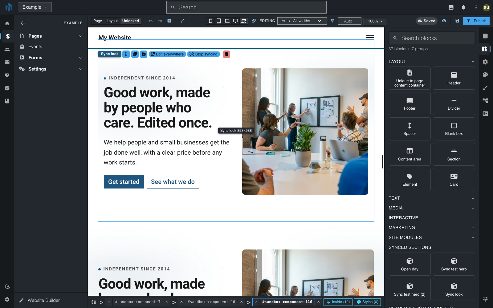

# Synced sections

**Last verified:** 2026-11-22 9:40pm

A synced section is one section that you use on many pages. You change it once and every page that shows it follows. This guide covers how to make one, add it to pages, change it everywhere, stop syncing it and delete it.

Synced sections are free on every plan. Making and changing them needs the **Synced sections** permission. See [Team and permissions](../dashboard/team-and-permissions.md).

## Synced section or copy?

Both let you reuse a section, and they behave in opposite ways.

- A synced section stays shared. Every page shows the same section, so a change shows on all of those pages.
- A copy belongs to its page. You change it there alone, and the other copies stay as they are. See [Save Your Own Section](adding-components.md#save-your-own-section).

Use a synced section for something that must match everywhere, such as your opening hours or a "Book a call" band. Use a copy for a starting point that you adapt on each page, such as a banner.

## Make a synced section

1. Open the page in the builder and select the section you want to reuse.
2. Select **Save as section** in the small toolbar on the section. You can also right-click the section and choose **Save as section**.
3. Check the **Name**. A section with no heading starts with an empty name, so type one.
4. Optional: pick a **Type**, such as Hero or Pricing. The type is where the section shows in the **Add section** window.
5. Choose **Keep in sync everywhere**. Its line says "Edits show on every page that uses it."
6. Select **Save section**.

The section on your page becomes the synced section, and the page looks the same. A message says: Saved the synced section "Name". This spot now uses it. Find it under Add section → Saved by you. Select **Show it** in the message to open the **Add section** window on **Saved by you**.

If you already use the name, the window shows the name the section will get, such as "Open day (2)". Undo (**Ctrl+Z** on Windows, **Cmd+Z** on Mac) puts the section back on your page as it was, and the synced section stays saved. If the save fails, the window says "We couldn't make the synced section. Your page is unchanged." and saves nothing.

An **HTML** component comes into a synced section empty unless you have the **Custom Code** permission. A message tells you when that happens.

**Keep in sync everywhere** is off in three cases, and a line under it says why:

| The line says | What to do |
|---|---|
| Ask a team member who can make synced sections. | You do not have the **Synced sections** permission. Ask a team member who has it. |
| Not available inside a synced section. | You are changing a synced section. Make a new one from a page. |
| This section is already synced. | Nothing to do. The section is already a synced section. |

## Add a synced section to a page

A synced section sits with your other saved sections. It wears a **Synced** badge and says how many pages show it, such as "On 3 pages". A section that no page shows yet says "Not on any page".

1. Open the page in the builder and select **Add section**.
2. Choose **Saved by you**.
3. Select the synced section, or press **Add**.

The page shows the one shared section itself.

To put a synced section inside a column, inside a layout or inside another synced section, use the **Add** panel:

1. Select **Add** in the panel rail on the right.
2. Open the **Synced sections** group. It lists every synced section by name.
3. Drag the section you want onto your canvas.

A synced section can never hold itself. While you change a synced section, the **Synced sections** group greys out that section and every section that holds it, with the line "A synced section can't contain itself."

You can use the same synced section on as many pages as you like, and more than once on one page.

## Change a synced section everywhere

You change a synced section in its own editor, not on the pages that show it.

1. Open a page that shows the synced section and select the section.
2. Select **Edit everywhere** in the small toolbar on the section. You can also open **Settings** and select **To change every page, edit it everywhere**.
3. The builder saves your page, then opens the synced section by itself. Its name is at the top.
4. Make your changes. The canvas, components and styles are the same as on a page.
5. Select **Publish everywhere**.

To go back, select the link at the top left. It reads **Page** and returns you to the page you came from. If you did not come from a page, it reads **Home page**.

Visitors see a change only after you select **Publish everywhere**, and it reaches every page that shows the section. Check it before you publish a big change.

With nothing selected, **Settings** shows **Synced section properties** and **Variants**. The next two sections describe them.

## Let each page change a part

A property is a part of a synced section that each page can change while the rest stays shared. For example, a pricing card can show a different title, photo and button link on each page and still get every design change you make to the section.

To make a property:

1. Open the synced section with **Edit everywhere**.
2. Select the element each page should change, such as the title.
3. Open **Settings**. **Synced section properties** is at the top.
4. Turn on **Let people change this per spot**.
5. Under **What can people change?**, pick the text, the picture, the link, or whether it shows.
6. Under **Name people see**, type a name such as "Title" and select **Save property**.
7. Select **Publish everywhere**, so your live pages can use the property.

To see every property of the section, select nothing and open **Settings**. Each property shows how many pages set their own value. You can rename a property there, and every page keeps its value. Deleting a property first tells you how many pages lose their own value.

To give one page its own value:

1. Open the page in the builder and select the synced section.
2. Open **Settings**. **Synced section** is at the top.
3. Change a property. For example, type a new title or choose a new photo.
4. Publish the page.

A property you have not changed shows the section's own value. Reset a changed one with **Back to the synced section's value**. To change every page at once, select **To change every page, edit it everywhere**.

## Variants

A variant is a ready-made version of a synced section, such as "Quiet" or "Dark". It adds Styles to the section and can give properties a starting value. Each page picks the variant it uses.

To make a variant:

1. Open the synced section with **Edit everywhere**, select nothing and open **Settings**.
2. Under **Variants**, select **New variant**.
3. Type a name and select **Make variant**.
4. Pick the Styles the variant adds. Each page that uses the variant gets these Styles.
5. Optional: give a property a starting value. A value you leave alone follows the section.
6. Select **Publish everywhere**.

To pick a variant for a page:

1. Select the synced section on your page and open **Settings**.
2. Open **Variant** and pick one. **The synced section's own look** goes back to the plain section.
3. Publish the page.

A value you set on the page wins over the variant's starting value. When you change a variant in the synced section, every page that uses it changes too. If you delete a variant, the pages that used it show the section's own look.

## Stop syncing

Sometimes one page needs a section to differ in a way that properties do not allow. Stop syncing on that page. The page gets its own copy of the section and no longer follows the synced section.

1. Select the synced section on your page.
2. Select **Stop syncing** in the small toolbar on the section. You can also right-click the section and choose **Stop syncing**, or open **Settings** and select **Stop syncing** under **Syncing**.
3. Read the message: "This spot stops matching the section. Changes to the section won't reach it. This spot keeps what it shows now, and you can change any part of it."
4. Select **Stop syncing**.

The page looks the same as before. A message says "This section is no longer synced. Changes to the synced section won't reach this spot." You can now change any part of it on this page. The synced section and every other page that shows it stay as they are. Undo makes the page use the synced section again.

A synced section that shows records from a collection stays synced. Its **Stop syncing** button is off, and the line says "This synced section shows records, so it must stay synced."

## Rename or delete a synced section

In the **Add section** window, choose **Saved by you** and open the **⋮** menu in the top right corner of the section's picture.

- **Rename** gives the section a new name everywhere it is listed. It needs permission to edit synced sections.
- **Delete** asks first. Deleting completely needs permission to delete synced sections.

If pages show the section, the window says "On 3 pages: they keep it. Stop syncing there to make each page's own copy." The section leaves your list and every page keeps showing it, so no page breaks. **Edit everywhere** and **Stop syncing** still work on those pages. A section that no page shows leaves your synced sections for good.

To clean up, use **Stop syncing** on each page that should keep its own copy, then delete the section.

## Show your own data

A synced section can show entries from a data module such as Articles, Events or Products, or from a custom data table. The entries update by themselves. A "Latest news" section, for example, can show your three newest articles on every page.

1. Open the synced section with **Edit everywhere**.
2. Select the list or group of cards that should show the entries.
3. Select **Data source** in its small toolbar.
4. Under **Where does this content come from?**, choose **Module**, then pick the module under **Module**.
5. Under **How many records?**, choose **First (one record)**, **All (a list)** or **Paginated**.
6. Set **Limit**. With **Paginated**, also set **Per page** and **Pagination style**: **Page links**, **Load-more button** or **Infinite scroll**.
7. Select **Save**, then **Publish everywhere**.

### Show an item's values in text

Type `{{` in a text box inside the section to pick a value of each item, such as `{{ item.title }}`. A value of a linked item works too. A product's page title is `{{ item.page.title }}`, and you can follow up to two links. To show one entry of a list, add its place in the list, counting from 0. The time of an event's first showing is `{{ item.showing.0.date_time }}`, and its first category is `{{ item.event_category.0.name }}`.

A whole linked item or a whole list shows nothing, so pick one of its values. Passwords and other private details never show.

### Show each visitor only their own entries

A list on your page can show only the entries of the person who is signed in. A member sees their own form submissions or listings, for example. The table needs an [Owner Contact](../content-modules/custom-data-tables.md#owner-contact) column. Form submissions have one already, named `contact_id`.

1. Select the element on your page and select **Data source** in its toolbar.
2. Under **Module**, pick the table.
3. Turn on **Advanced filters**.
4. Under **Match ALL of these**, select **Add condition**.
5. Pick the Owner Contact column as the field.
6. Keep the condition **Belongs to this visitor**. It needs no value.
7. Select **Save**.

A visitor who is not signed in sees no entries. WebNesting loads the page fresh for each visitor, so one visitor never sees another visitor's entries. In the builder and in the data preview, you see every entry.

## Good uses for synced sections

Use one for content that shows on many pages and must match everywhere: a "Get a free quote" band, your address and opening hours, a sidebar with a newsletter signup, or a sale banner. When the sale ends, change the synced section once or delete it. Start with one or two sections you use on every page.

## Header, footer and menu panels

Your site's own header and footer have their own guide: [Your own header and footer](your-own-header-and-footer.md). A mega menu panel is made from the menu itself. See [Site Navigation](site-navigation.md#choose-what-a-panel-shows). Neither one shows in the **Add section** window or in the **Synced sections** group.
